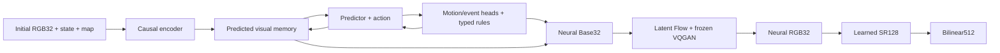

# TurkeyWorld: a neural game world

English | [Русский](README_RU.md)

TurkeyWorld contains a first-person reference game and an experimental neural
world model. The active configuration has **one persistent enemy**,
a **20-value state** and **two participant conditions: player + NPC**. All
conditions and losses use that one enemy. Single-enemy staged training is running
in `training_runs/staged_single_20261110`; its first optimizer update is saved.
The locally trained VQGAN and SR remain frozen. Native **32×32** playback is
**neural RGB32 → learned SR128 → bilinear512**.

The [staged curriculum](#staged-game-curriculum) is active. The
eight-enemy/90-value corpus, checkpoints and measurements below are explicitly
historical and do not describe the new one-enemy configuration. **Training
completion, image similarity and 15 seconds of correct autonomous gameplay
are separate results.** Fifteen seconds remains a target. A saved checkpoint does
not establish that result; future artifact names below do not mean those
training stages have already finished.

## Installation and the reference game

Run PowerShell commands from the repository root. Use an existing compatible
Python environment or create one:

```powershell
python -m venv .venv
$twPython = Join-Path $PWD '.venv\Scripts\python.exe'
& $twPython -m pip install -r requirements-vqgan.txt
& $twPython -c "import torch; print(torch.__version__); print('CUDA:', torch.cuda.is_available())"
```

`requirements.txt` contains game dependencies; `requirements-ml.txt` adds
PyTorch; `requirements-vqgan.txt` also installs perceptual-loss dependencies.
GPU training requires a compatible CUDA build of PyTorch. The frozen LPIPS/VGG
loss may download its own weights on first use. These are training-loss weights,
not pretrained world, codec, SR or image-generator weights.

```powershell
& $twPython -m turkeyworld.play --size 32 --display-size 512
```

Controls: **WASD** to move, **Q/E or left/right arrows** to turn, **Space or left
mouse button** to fire, **Esc** to exit. **R** restarts the reference game.
Simulation runs at 30Hz. The revised game has unlimited ammunition and one
persistent enemy slot. Respawn uses a simple game-time cycle without hashing;
kills remain cumulative.
Player death ends the session. `--classic` selects the finite-enemy mode.
This command uses the original engine and classical display resizing; neural
playback is a separate command below.

## Historical eight-enemy data

New one-enemy/20-value data has been collected in
`training_runs/staged_single_20261110/data_v2` for the four-stage curriculum.
The archived 128k corpus below contains eight enemies/90-value states and must
not be loaded into the new profile. Current stage counts come from the staged
manifest and dashboard `current_data`, rather than these historical totals.

The archived eight-enemy corpus is in `training_runs/fresh32_128k_20261109/data`.

| Split | Clips | Transitions per clip | Total transitions |
|---|---:|---:|---:|
| Train | 4,000 | 32 | **128,000** |
| Validation | 512 | 32 | **16,384** |

Episodes contain native source RGB32 and genuine source-rendered HR128, aligned
to the same states and controls. HR frames are rendered by the engine, not
enlarged from LR. The initial seed is 50,000,000; train and validation use
separate seed bands. The source behavior is
`deterministic_enemy_v3_simple_spawn`: enemy motion, attacks, animation and
respawn decisions are deterministic given the relevant state and game time.

Nine training policies cover movement, collisions, combat, misses, kills,
respawns, returning to objects, attacks and valid perturbed reference states.
The latter are source augmentation, not model-generated error states. Each
clip has 33 observations and 32 controls: action `t` belongs to transition
`state[t] → state[t+1]`. NPZ files also contain maps, events, hit/attack/spawn
labels and initialization metadata. No long episodes are included here.

The old corpus was prepared with the following historical command. It is not
a command for regenerating the new one-enemy corpus in that same directory:

```powershell
& $twPython -m turkeyworld.data_expansion training_runs/fresh32_128k_20261109/data `
  --rgb-train 4000 --rgb-val 512 --clip-frames 32 `
  --long-train 0 --long-val 0 --long-frames 3600 `
  --size 32 --hr-size 128 --hz 30 --seed 50000000 `
  --rgb-time-span 120 --workers 8
```

There is no `--source`: old recordings are not reused. Actual counts and
provenance are in `data/status.json`, `data/manifest.json` and `data/progress.jsonl`.
The controller pins 4,000 training filenames in
`training_runs/fresh32_pipeline_20261109/training_subset_128k.json`. Model loading
uses only this immutable membership. Training samples windows with replacement:
optimizer updates are not counts of unique examples or full dataset epochs.

## Historical initial codec, SR and world run

The following command and launch history describe the earlier eight-enemy
pipeline. Current one-enemy commands are in the
[staged curriculum](#staged-game-curriculum) section. VQGAN/SR are reused frozen.

The earlier controller runs one GPU training worker at a time. Its last configuration:
microbatch 16 and accumulation 1, effective batch 16,
target 15 seconds / 450 steps:

```powershell
& $twPython -m turkeyworld.fresh_pipeline `
  --run-dir training_runs/fresh32_pipeline_20261109 `
  --data-dir training_runs/fresh32_128k_20261109/data `
  --codec-run-dir training_runs/vqgan32_20261109 `
  --sr-run-dir training_runs/sr32x4_20261109 `
  --world-run-dir training_runs/vjepa175_32px_128k_20261109 `
  --image-size 32 --device cuda --batch 16 --gradient-accumulation-steps 1 --target-seconds 15
```

This experiment already exists in the workspace; do not start a second copy.
The accumulation change **21→5** was applied when resuming checkpoint 154 after
a completed optimizer update, retaining weights, optimizer state and counters.
That is a historical configuration. Training resumed from checkpoint **746**
with **27×1=27**; completed update **747** and its checkpoint were verified.
The subsequent change to **16×1=16** is verified: training resumed checkpoint
**800**, and completed checkpoint **801** records 16 additional fragments,
one optimizer update and no pending microbatches.
New experiments require separate controller, codec, SR and world directories.
After a graceful stop, the identical command resumes saved stages. Changing
the persisted controller configuration is rejected.
The production command is also recorded in
`training_runs/fresh32_pipeline_20261109/launch_command.json`. A completed
`spatial_entities_migration.json` in the world run selects the spatial profile,
motion curriculum and upgraded SR checkpoint on subsequent resumes. Its
historical 30-second target is retained in the migration record; the explicit
`--target-seconds 15` controller setting overrides it for the current run.
This continues the existing budget and compatible optimizer state.

1. **VQGAN from scratch.** Encoder, codebook, decoder and codec PatchGAN learn
   from source32. Every 100 updates, a fixed held-out panel is reconstructed.
   Each passing frame needs PSNR≥35dB, SSIM≥0.98 and MAE≤2/255. At least 95% must
   pass, with aggregate SSIM/MAE and numerical/codebook integrity checks.
   Automatic export requires **three consecutive successful checks**, with no fixed
   step cap: `training_runs/vqgan32_20261109/checkpoints/codec_for_renderer.pt`.
2. **Learned SR from scratch.** After the codec process exits, a fresh x4 network
   trains **2,000 updates** on genuine source32/source128 pairs. Current held-out
   metrics accompany `training_runs/sr32x4_20261109/checkpoints/sr_for_game.pt`.
   Budget completion does not assert an SR similarity threshold passed.
3. **Offline object labels.** Engine replay verifies source pixels and constructs
   exact visible-NPC masks and matching source images without NPCs. This CPU
   cache supplies training labels only.
4. **Fresh world, Base, Flow and conditional GAN.** The teacher starts randomly,
   loading only the newly trained, frozen codec. Joint training has a persisted
   budget of **6,000 optimizer updates**. The active run uses microbatch
   **16**, accumulation **1**, effective fragment batch **16**. World, Base and Flow train; codec weights
   stay frozen. Conditional GAN weight is 0.005 and feature weight 0.01, with 32
   discriminator updates of warmup and a 128-update ramp.

The world receives two observed context frames and predicts four future steps.
Its independent main trajectory carries its own state and latent memory;
future recorded frames/states are targets and never replace that trajectory.
A separate causal GT-pose auxiliary stream supplies aligned local motion,
combat, spawn, Base and Flow labels. Sampled-GAN conditions are detached from
world heads. Base learns direct reconstruction; Flow detaches its Base condition.
Exact NPC pixels receive normalized weight 4. Source-without-NPC images are
conditional discriminator negatives only when NPCs are present.

With this configuration, one microbatch produces one generator and one
discriminator update, without gradient accumulation. EMA/global/save clocks
advance at completed optimizer boundaries.

After the 6,000-update world budget, status becomes `awaiting_user`. The run
does **not automatically expand data, start repair rounds or train the student**,
and does not declare gameplay qualified. A native32 student profile exists for
future work. Codec qualification is open-ended, and native32 needs its own
timing measurements; old 128px timings do not establish an ETA for this run.
Time to correct 15-second gameplay is unknown.

## Additional SR quality run

The VQGAN is fixed at **42,216 updates**, frozen and accepted by the user;
`quality_gate_passed=false` remains recorded. The 175M world keeps its current
training state. The earlier 25,776-parameter SR completed 2,000 updates, with
mean PSNR 20.907 dB and mean SSIM 0.698759 on its older 100-frame panel.
On the new 512-frame panel, baseline clean/decoded SSIM was 0.705097/0.702811;
at update 1,000 the new SR measured 0.806688/0.803097. These are progress measurements.
The completed 20,000-update SR selected clean/decoded SSIM 0.852550/0.846338;
its requested 0.90 target remains unconfirmed.

The separate run `training_runs/sr32x4_quality_20261109` uses an EDSR-inspired residual network with 64 channels
and 16 residual blocks (**1,517,571 parameters**) for 32→128. Its target is
**clean-source mean SSIM≥0.90 on two distinct full checks** of a fixed 512-frame
validation panel. Optional frozen-codec degradation uses probability 0.25 per
training LR sample, keeping the paired HR target unchanged. Clean and decoded-LR
validation metrics are reported separately; decoded metrics do not replace the
clean-source criterion.

```powershell
& $twPython -m turkeyworld.train_sr `
  --run-dir training_runs/sr32x4_quality_20261109 `
  --data-dir training_runs/fresh32_128k_20261109/data --image-size 32 --device cuda `
  --architecture edsr --channels 64 --blocks 16 --res-scale .1 `
  --steps 20000 --batch 16 --lr .0002 --edge-weight .1 --ssim-weight .2 `
  --target-ssim .9 --quality-patience 10 --quality-min-delta .0005 --lr-min .000001 `
  --codec-checkpoint training_runs/vqgan32_20261109/checkpoints/codec_for_renderer.pt `
  --codec-fraction .25 --validation-frames 512 --validation-batch 8 `
  --validate-every 500 --preview-every 100 --save-every 500
```

`sr_last.pt` resumes training, `sr_best.pt` tracks the best numerical clean SSIM,
and `sr_for_game.pt` exports the selected best checkpoint with matching validation
metadata. Plateau/stop reasons remain separate from reaching 0.90. Monitoring uses
the independent page http://127.0.0.1:8766/ after its local server is started;
Teacher progress stays on 8765. Parallel GPU training depends on available VRAM.

## Historical nine-participant spatial extension

The optional `spatial_entities` profile encodes the player and eight persistent
NPC IDs as nine spatial tokens: position, camera-relative forward/side offsets,
direction/validity, status and rotated local learned-map features. NPC direction
is derived from velocity; a stationary NPC has no observed direction. Source
sprites are camera-facing billboards and have no independent heading label.
Player velocity is not present in a single state90 vector and is marked unknown.
Dead and behind-camera slots remain in state and memory.

The renderer reads these tokens through a separate residual attention branch,
grounded by overlap between output patches and projected NPC extents. Its output
projection starts at zero; the existing ray/object attention remains intact.
Behind-camera NPCs have zero visual weight in this branch; wall occlusion remains
learned. No engine renderer, source visibility oracle or future RGB is used.
The disabled profile preserves legacy parameter keys/counts. Migration retains
existing learned parameters where compatible and initializes new parameters;
the complete enabled model is not claimed to be functionally identical.

The dataset stays at 128k transitions; no replacement corpus has been collected.
Short autoregressive training uses the local-motion curriculum
**1→4→8→16→29** within the existing 33-frame clips. Spatial mode measures
forward/side motion in local coordinates; the legacy mode keeps world axes.
`motion_player` and `motion_npc` already include the common ×5 weight and sum to
the existing `motion` term; they are diagnostics, not extra loss terms.
The independent final target is **15 seconds = 450 autonomous steps at 30 Hz**.
Training on 29-step clips does not establish 450-step training or qualification.
The real GPU probe completed the 29-step, batch 21 forward/backward/sampler update
with 15.75 GiB peak allocated memory; it does not qualify autonomous gameplay.

## Historical eight-enemy combat, spawn and renderer conditioning

The optional `spatial_combat` extension requires `spatial_entities`. Migration
completed at optimizer step 147; training resumed with the extension enabled,
and update 148 was verified under the new combat/spawn/Flow loss protocol.
This confirms an optimizer update, not gameplay or image-quality qualification.
The dashboard reports the loaded configuration and loss protocol.
The earlier nine-participant profile has 175,585,830 generator parameters;
the complete combat/spawn/wall-conditioned profile has **176,492,456**,
including the frozen codec and excluding EMA, critics and SR.
The 90-value state and 264-token carried memory stay unchanged.

Each NPC gets a pair combat head conditioned on its spatial token, the player's
token, visual context and HP-derived features. It adds residuals to the existing
hit-target and attack heads; the no-hit class stays intact. Counts describe
**nominal damage within the current life**, not recorded shots or cumulative
game history. A normal NPC follows HP **60→25→0**, corresponding to nominal
counts **0→1→2** under 35-damage hits; respawn resets the count. Augmented HP 35
does not fit that ladder and carries an invalid-ladder flag.

Base receives a count adapter. Both Flow velocity networks—the main DiT and
its residual adapter—receive nine separate participant tokens with coordinates,
direction/validity, HP and nominal counts. They also receive explicit wall-cell
coordinates/materials from the known 16×16 map. These are conditioning inputs;
RGB remains neural. Eight slot-specific spawn queries attend to all nine
participants, known time and 256 learned map-cell keys. The earlier global spawn
head and walkable/distance/separation constraints remain in use. New residual
outputs start at zero; [combat migration](turkeyworld/combat_migration.py) retains existing weights and optimizer moments,
EMA, GAN state, RNG and completed-update counters.

Training keeps the same fixed **128k transitions**. The active run uses
microbatch **16 × 1** accumulation = **16 fragments per optimizer update** and the remaining original
6,000-update budget. Sampling mixes **25% uniform, 35% motion and 40% combat**
windows, using source hit, miss, attack, damage, death, wall and spawn events.
The main autoregressive rollout finishes before separate GT-pose combat/spawn
image supervision runs from detached contexts. Future source labels/RGB are
training targets; they never correct the main rollout or neural gameplay.

The dashboard shows `combat_events`, `combat_target`, `combat_attack`,
`combat_damage_npc`, `combat_damage_player` and `combat_death_npc` separately;
these remain components of the aggregate `combat`. Image terms
`combat_image_loss`, `spawn_image_loss`, `foreground_base` and
`foreground_sampled` are displayed separately. Values come only from the current
phase and `loss_protocol`; a missing field is “—”, never an invented zero.
This extension does not qualify the **15-second / 450-step** target or change
the selected SR result: clean mean SSIM **0.852550**, below its 0.90 goal.

## Training improvements V5: eight-enemy baseline history

V5 is **active: training resumed from checkpoint 725 and completed update 726
was verified**, including generator/discriminator optimizer and EMA counters.
It keeps the same fixed 128k transitions,
frozen codec and selected 20,000-update SR. The batch change to **27×1=27**
was verified by completed, saved update **747** after resuming checkpoint **746**.
The current batch **16×1=16** was verified by saved update **801**, continuing
checkpoint **800** with optimizer state and counters preserved.
The 15-second / 450-step gameplay target remains unqualified. This duration
change does not alter the frozen 32-transition source clips or reset weights.
The measured full
generator count is **181,167,857**, including the codec. EMA, critics and SR
are counted separately.

The V5 flag introduces nine related changes:

1. Explicit own-trajectory XY objectives at offsets **1, 4, 8, 16** when the
   current curriculum horizon permits them, plus circle/wall and X-then-Y path
   penalties. These are training losses, not runtime position correction.
2. Attack BCE normalizes positive and eligible-negative cases separately across
   batch and horizon, with class masses **4:1**. Missing classes do not dilute
   present ones; focal weighting is optional and disabled by default.
3. A learned **eight-anchor + fallback** spawn decision retains the old 256-cell
   head for non-anchor choices. Geometry safety and slot order stay intact.
   Anchor/fallback CE is normalized over actual revived slots across **B×H**;
   the effective 256-cell CE is not added again.
4. Image and continuous-latent losses give each present NPC/background region
   equal mass using the actual offline mask, instead of background-dominated
   averaging. Base, sampled Flow and combat/spawn image auxiliaries use it.
5. The latent Flow patch changes **4→2**: **4→16 image tokens** at native32.
   RGB resolution, 64 visual encoder tokens and carried memory are unchanged.
6. Every Flow block in both the main DiT and residual adapter receives explicit
   nine-participant and wall-map conditions through new residual branches.
7. The decoded CFM endpoint estimate gains small SSIM and edge terms
   (**0.05 each**), alongside its reconstruction objective.
8. Flow times are stratified through the chosen CDF. Teacher keeps its fixed
   logit-normal distribution; `time_uniform_fraction` is an optional renderer
   knob, default 0. Five time-bin losses are diagnostics; errors do not
   automatically change the sampling distribution.
9. Fixed held-out behavior validation runs every **100 optimizer updates**:
   one-step event cohorts and 32 own-state trajectories of horizon16. The new
   protocol's initial baseline was recorded at **725**, with the first regular
   check at **800**. Results go to `behavior_validation_latest.json` and
   `behavior_validation/step_XXXXXX/`; this is not 450-step qualification.

Stop both controller and worker after a complete optimizer update before
migrating. The command creates backups and a recoverable completion marker:

```powershell
& $twPython -m turkeyworld.training_v5_migration `
  --run-dir training_runs/vjepa175_32px_128k_20261109 --seed 173
```

Resume the existing production controller after migration. Its completed
`training_v5_migration.json` adds `--training-improvements-v5` to the world
command; direct `train_vq_world` use also requires `--spatial-entities` and
`--spatial-combat`. Compatible generator tensors, EMA, GAN, RNG and completed
step/corpus-budget counters are retained from 725. Eight patch-shape tensors
are transferred deterministically and **only their eight Adam states reset**;
new parameters start without moments. Patch resizing does not promise identical
rendered outputs. V4 and V5 have different objectives: their raw loss totals
cannot be compared directly; use matching-protocol held-out measurements.

## Staged game curriculum

The **one-enemy** staged curriculum is running in
`training_runs/staged_single_20261110`. Checkpoint update **1** is verified:
one optimizer update, 16 fragments, accumulation 1 and no pending microsteps.
Its source is the archived eight-enemy checkpoint **818**. Compatible model
weights were transferred with changed state/head shapes checked separately;
the changed schema started **new Adam and discriminator states**. New global
step numbering starts at 0 with the **5,182 updates remaining** from the prior
6,000-update budget. The configuration stays **batch16 × accumulation1 = effective16**. VQGAN and
the selected SR remain frozen. Every newly collected stage uses the 20-value
state and at most one NPC; the earlier 90-value recordings are not replay data.
The current Teacher has **180,071,125 parameters**. A production CUDA probe with
batch 16 and horizon 29 passed all four backward paths in 38.6 seconds, using
11,919 MiB peak memory; this probe does not establish gameplay quality.

The audited dataset is `training_runs/staged_single_20261110/data_v2`:

| Stage | Train | Validation |
|---|---:|---:|
| Navigation | 1,000 clips / 32,000 transitions | 64 clips / 2,048 transitions |
| Static NPC | 32,000 independent images | 2,048 independent images |
| Moving NPC | 2,000 clips / 64,000 transitions | 64 clips / 2,048 transitions |
| Full game | 64 clips / 28,864 transitions | 32 clips / 14,432 transitions |

The full-game recordings have 451 continuous transitions after a valid seeded
initial pose, without resets or health repair. Static images have no motion
targets and are not counted as world transitions. The collection command is:

```powershell
& $twPython -m turkeyworld.staged_data `
  --root training_runs/staged_single_20261110/data_v2 `
  --navigation-clips 1000 --static-clips 1000 --moving-clips 2000 `
  --val-clips 64 --full-train-clips 64 --full-val-clips 32 `
  --full-frames 451 --workers 4
```

For this prepared run, `curriculum_plan.json`, `training_ready.json` and the
transferred `checkpoints/single_enemy_initial.pt` already exist. To resume the
standalone trainer after its existing worker has stopped:

```powershell
& $twPython -m turkeyworld.train_staged_world `
  --run-dir training_runs/staged_single_20261110 `
  --source training_runs/staged_single_20261110/checkpoints/single_enemy_initial.pt `
  --curriculum-manifest training_runs/staged_single_20261110/curriculum_plan.json `
  --sr-checkpoint training_runs/sr32x4_quality_20261109/checkpoints/sr_for_game.pt `
  --device cuda --batch 16 --gradient-accumulation-steps 1 `
  --target-seconds 15 --updates 5182 --cache-mb 128
```

The exact active arguments are also saved in the run's `launch_command.json`.
Request a checkpointed stop by creating `stop_training` in this run directory;
wait until its supervisor and worker exit, then remove that marker before
resuming. Restart this staged runner, rather than the historical `fresh_pipeline`.

The four stages are navigation with no active NPC → one static NPC with
**renderer-only** training → one moving NPC → the full game with that same
single NPC. Static-image supervision does not invent world-motion targets.
Source version `deterministic_enemy_v4_single_spawn_cycle` uses
`anchor=(game_tick//90)%8`, scanning to the next legal anchor when necessary.
This is a three-second phase and a 24-second spawn cycle without hashes; eight
anchors are possible locations for the **one enemy**, not eight enemy slots.
The neural spawn head still learns its choice; agreement is measured separately.
Earlier-stage replay is configured at **25%** when earlier-stage data is
available; the dashboard reports the actual fraction and current stage's
train/validation selection separately.

Held-out stage gates run every **100 optimizer updates**, with an initial
baseline allowed. Preview cadence stays **10 updates**. A failed gate keeps
training the same stage; elapsed time alone does not promote it. The local
dashboard at **http://127.0.0.1:8765/** lists all four stages, their current
states and passed step/time, plus each phase's measured metrics, thresholds
and report history. The last gate step and its age remain visible while a new
report is pending.

The initial navigation gate at step 0 **did not pass**: mean player drift was
0.8395 tile, RGB SSIM 0.4649 and one collision window was observed. Navigation
training continues; these baseline measurements are not completion evidence.

Passing an intermediate gate does not qualify gameplay. The independent final
target remains **15 seconds / 450 autonomous transitions**, and only an explicit
successful full-game check can set `staged_curriculum.final_qualified=true`.
There is no promised completion time or automatic Student start.

### Three phases for training model components

The approved plan separates component training from the four game-content
milestones above. It resumed the same run from the saved optimizer step **777**;
the renderer phase is running, with its first GPU update saved at **778**. Model weights and
optimizer history are retained; VQGAN and SR stay frozen, with batch16 and
accumulation1 unchanged.

| Component phase | Trained | Frozen | Minimum / maximum updates |
|---|---|---|---:|
| Renderer | Base, Flow and GAN on Source GT coordinates | Dynamics, shared map encoder, VQGAN, SR | 200 / 1,000 |
| Dynamics | Motion, wall sliding and returns | Base, Flow, GAN, shared map encoder, VQGAN, SR | 300 / 1,000 |
| Joint | World dynamics, renderer and shared map encoder, followed by autonomous validation | VQGAN, SR | Remaining overall budget |

The shared map encoder is frozen in **both isolated phases** so a dynamics-only
update cannot change a fixed-pose renderer's map condition. It trains only in
the joint phase. The saved update verifies GPU execution and continuation of
the phase; it does not establish a quality improvement or a passed gate.

Checks run every **100 optimizer updates**, previews every **10**. The first
two phases advance after two passing checks, a five-check plateau or their
update limit. Plateau and budget completion are recorded separately from a
quality pass. The joint phase retains the overall **5,182-update** budget and
the original strict game-content gates, including the independent final
**15-second / 450-transition** check. It continues navigation → static NPC →
moving NPC → full game rather than treating component-phase completion as
completion of those tasks.

At **http://127.0.0.1:8765/** the three component cards show actual status,
updates, minimum/budget, trainable/frozen modules, coordinate source, measured
losses and gate/completion reason. The four content milestones remain separate.
The dynamics phase uses the six navigation-case weights below with new
phase-local counters; dataset and immutable curriculum-plan fingerprints stay
unchanged.

### Previous navigation sampling experiment: superseded

The earlier **300-optimizer-update** navigation focus started at step **625**
and was superseded by the three-phase plan at step **777**, after **152 updates /
2,432 window draws**. Its previous scheduled end was 925; that schedule is no
longer active. It selected existing Source windows by cases appearing in their forecast interval:
slide 30%, short return 25%, wall stop 20%, turn 15%, straight 5%, strafe 5%.
This changes window selection only: the data, immutable curriculum-plan
fingerprint, losses and **batch16 × accumulation1 = effective16** stay the same.
Source case labels select examples; future Source states do not become model
inputs or corrections to its autoregressive state.

The checkpointed `staged_curriculum.sampling_experiment` records the actual
start/stop optimizer steps, completed/remaining updates, source fingerprint,
draw count and per-case counts. The dashboard shows these measured values;
draws are windows sampled with replacement, not unique examples. Its original
schedule would return to MotionCurriculum after 300 updates; it was superseded
before that boundary by the component plan above. Weights, optimizer state and historical sampling counters continue
across resumes. Stage gates remain every **100 updates** and previews every
**10**; completion of this sampling experiment does not pass a quality gate.
Its historical bounds were **625 → 925**. Every 100-update held-out check also
reports endpoint XY mean/p95 and collision windows/steps for each case, with
its window count, validation step and a separate baseline. Missing cohorts
remain unmeasured rather than being reported as zero error.

## Historical eight-enemy architecture and execution

This section documents the archived 90-value/eight-NPC model. The current
single-NPC profile uses 20 state values and two participant tokens; actual
post-transfer parameter counts will come from the new run, not this table.

The world adapts principles from the
[official V-JEPA2 repository](https://github.com/facebookresearch/vjepa2) and
[paper](https://arxiv.org/abs/2506.09985); the codec adapts
[CompVis/taming-transformers](https://github.com/CompVis/taming-transformers).
This is a compact game implementation with no official pretrained world or
VQGAN weights.

| Component | Teacher baseline, spatial disabled | Student baseline, spatial disabled |
|---|---:|---:|
| Inference generator, including codec | **174,461,156 parameters** | 22,209,956 |
| Visual width | 512 | 320 |
| Encoder / predictor blocks | 18 / 12 | 4 / 5 |
| Visual patch | 4×4 | 4×4 |
| Visual tokens per frame | 64 | 64 |
| Carried memory | 264×512 | 264×320 |
| Renderer | Conditional Flow Matching | Rectified Flow |
| Integration | 12 full Heun steps | 4 Euler steps |
| Shared frozen codec | 4,763,731 parameters | Same codec |

The causal encoder produces 8×8 visual tokens. The predictor interleaves action
and 90-value state tokens with visual tokens. Attention is bidirectional inside
a frame and causal between frames, with time/height/width RoPE. Four carried
blocks contain 264 tokens. The separate 56,769,024-parameter EMA target encoder,
discriminators and perceptual-loss network are training-only.

Base directly produces RGB32. The VQGAN downsamples by 4 to **8×8×16**, with a
**1,488-entry** learned codebook. Flow evolves normalized continuous latents;
a legacy patch size of 4 gives four spatial transformer tokens; V5 patch2 gives
16. Terminal latents are
quantized and decoded back to 32. The world generator produces no intermediate
RGB128. Learned SR then maps 32→128; only 128→512 is bilinear. SR is excluded
from the teacher count.



This is a hybrid world model. Neural heads predict motion, hit targets, attacks
and spawn locations. Explicit rules update HP, life flags, timers, heading,
ammunition and kills, and constrain speed/command direction. A map-derived
floor/distance mask limits spawn choices. These are disclosed rules, not claims
of learned physics. Persistent map features and eight object slots survive
outside the camera. Collision, combat and long-rollout stability need testing.

Neural playback uses one initial engine map/state/source frame. After that the
engine supplies no frames, collision answers, hit tests or state corrections.
All subsequent game states and rendered images come from the model.

## Dashboard, previews, stop and resume

If the local monitor is not already running:

```powershell
& $twPython -m training_dashboard.local_server `
  --run-dir training_runs/fresh32_pipeline_20261109 --port 8765
```

Open **http://127.0.0.1:8765**. The dashboard follows the active worker and keeps
codec/SR results separate from world counters. Missing results remain missing.
The controller also publishes the pointer for the existing monitor directory.

World previews refresh every **10 global optimizer updates**. Their five rows
show initial context, future Source comparison, free autoregressive model RGB32,
learned SR128 of that same prediction, and bilinear512 of that same SR output.
Future Source is display-only; SR never consumes it or corrects world state.
Codec and SR have separate previews/validation every 100 updates. Full world
quality checks remain every 500; a light preview is not a passing quality check.

Request a graceful stop:

```powershell
New-Item -ItemType File -Path training_runs/fresh32_pipeline_20261109/stop_training -Force
```

Wait for the active worker to save and exit. Remove existing stop markers from
the controller and stage directories, then repeat the same controller command:

```powershell
$freshRuns = @('fresh32_pipeline_20261109', 'vqgan32_20261109',
               'sr32x4_20261109', 'vjepa175_32px_128k_20261109')
foreach ($runName in $freshRuns) {
  $stopRequest = Join-Path (Join-Path $PWD 'training_runs') "$runName/stop_training"
  if (Test-Path -LiteralPath $stopRequest) { Remove-Item -LiteralPath $stopRequest }
}
```

Saved model/optimizer states and the stage ledger are resumed. Do not start
concurrent trainers for one run. The controller launches hidden child workers
on Windows and waits for each GPU process to exit before the next stage.
Keep its foreground terminal open or use a background launcher. The awake
guard permits **Win+L** and display sleep; computer sleep, sign-out or shutdown
still interrupts processes.

## Neural playback and 15-second evaluation

Once new world and trained-SR checkpoints exist, with GPU capacity available:

```powershell
& $twPython -m turkeyworld.neural_play `
  --world training_runs/vjepa175_32px_128k_20261109/checkpoints/teacher175vq_world.pt `
  --sr training_runs/sr32x4_quality_20261109/checkpoints/sr_for_game.pt `
  --device cuda --two-stage-upscale --max-catchup-steps 1
```

Native32 defaults to output 512; `--display-size 512` is equivalent. Two-stage
playback requires trained x4 SR and does not replace that stage with ordinary
resizing. Controls match the reference game; close/relaunch to restart after
death. Without `--two-stage-upscale`, the legacy display default remains 1024.
Actual 30Hz/FPS performance must be measured.

The independent evaluator can test **15 seconds = 450 steps**:

```powershell
& $twPython -m turkeyworld.evaluate_rollout `
  --world training_runs/vjepa175_32px_128k_20261109/checkpoints/teacher175vq_world.pt `
  --device cuda --seconds 15 --episodes 2 --scenario explore `
  --render-every 30 --output training_runs/vjepa175_32px_128k_20261109/evaluation_15s.json
```

Reports include actual duration, integrity, movement/combat coverage, oracle
rejections and sampled image comparisons. Oracle calls measure only; they do
not correct the rollout. A 15-second pass does not qualify longer rollouts. Seeds vary
trajectories on one fixed arena; this does not establish new-map generalization.
Checkpoint 700's historical 30-second reports remain labeled as such under
`diagnostics/validation_20261110T055628Z_g700/`; changing the current target
does not relabel those measurements or establish a new pass.

## Artifacts and history

| Directory under `training_runs` | Purpose |
|---|---|
| `fresh32_pipeline_20261109` | Controller status/commands, fixed subset, object masks |
| `fresh32_128k_20261109/data` | New paired 32/128 corpus and provenance |
| `vqgan32_20261109` | Codec metrics/preview, resumable weights and qualified export |
| `sr32x4_20261109` | SR metrics/preview, held-out results and x4 export |
| `vjepa175_32px_128k_20261109` | Fresh teacher metrics/preview, budget and checkpoints |

Workers write `status.json`, `training.stdout.log`, `training.stderr.log` and
checkpoints as their stages execute. `active_run.json` identifies the active
stage. Future checkpoint names here are not claims that they already exist.

On 9 November 2026, **dataset B, all old checkpoints and obsolete experiment data
were deleted at the user's request**, reclaiming 195.49GiB. Historical reports
were kept. Earlier 128px/32k, replay-B 64k, 125M/250M/500M and accepted-old-codec
procedures are historical. Their deleted weight/data paths are not prerequisites
for this fresh run; compatible source-code profiles remain available.

## Code and tests

Main modules: [fresh_pipeline.py](turkeyworld/fresh_pipeline.py),
[train_vqgan.py](turkeyworld/train_vqgan.py), [train_sr.py](turkeyworld/train_sr.py),
[train_vq_world.py](turkeyworld/train_vq_world.py),
[vjepa2_ac.py](turkeyworld/vjepa2_ac.py),
[latent_flow_renderer.py](turkeyworld/latent_flow_renderer.py),
[neural_play.py](turkeyworld/neural_play.py).

```powershell
& $twPython -m unittest discover -s tests -q
```

Tests cover causality/memory, native32/64/128 shapes, frozen-codec gradients,
Heun/GAN/R1 backward execution, accumulation, immutable training membership,
resume budgets, preview/SR separation and gameplay checks. Passing implementation
tests does not establish trained gameplay quality.
