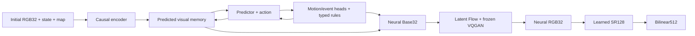

# TurkeyWorld: a neural game world

English | [Русский](README_RU.md)

TurkeyWorld contains a first-person reference game and an experimental neural
world model. The current run trains **a new VQGAN, learned x4 upscaler, 175M
teacher world model, neural renderer and GAN from scratch**, using new native
**32×32** game data. Playback is **neural RGB32 → learned SR128 → bilinear512**.

The new run has started; the dashboard reports its actual stage. **Training
completion, image similarity and two minutes of correct autonomous gameplay
are separate results.** Two minutes remains a target. A saved checkpoint does
not establish that result; future artifact names below do not mean those
training stages have already finished.

## Installation and the reference game

Run PowerShell commands from the repository root. Use an existing compatible
Python environment or create one:

```powershell
python -m venv .venv
$twPython = Join-Path $PWD '.venv\Scripts\python.exe'
& $twPython -m pip install -r requirements-vqgan.txt
& $twPython -c "import torch; print(torch.__version__); print('CUDA:', torch.cuda.is_available())"
```

`requirements.txt` contains game dependencies; `requirements-ml.txt` adds
PyTorch; `requirements-vqgan.txt` also installs perceptual-loss dependencies.
GPU training requires a compatible CUDA build of PyTorch. The frozen LPIPS/VGG
loss may download its own weights on first use. These are training-loss weights,
not pretrained world, codec, SR or image-generator weights.

```powershell
& $twPython -m turkeyworld.play --size 32 --display-size 512
```

Controls: **WASD** to move, **Q/E or left/right arrows** to turn, **Space or left
mouse button** to fire, **Esc** to exit. **R** restarts the reference game.
Simulation runs at 30Hz. The default game has unlimited ammunition, eight
persistent enemy slots, respawns after three seconds and cumulative kills.
Player death ends the session. `--classic` selects the finite-enemy mode.
This command uses the original engine and classical display resizing; neural
playback is a separate command below.

## Current data

The new corpus is in `training_runs/fresh32_128k_20261109/data`.

| Split | Clips | Transitions per clip | Total transitions |
|---|---:|---:|---:|
| Train | 4,000 | 32 | **128,000** |
| Validation | 512 | 32 | **16,384** |

Episodes contain native source RGB32 and genuine source-rendered HR128, aligned
to the same states and controls. HR frames are rendered by the engine, not
enlarged from LR. The initial seed is 50,000,000; train and validation use
separate seed bands. The source behavior is
`deterministic_enemy_v3_simple_spawn`: enemy motion, attacks, animation and
respawn decisions are deterministic given the relevant state and game time.

Nine training policies cover movement, collisions, combat, misses, kills,
respawns, returning to objects, attacks and valid perturbed reference states.
The latter are source augmentation, not model-generated error states. Each
clip has 33 observations and 32 controls: action `t` belongs to transition
`state[t] → state[t+1]`. NPZ files also contain maps, events, hit/attack/spawn
labels and initialization metadata. No long episodes are included here.

The current corpus is already prepared. Its reproducible collection command
is shown below; repeat it only to validate/resume the same data plan:

```powershell
& $twPython -m turkeyworld.data_expansion training_runs/fresh32_128k_20261109/data `
  --rgb-train 4000 --rgb-val 512 --clip-frames 32 `
  --long-train 0 --long-val 0 --long-frames 3600 `
  --size 32 --hr-size 128 --hz 30 --seed 50000000 `
  --rgb-time-span 120 --workers 8
```

There is no `--source`: old recordings are not reused. Actual counts and
provenance are in `data/status.json`, `data/manifest.json` and `data/progress.jsonl`.
The controller pins 4,000 training filenames in
`training_runs/fresh32_pipeline_20261109/training_subset_128k.json`. Model loading
uses only this immutable membership. Training samples windows with replacement:
optimizer updates are not counts of unique examples or full dataset epochs.

## Train codec, SR and world

The controller runs one GPU training worker at a time. Current configuration:

```powershell
& $twPython -m turkeyworld.fresh_pipeline `
  --run-dir training_runs/fresh32_pipeline_20261109 `
  --data-dir training_runs/fresh32_128k_20261109/data `
  --codec-run-dir training_runs/vqgan32_20261109 `
  --sr-run-dir training_runs/sr32x4_20261109 `
  --world-run-dir training_runs/vjepa175_32px_128k_20261109 `
  --image-size 32 --device cuda --batch 48 --gradient-accumulation-steps 21
```

This is already running in the current workspace; do not start a second copy.
New experiments require separate controller, codec, SR and world directories.
After a graceful stop, the identical command resumes saved stages. Changing
the persisted controller configuration is rejected.

1. **VQGAN from scratch.** Encoder, codebook, decoder and codec PatchGAN learn
   from source32. Every 100 updates, a fixed held-out panel is reconstructed.
   Each passing frame needs PSNR≥35dB, SSIM≥0.98 and MAE≤2/255. At least 95% must
   pass, with aggregate SSIM/MAE and numerical/codebook integrity checks.
   Export requires **three consecutive successful checks**, with no fixed
   step cap: `training_runs/vqgan32_20261109/checkpoints/codec_for_renderer.pt`.
2. **Learned SR from scratch.** After the codec process exits, a fresh x4 network
   trains **2,000 updates** on genuine source32/source128 pairs. Current held-out
   metrics accompany `training_runs/sr32x4_20261109/checkpoints/sr_for_game.pt`.
   Budget completion does not assert an SR similarity threshold passed.
3. **Offline object labels.** Engine replay verifies source pixels and constructs
   exact visible-NPC masks and matching source images without NPCs. This CPU
   cache supplies training labels only.
4. **Fresh world, Base, Flow and conditional GAN.** The teacher starts randomly,
   loading only the newly trained, frozen codec. Joint training has a persisted
   budget of **6,000 optimizer updates**, microbatch **48**, accumulation **21**,
   effective fragment batch **1,008**. World, Base and Flow train; codec weights
   stay frozen. Conditional GAN weight is 0.005 and feature weight 0.01, with 32
   discriminator updates of warmup and a 128-update ramp.

The world receives two observed context frames and predicts four future steps.
Its independent main trajectory carries its own state and latent memory;
future recorded frames/states are targets and never replace that trajectory.
A separate causal GT-pose auxiliary stream supplies aligned local motion,
combat, spawn, Base and Flow labels. Sampled-GAN conditions are detached from
world heads. Base learns direct reconstruction; Flow detaches its Base condition.
Exact NPC pixels receive normalized weight 4. Source-without-NPC images are
conditional discriminator negatives only when NPCs are present.

An accumulation group processes 21 separate microbatches, then takes one
generator and one discriminator update. EMA/global/save clocks advance at
optimizer boundaries; 21 full graphs are not retained simultaneously.

After the 6,000-update world budget, status becomes `awaiting_user`. The run
does **not automatically expand data, start repair rounds or train the student**,
and does not declare gameplay qualified. A native32 student profile exists for
future work. Codec qualification is open-ended, and native32 needs its own
timing measurements; old 128px timings do not establish an ETA for this run.
Time to correct two-minute gameplay is unknown.

## Architecture and execution

The world adapts principles from the
[official V-JEPA2 repository](https://github.com/facebookresearch/vjepa2) and
[paper](https://arxiv.org/abs/2506.09985); the codec adapts
[CompVis/taming-transformers](https://github.com/CompVis/taming-transformers).
This is a compact game implementation with no official pretrained world or
VQGAN weights.

| Component | Current teacher | Future native32 student |
|---|---:|---:|
| Inference generator, including codec | **174,461,156 parameters** | 22,209,956 |
| Visual width | 512 | 320 |
| Encoder / predictor blocks | 18 / 12 | 4 / 5 |
| Visual patch | 4×4 | 4×4 |
| Visual tokens per frame | 64 | 64 |
| Carried memory | 264×512 | 264×320 |
| Renderer | Conditional Flow Matching | Rectified Flow |
| Integration | 12 full Heun steps | 4 Euler steps |
| Shared frozen codec | 4,763,731 parameters | Same codec |

The causal encoder produces 8×8 visual tokens. The predictor interleaves action
and 90-value state tokens with visual tokens. Attention is bidirectional inside
a frame and causal between frames, with time/height/width RoPE. Four carried
blocks contain 264 tokens. The separate 56,769,024-parameter EMA target encoder,
discriminators and perceptual-loss network are training-only.

Base directly produces RGB32. The VQGAN downsamples by 4 to **8×8×16**, with a
**1,488-entry** learned codebook. Flow evolves normalized continuous latents;
a patch size of 4 gives four spatial transformer tokens. Terminal latents are
quantized and decoded back to 32. The world generator produces no intermediate
RGB128. Learned SR then maps 32→128; only 128→512 is bilinear. SR is excluded
from the teacher count.



This is a hybrid world model. Neural heads predict motion, hit targets, attacks
and spawn locations. Explicit rules update HP, life flags, timers, heading,
ammunition and kills, and constrain speed/command direction. A map-derived
floor/distance mask limits spawn choices. These are disclosed rules, not claims
of learned physics. Persistent map features and eight object slots survive
outside the camera. Collision, combat and long-rollout stability need testing.

Neural playback uses one initial engine map/state/source frame. After that the
engine supplies no frames, collision answers, hit tests or state corrections.
All subsequent game states and rendered images come from the model.

## Dashboard, previews, stop and resume

If the local monitor is not already running:

```powershell
& $twPython -m training_dashboard.local_server `
  --run-dir training_runs/fresh32_pipeline_20261109 --port 8765
```

Open **http://127.0.0.1:8765**. The dashboard follows the active worker and keeps
codec/SR results separate from world counters. Missing results remain missing.
The controller also publishes the pointer for the existing monitor directory.

World previews refresh every **10 global optimizer updates**. Their five rows
show initial context, future Source comparison, free autoregressive model RGB32,
learned SR128 of that same prediction, and bilinear512 of that same SR output.
Future Source is display-only; SR never consumes it or corrects world state.
Codec and SR have separate previews/validation every 100 updates. Full world
quality checks remain every 500; a light preview is not a passing quality check.

Request a graceful stop:

```powershell
New-Item -ItemType File -Path training_runs/fresh32_pipeline_20261109/stop_training -Force
```

Wait for the active worker to save and exit. Remove existing stop markers from
the controller and stage directories, then repeat the same controller command:

```powershell
$freshRuns = @('fresh32_pipeline_20261109', 'vqgan32_20261109',
               'sr32x4_20261109', 'vjepa175_32px_128k_20261109')
foreach ($runName in $freshRuns) {
  $stopRequest = Join-Path (Join-Path $PWD 'training_runs') "$runName/stop_training"
  if (Test-Path -LiteralPath $stopRequest) { Remove-Item -LiteralPath $stopRequest }
}
```

Saved model/optimizer states and the stage ledger are resumed. Do not start
concurrent trainers for one run. The controller launches hidden child workers
on Windows and waits for each GPU process to exit before the next stage.
Keep its foreground terminal open or use a background launcher. The awake
guard permits **Win+L** and display sleep; computer sleep, sign-out or shutdown
still interrupts processes.

## Neural playback and two-minute evaluation

Once new world and trained-SR checkpoints exist, with GPU capacity available:

```powershell
& $twPython -m turkeyworld.neural_play `
  --world training_runs/vjepa175_32px_128k_20261109/checkpoints/teacher175vq_world.pt `
  --sr training_runs/sr32x4_20261109/checkpoints/sr_for_game.pt `
  --device cuda --two-stage-upscale --max-catchup-steps 1
```

Native32 defaults to output 512; `--display-size 512` is equivalent. Two-stage
playback requires trained x4 SR and does not replace that stage with ordinary
resizing. Controls match the reference game; close/relaunch to restart after
death. Without `--two-stage-upscale`, the legacy display default remains 1024.
Actual 30Hz/FPS performance must be measured.

The independent evaluator can test **120 seconds =3,600 steps**:

```powershell
& $twPython -m turkeyworld.evaluate_rollout `
  --world training_runs/vjepa175_32px_128k_20261109/checkpoints/teacher175vq_world.pt `
  --device cuda --seconds 120 --episodes 2 --scenario explore `
  --render-every 30 --output training_runs/vjepa175_32px_128k_20261109/evaluation_120s.json
```

Reports include actual duration, integrity, movement/combat coverage, oracle
rejections and sampled image comparisons. Oracle calls measure only; they do
not correct the rollout. A 120-second pass is not a 300-second pass. Seeds vary
trajectories on one fixed arena; this does not establish new-map generalization.

## Artifacts and history

| Directory under `training_runs` | Purpose |
|---|---|
| `fresh32_pipeline_20261109` | Controller status/commands, fixed subset, object masks |
| `fresh32_128k_20261109/data` | New paired 32/128 corpus and provenance |
| `vqgan32_20261109` | Codec metrics/preview, resumable weights and qualified export |
| `sr32x4_20261109` | SR metrics/preview, held-out results and x4 export |
| `vjepa175_32px_128k_20261109` | Fresh teacher metrics/preview, budget and checkpoints |

Workers write `status.json`, `training.stdout.log`, `training.stderr.log` and
checkpoints as their stages execute. `active_run.json` identifies the active
stage. Future checkpoint names here are not claims that they already exist.

On 9 November 2026, **dataset B, all old checkpoints and obsolete experiment data
were deleted at the user's request**, reclaiming 195.49GiB. Historical reports
were kept. Earlier 128px/32k, replay-B 64k, 125M/250M/500M and accepted-old-codec
procedures are historical. Their deleted weight/data paths are not prerequisites
for this fresh run; compatible source-code profiles remain available.

## Code and tests

Main modules: [fresh_pipeline.py](turkeyworld/fresh_pipeline.py),
[train_vqgan.py](turkeyworld/train_vqgan.py), [train_sr.py](turkeyworld/train_sr.py),
[train_vq_world.py](turkeyworld/train_vq_world.py),
[vjepa2_ac.py](turkeyworld/vjepa2_ac.py),
[latent_flow_renderer.py](turkeyworld/latent_flow_renderer.py),
[neural_play.py](turkeyworld/neural_play.py).

```powershell
& $twPython -m unittest discover -s tests -q
```

Tests cover causality/memory, native32/64/128 shapes, frozen-codec gradients,
Heun/GAN/R1 backward execution, accumulation, immutable training membership,
resume budgets, preview/SR separation and gameplay checks. Passing implementation
tests does not establish trained gameplay quality.
