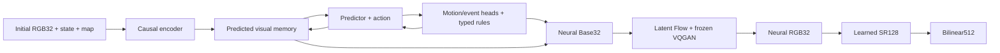

# TurkeyWorld: a neural game world

English | [Русский](README_RU.md)

Development and results journal: [English](README_HISTORY_EN.md) | [Русский](README_HISTORY_RU.md).

TurkeyWorld contains a first-person reference game and an experimental neural
world model. The active configuration has **one persistent enemy**,
a **20-value state** and **two participant conditions: player + NPC**. All
conditions and losses use that one enemy. The active dynamics run is now
**three DreamerV3-style RSSMs + a pretrained shared MoE trunk + five private
Transformer experts** for player, enemy and combat, in
`training_runs/rssm_moe_nav15_enemy25_cap20_20261113`, continued from5800
with microbatch32×accumulation1=effective32 and simultaneous three-task training; the earlier
JEPA dynamics are archived at update **1633**. In the RSSM worker, the locally
trained image renderer, VQGAN and SR remain frozen. Native **32×32** playback is
**neural RGB32 → learned SR128 → bilinear512**.

The [RSSM run](#current-rssm-dynamics-run) completed its initial **2,000 updates**,
including 200 distillation updates. Continuation from 2000 is configured to train
until navigation quality passes, without resetting the model or Adam; that
navigation history now continues with explicit combat, no-enemy navigation replay
and a separate pure-NPC-motion stream.
The [staged curriculum](#staged-game-curriculum)
records the earlier JEPA experiment. The
eight-enemy/90-value corpus, checkpoints and measurements below are explicitly
historical and do not describe the new one-enemy configuration. **Training
completion, image similarity and 15 seconds of correct autonomous gameplay
are separate results.** Fifteen seconds remains a target. A saved checkpoint does
not establish that result; future artifact names below do not mean those
training stages have already finished.

## Installation and the reference game

Run PowerShell commands from the repository root. Use an existing compatible
Python environment or create one:

```powershell
python -m venv .venv
$twPython = Join-Path $PWD '.venv\Scripts\python.exe'
& $twPython -m pip install -r requirements-vqgan.txt
& $twPython -c "import torch; print(torch.__version__); print('CUDA:', torch.cuda.is_available())"
```

`requirements.txt` contains game dependencies; `requirements-ml.txt` adds
PyTorch; `requirements-vqgan.txt` also installs perceptual-loss dependencies.
GPU training requires a compatible CUDA build of PyTorch. The frozen LPIPS/VGG
loss may download its own weights on first use. These are training-loss weights,
not pretrained world, codec, SR or image-generator weights.

```powershell
& $twPython -m turkeyworld.play --size 32 --display-size 512
```

Controls: **WASD** to move, **Q/E or left/right arrows** to turn, **Space or left
mouse button** to fire, **Esc** to exit. **R** restarts the reference game.
Simulation runs at 30Hz. The revised game has unlimited ammunition and one
persistent enemy slot. Respawn uses a simple game-time cycle without hashing;
kills remain cumulative.
Player death ends the session. `--classic` selects the finite-enemy mode.
This command uses the original engine and classical display resizing; neural
playback is a separate command below.

## Current RSSM dynamics run

The active dynamics now has **1,005,088 parameters per private role expert**,
with two Transformer blocks per expert and5,107,388 parameters in the five-role
fusion. Continuation from6022 preserved the three RSSMs/5232-value memory,
360 old Adam states, all samplers/RNG,32×1 batching and H240/stage51 of100;
70 new tensors form a sixth optimizer group. Actual6023 and the live UI were
verified; this is a capacity change, not a demonstrated quality improvement.
Frozen preview assets remain NPR29609/Base29209/SR108105. The separately trained
expanded RF3 renderer has not been promoted into dynamics or the game. See
[H93](README_HISTORY_EN.md#h93-one-million-parameters-per-private-dynamics-expert).

The current phase is `training_runs/rssm_moe_nav15_enemy25_cap20_20261113`, monitored at
**http://127.0.0.1:8765/**. Three persistent RSSM memories contain2032 player,
1600 enemy and1600 combat values:5232 total, updated every tick. The shared
two-block Transformer has three sparse top-2 experts (3,118,099 parameters).
The added combat branch has **20,007,020 parameters**, including a zero-initialized
adapter into the existing combat query. Its four zero residuals refine target,
attack and hierarchical spawn logits. Coordinates, HP and events retain one
shared structured transition; the combat branch does not create another state.

At the complete5939 boundary, worker73164 continued this same run with five
private Transformer experts after the existing shared trunk. Their roles are
`player_without_enemy`, `player_with_enemy_quiet`, `player_with_enemy_combat`,
`enemy_motion_spawn`, `combat_health_hit_death`; each uses width256/heads4/FF512.
The adapter adds2,717,468 parameters in83 tensors, with zero task readouts at
activation. It preserves all three RSSMs and the5232-value memory, all1434 old
model tensors,277 Adam states/four groups, RNG, three sampler streams and the
current H208/cap20/micro16×4. Only the new optimizer group starts fresh. The
three task losses remain Player/Enemy/Combat; old and new router auxiliaries
share the configured0.01/0.001 weights. The8765 card shows actual five-expert
routing only after a matching completed update, separately from task losses.
At5939 NPR26200/Base25800 and Atlas SR106105 remained pinned. The later5947
preview-only revision explicitly selects RF29609/Base29209 with the same SR;
the open game assets are unchanged. See
[H84](README_HISTORY_EN.md#h84-five-private-dynamics-experts-over-three-preserved-rssms).
The first complete update5940 was finite (TOTAL3.012795), with unchanged
H208/cap20 and main64/AUX64/late8. Initial expert routing was0.2 each; the private
blocks had zero gradient on this first zero-readout step while new routers/task
heads received gradients. This confirms execution, not learned specialization
or improved gameplay.

Adding combat memory at5437 preserved all1386 existing tensors,229 Adam states/groups,
serialized RNG and the current MoE horizon/streak. Only the new combat group
starts without moments. Both16-step argmax and stochastic GPU rollouts preserve
the old outputs, old3632-memory prefix and RNG exactly before the first update.
The earlier two-RSSM and pure-XY phases remain history.

The preceding continuation from5476 fixed death/respawn timing only. A shared30Hz phase
advance recovers float32 representation error at the simulation step, preserving
literal Source state decoding and its strict2e-7 canonical guard. Source, typed
transition, spawn heads/decoder and invariant checks use the same death-clock
rule. The full5476 checkpoint was copied bitexactly:1434 model tensors,277 Adam
states, RNG and the existing H4/streak0 gate. Replay coverage on the same4096
windows improved264→1043/1043 spawn labels, including all four offsets. Actual
neural batches now log all-microbatch per-offset/anchor counts on the dashboard.
Remaining invalid own geometry is reported rather than corrected by Source.

Every32×1 update trains **Player + Enemy + Combat**. The fixed total is their
sum plus0.01 router role CE and0.001 load balancing; no EMA scaling, KL floor,
reconstruction objective or renderer training is used. Local navigation branches
have weight0.1 and late own-memory branches weight0.25. Event-balanced TRAIN
windows use the actual min(H,16) horizon. Source labels supervise the own state;
future Source states/images never correct the autonomous rollout.

The one MAIN micro has19 combat/8 NPC-motion/5 navigation actors, retaining
59.375%/25%/15.625% of32. Combat AUX32 and late-prefix4 remain separate, outside
MAIN percentages. Navigation adds a weighted Player term; pure NPC movement adds
an Enemy term. The NPC denominator excludes navigation. Historical256- and64-example
segments retain their actual sizes; new updates add32. Activation at5958 preserved
the model,360 Adam states, RNG/three sampler streams and H224/stage7; actual5959
committed one32-example update. See
[H89](README_HISTORY_EN.md#h89-microbatch32-with-one-accumulation-step);
[H79](README_HISTORY_EN.md#h79-microbatch16-with-four-step-accumulation);
[H73](README_HISTORY_EN.md#h73-three-way-main-replay-and-twenty-updates-per-stage)
preserves the earlier64×4 phase.

The immutable `--moe-plan` selects31 stages:
**4 → 8 → 16 → 32 → 48 → … → 432 → 448 → 450**.
The current `--stage-budget-plan` requires **100 completed updates each at H240,
H368 and H450**, with early loss advancement disabled on those three stages.
All other stages advance after **5 consecutive completed optimizer updates with
strict TOTAL loss <0.5 OR20 completed updates at that stage**.
Loss is computed from one32-example microbatch; a value≥0.5 resets the streak.
The preceding cap25 activation at5741, when H48 had45 completed updates, caused one boundary advance to
H64/0 without SGD, preserving the389-update objective clock and prior stage history.
That earlier threshold revision started its streak at0. At5800, cap20 preserved
H96/stage9 and objective448. The selected-horizon policy was activated at5947
without SGD, preserving H208/stage16, MoE595 and its current streak. H450 now
stops after its mandatory100 updates with `completed_budget`; a low-loss streak
cannot end it early and neither establishes gameplay quality. The
previous cap50 and `50+15*N` policies remain historical; the interim100 cap was never activated.
The original objective/`--moe-plan` is unchanged; model tensors1434, all277 Adam
states and serialized RNG were preserved. Previews every10 updates use the current H and explicitly
pinned five-role NPR29609/Base29209 (stopped local1409,6241 private-geometry
parameters) with five-expert SR108105/local2000, explicitly selected after recovery5971.
Full450-transition held-out validation runs every250 updates. See
[H90](README_HISTORY_EN.md#h90-completed-sr-validation-preview-deployment-and-dynamics-recovery).
The display-only revision resumed the same5816 boundary without SGD; see
[H76](README_HISTORY_EN.md#h76-latest-private-npr-in-the-dynamics-preview).
The later selected budgets and renderer revision are recorded in
[H85](README_HISTORY_EN.md#h85-mandatory100-updates-at-h240-h368-and-h450) and
[H87](README_HISTORY_EN.md#h87-requested-five-role-npr-in-the-dynamics-preview).

This phase supersedes the earlier pure-XY and forced-long schedules below.
Its checkpoint is `checkpoints/rssm_world.pt`; stop safely with
`rssm_moe_nav15_enemy25_cap20_20261113/stop_training`. Resume using the argv in
`rssm_moe_nav15_enemy25_cap20_20261113/launch_command.json` after removing that marker.
The full `checkpoints/rssm_world.pt` is now replaced atomically after every
completed optimizer update, including all four microbatches, Adam, sampler and
gate commits, before the next update begins. This keeps one resumable file;
image previews remain every10 and full450 validation every250. A failed partial
update cannot replace the last complete boundary. See
[H78](README_HISTORY_EN.md#h78-empty-late-source-support-and-durable-checkpoints).
Keep the original `--moe-plan`, the new `--combat-memory-plan`, both migration
proofs and Source corpus pins unchanged. Also retain `--respawn-timing-plan` and
its pinned clock-source files, plus `--stage-budget-plan`, `--navigation-replay-plan`,
`--batch-revision-plan` (`micro32_batch_revision_plan.json`)
and `--enemy-motion-data-root`. Adding combat memory or correcting timing keeps the existing
4→450 curriculum clock; it does not restart H4 or its consecutive-pass counter.
There is no forced long optimizer update. The existing eight-prefix no-grad scout
may still run to450 to select 16-step XY recovery branches; this is not an H450
training update or a gate success. Full held-out450 validation remains separate,
before SGD and every250 global updates. A training-stage pass does not establish
15-second gameplay quality. See
[H53](README_HISTORY_EN.md#h53-loss-gated-horizons-with-ten-consecutive-updates).
The preceding cap25 policy and exact5741 restoration are recorded in
[H67](README_HISTORY_EN.md#h67-twenty-five-updates-or-five-total-loss-passes-per-stage).
The preceding cap50 activation remains in [H65](README_HISTORY_EN.md#h65-fifty-updates-per-stage-without-resetting-training).

### Current SR: five private Transformer experts

The separate SR worker in `training_runs/sr_moe_20261113/training` completed2000
local updates (cumulative108105), training
five private Transformer experts: enemy detection, sprite selection/placement,
far walls, near walls and player/weapon effects. All160 parent AtlasSR parameter tensors
and buffers remain frozen; only343,460 new parameters are trained
(2,311,333 total). The inputs are refreshed NPR32 from frozen RF29609/Base29209
and world5947, with optional causal predicted hypotheses. The original
8192 TRAIN/1024 VAL Source128 pairs are unchanged; the new sampler starts explicitly
from seed173. No Source HR, masks or future RGB enter inference.

**http://127.0.0.1:8779/** now follows this SR phase. The recorded live check at
local1005/VAL1000 verified five measured routing gates, a four-row preview and
the real weighted NPR validation loss. The existing server provides only its
recent train rows; the client additionally plots the latest verified validation
report and explicitly discloses the missing full VAL history. Preview reference0
is labelled separately from the latest full validation. Neither the strict
SSIM>0.91/MAE255<2.5 goal nor gameplay quality has passed. These weights are not
automatically connected to other components. The later explicit user request
selected SR108105 for dynamics visualization and a freshly launched game snapshot;
the main cached-hypothesis validation is distinct from the RGB-only dynamics-preview
call. Its fixed256 scores were SSIM0.762556/MAE2559.614, with mixed foreground/wall
results and failed quality goals. See
[H90](README_HISTORY_EN.md#h90-completed-sr-validation-preview-deployment-and-dynamics-recovery) and
[H88](README_HISTORY_EN.md#h88-five-private-sr-experts-on-refreshed-npr-pairs).

### Stopped hybrid-atlas SR archive

The SR worker in `training_runs/sr_atlas_enemy_20261113/training` was stopped
at update5175 by user request; its files retain the stopped archive while
the new SR phase above and three-way dynamics run separately. Enemy pixels come from a
fixed embedded atlas;70,195 trainable NN parameters predict the full unclipped
sprite box, animation phase, occlusion and binary visibility. The learned parent
SR supplies the background and is a frozen reference, not a matched NoGAN control.
The phase preserves the stopped PatchGAN2900/cumulative100930 model's158 tensors,
Adam, RNG and sampler; only49 RGB HP0 parameters in two new tensors are added.
The total is1,967,873 parameters. Previews update every15, full validation every100.
Training remains stopped; its exported106105 snapshot is used by the dynamics
preview on8765 with an explicitly RGB-only SR call, and by the user-requested
latest paired game below with the current predicted neural-state hint.

Worker40076 passed the real three-step disposable GPU preflight and reached420
updates in the archived live check. The actual page, served JavaScript and four-row
PNG passed37 checks, including measured Train/Validation curves and1024 held-out
images/138 cached temporal pairs. Initial-to-VAL100 bbox error improved10.217→6.708
pixels and visibility IoU0.346→0.395, while phase accuracy fell27.22%→19.76%.
Placement and occlusion remain imperfect. No quality pass or automatic game update
is claimed. See [H70](README_HISTORY_EN.md#h70-fixed-atlas-enemy-appearance-with-learned-geometry-and-visibility).

The preceding matched ROI PatchGAN / NoGAN worker was
`training_runs/sr_patchgan_ab_20261113/training`. Both generators started from
the complete restoration1830/cumulative98030 checkpoint:158 model tensors/Adam
states per arm, RNG and403,440 sampler draws were preserved. Each generator has
**1,967,824** parameters,300,456 trainable;102 parent tensors remain frozen.
Only GAN training adds a separate206,889-parameter conditional ROI discriminator;
the generator architecture and inference cost are unchanged.

GAN and the trained NoGAN control receive identical actual inputs and equal
generator update counts. Both retain RGB/alpha/geometry/edge reconstruction;
Source RGB/masks remain targets only. The adversarial weight is0 for100 updates,
then ramps over400 to at most0.01, further limited by the0.1 shared-readout gradient
ratio. Both restoration blends are1. Four-row paired previews update every15;
full validation every100 compares1024 held-out frames and138 verified adjacent
cached one-step NPR pairs. These temporal pairs are not autonomous gameplay.

The7.38-second GPU preflight verified source preservation, exact matched zero-weight
updates and three disposable forced-weight steps. The live page at paired200 showed
GAN/NoGAN/D steps200, effective weight0.00088504, and the earlier warmup VAL100.
Warmup equality is not a GAN quality advantage. The first active VAL200 was mixed:
GAN slightly increased ROI/image SSIM, while silhouette IoU and temporal foreground
delta error were worse. No overall GAN advantage is established. Image/temporal metrics and support
counts are shown separately from GAN/D losses. The open game is not automatically
updated. See [H69](README_HISTORY_EN.md#h69-matched-roi-patchgan-and-nogan-control);
the raw-RGBA restoration method and its initial results remain in
[H68](README_HISTORY_EN.md#h68-raw-rgba-restoration-before-gradual-blending).

The following schedule and replay details describe the preceding phases only.
The preceding5014 phase enabled Player/Enemy RSSM memory agreement at1/4/8/16, separate
NPC speed/direction losses and balanced player per-axis displacement supervision.
XY accumulation carries gradients within TBPTT16; numerical forward states and
detached neural conditioning are preserved. Future RGB belongs exclusively to
stopped memory targets. The pinned `--coordinate-curriculum-plan` schedules
16/32/64/128/256/450 transitions; the500th new update already uses450.
Full450 validation runs before SGD, every250 global updates and after local
100/200/300/400/500 updates. `best_drift.json` selects full model/Adam weights
using Source life masks, including NPCs the model incorrectly calls missing.
This criterion remains separate from the overall quality gate. See
[H49](README_HISTORY_EN.md#h49-coordinate-drift-training-and-memory-agreement-from-the-first-update).
After long-horizon regression, `--replay-curriculum-plan` adds a450-transition
update every fifth new optimizer step; the others retain the scheduled short
horizon. The original46/500 clock continues. On the first of four short
microbatches, eight actual own trajectories continue to450 without observations
or h/z resets; eight recovery slots are reserved for legal late branches before
walls, after spawn, and at motion errors. Long updates reuse their existing
own prefixes. EMA values are separated into short/450 banks, fixed throughout
four microbatches. The composite phase updated the selected bank after one Adam
commit; the current XY-only phase freezes both banks' numerical values.
Full450 validation and historical best5014 remain retained.
Batch-dependent terms use microbatch64, not globally pooled256. Resume also
requires the saved `--batch256-plan`; see [H47](README_HISTORY_EN.md#h47-effective256-and-an-exact-resume-after-a-status-file-lock). At4482 the preceding
run retained player/shared weights and Adam,
RNG and data clocks, enlarged the enemy RSSM, and disabled no-enemy navigation
training temporarily. Exact-shape enemy Adam states are retained;29 resized
states start fresh. At4430 the previous dual run retained the player model, Adam/RNG,
curriculum and data clocks, and appended a fresh independent enemy RSSM and Adam
group. Player memory has **1,008 deterministic values +32 categorical variables
with32 classes =2,032 FP32 values**. Enemy memory has **1,344 +8×32 =1,600**;
combined memory is **3,632**. Dynamics contain **45,007,371 parameters**, including
the shared map and training-only observation decoder; the current XY-only phase
trains **40,065,236 parameters**. The preceding composite phase trained43,287,657.
The retained player branch contributes25,007,048 and the resized enemy branch20,000,323.
The earlier first persisted dual checkpoint4440 verified10 updates, all50 new
enemy parameter tensors changed and all1156 frozen tensors bitexact. This is not
a saved4431 snapshot or proof of gameplay quality. See
[H40](README_HISTORY_EN.md#h40-an-independent-enemy-rssm-and-verified-dual-continuation).
Frozen Base/Flow/VQGAN, map/geometry, appearance projection and SR retain their
trained weights. These dynamics counts exclude the image renderer and SR.

The first full combat-only update4483 completed and was saved. The independent
4482→4486 checkpoint audit verifies four combat updates, including the former
navigation slot4485. Only combat
episodes with one enemy train the dynamics now; Player and Enemy both continue
learning. Navigation counters and its EMA bank retain their history but do not
advance. Navigation validation remains a forgetting check. The combat-only
schedule is preserved under v6; no new navigation/combat qualification is
claimed. The saved command includes the mandatory `--combat-only-plan` and all
previous revision pins. See
[H43](README_HISTORY_EN.md#h43-a20m-enemy-rssm-and-temporary-combat-only-training).

The page shows **Player loss / Enemy loss / Interaction loss**. Current pure XY
uses fixed coordinate weights, with Interaction and KL-floor zero. The following
EMA formula applies only to historical composite v6 training. In v6, each actor's BASE uses
its inherited actor EMA; spawn and recovery use independent component EMAs and
calibrated priorities. Component contributions are added **after** BASE
normalization. Thus actor raw total is not divided by one actor scale:
`actor weighted = actor priority × base_raw / actor scale + sum(component weighted) + KL-floor`,
where `component weighted = component priority × component raw / component scale`.
Actor scale/effective weight describe BASE only. Actor priorities remain1;
component priorities come from the pinned measured-gradient probe. All scales
use lagged EMA0.95/minimum0.1, stay fixed across the current horizon/TBPTT16/four microbatches,
and update once after Adam commits. The fixed KL floors1.1+1.1 remain unscaled
and outside EMA. First saved4945 verifies real training; its new total units
do not establish quality improvement. Baseline4944 precedes SGD; additional
checks after100/250 new updates are pending. Details:
[H46](README_HISTORY_EN.md#h46-v6-combat-supervision-and-independent-component-normalization).

This is a PyTorch adaptation of the RSSM in the
[official DreamerV3 implementation](https://github.com/danijar/dreamerv3/blob/main/dreamerv3/rssm.py),
described in the [DreamerV3 paper](https://arxiv.org/abs/2301.04104).
It uses grouped recurrent gates, straight-through categorical samples, 0.01
uniform mixing and separately stopped dynamics/representation KL with a
one-nat floor; these KL objectives and floor are disabled in the current XY-only
phase. Runtime uses deterministic argmax categories. There is **no EMA
target encoder, actor or critic**: this run trains the world model, rather than
the full Dreamer reinforcement-learning system. Its explicit 20-value game
state, known action/clock rules and learned axis pass fractions remain part of
the game-specific transition. Collision outcomes are learned without online
engine queries or state corrections.

### Current one-enemy combat and parallel renderer

[H30](README_HISTORY_EN.md#h30-new-source-corpus-one-enemy-combat-and-detailed-navigation)
records the new immutable Source corpus:139010 TRAIN and34756 VAL transitions,
including genuine early terminal clips,451-step combat and no-enemy corners,
slides and returns. Only `navigation_only` changes to false for the combat
continuation; existing model/Adam/RNG are retained. The original cycle had3 combat
updates and1 no-enemy navigation replay, initially batch16×accumulation1,450 own-state
transitions, TBPTT16. The renderer stays frozen in this RSSM worker. Validation
every250 updates requires both navigation and combat to pass twice; preview
every10 remains a short image comparison. The initial3873 checks failed;
neither correct combat nor15-second gameplay is claimed.

The first6 combat updates had finite but excessively amplified gradients. A
checkpointed pause at3879 retained them; training resumed without rollback or
an optimizer reset under an explicit `--feedback-revision-plan`. Combat numeric
state feedback is detached from autograd while its own values and h/z BPTT16
are retained. Saved update3880 confirmed frozen assets and existing Adam/RNG.
[H32](README_HISTORY_EN.md#h32-numeric-npc-feedback-gradient-amplification-and-revision-v2)
records the controlled probe and the limits of these initial stability checks.

The dynamics revision starting at4159 adds own-memory combat branches1/4/8/16,
auxiliary4/4/8 quotas for spawn/negative attacks/legacy mixture and exhaustive
checking of128 VAL revivals plus302 negative attacks. Existing Adam/RNG and
own450 guards are retained. `--combat-recovery-plan` is mandatory on resume;
the saved command below already includes it. Results:
[H35](README_HISTORY_EN.md#h35-short-autonomous-branches-balanced-spawns-and-negative-attacks).

From4399 through4981, the RSSM used **microbatch32 × accumulation4 =
effective128**, with the existing Adam/RNG and450/TBPTT16 protocol preserved.
Each combat microbatch32 selects8 spawn,8 attack-negative,3 near-hit,3 mid-hit,
3 far-hit,3 fired-miss and4 legacy windows. Target CE uses actual Source shots
only, balances hit/miss means1:1 and gives present hit-distance groups equal
mass. This is a new loss protocol, not a direct comparison with the old total.
The first preview revision used NPR 6600 (RF cumulative 16200) and SRbest 18100
(cumulative 38100). The current immutable v2 descendant pins completed
private NPR: **26200 cumulative updates / phase10000**, Base25800 and6241
renderer-owned opacity parameters, with unchanged **Atlas SR106105 / local5175**.
The previous NPR22200 and Atlas-only revision remain in its verified chain.
The new [revision](training_runs/rssm_moe_nav15_enemy25_cap20_20261113/preview_assets_revision_npr26200_atlas_sr106105_v2.json)
(`a85da445`) directly follows the Atlas revision `2535bab8`; original preview
pins and the v1 NPR6600 revision remain historical.
At **http://127.0.0.1:8765/**, a separate frozen clone renders the current RSSM
rollout every 10 updates: five rows show context, Source reference, Base+RF1,
Atlas SR and bilinear enlargement. Preview H matches the active curriculum H;
an image from another H is hidden. A supplementary interactive map compares
Source and predicted player/NPC trajectories from the same rollout. Its slider
covers offsets0..H, with buttons for the four displayed frames, tile-coordinate
errors, headings and explicit NPC death/respawn mismatches. No extra transitions
or engine queries are used, and Source trajectories are display labels only.
Training image assets, loss-gated dynamics
and the open game's snapshots remain unchanged. This display update does not
establish Source/gameplay qualification.
See [H39](README_HISTORY_EN.md#h39-distance-supervision-effective128-and-updated-preview-assets)
and [H56](README_HISTORY_EN.md#h56-current-npr-in-the-rssm-preview-with-an-immutable-v2-chain).
The earlier Atlas-only5797 boundary preserved all world weights,277 Adam states, RNG, samplers
and H96 stage counters; actual page/PNG checks passed23/23. A separate no-enemy
diagnosis found lower final XY error but more wall-interior steps, while its measured
H96 image combined pose drift and the previous NPR blur. These are separate failures;
[H72](README_HISTORY_EN.md#h72-atlas-sr-in-dynamics-preview-and-separate-navigation-diagnosis)
records the measured scopes and the offline pose counterfactual.

The student Base/RF1 continuation completed in
`training_runs/renderer_far_geometry_20261112`. It preserved the full weights,
317 Adam states, RNG and MAIN sampler from the completed v 5 control at update 2000;
and reached renderer counter 6000, with validation every 100 and preview every 10.
RSSM 5152, compact VQGAN 997539 (E7) and SR 38100 remain frozen; live RSSM training
continues separately. The original MAIN batch 16 keeps its NPC/replay quotas and
losses. Four additional TRAIN-only far-wall frames contribute a separate far-only
loss with weight 0.25. The 5–8, 8–12 and ≥12-tile wall bands have independently
normalized boundaries, edges and thin corners. A fixed 2048-candidate TRAIN pool
provides 271 deep, 481 other thin-face and 255 other far-wall examples; no collection
or VAL mining was needed. The main 256, native-area 256 and distance 192 VAL panels
remain. The completed 500-update pixel-residual pilot was not selected because
control 2000 performed better. At 2100, distant-wall errors improved on the fixed
main panel, while overall RF MAE/SSIM and NPC error worsened; preservation gates
still fail. These early results do not establish repaired polygons or autonomous
gameplay quality.
Completed v 6 reports: **http://127.0.0.1:8777/**.
Codec and same-pose diagnostics: **http://127.0.0.1:8780/**.
See [H54](README_HISTORY_EN.md#h54-student-renderer-training-for-small-enemies-and-walls)
and [H55](README_HISTORY_EN.md#h55-far-wall-strata-and-preserved-adam-continuation).

The active renderer phase is `training_runs/renderer_rf_expanded_20261113` on
**http://127.0.0.1:8781/**: five RF experts of503,072 parameters each,
RF9,524,294 total excluding codec, with frozen Base/VQGAN/private opacity/world5906.
The user's latest choice is **three Euler steps**; budget2000, preview10 and
VAL100 retain the same held-out panels. All457 parent Adam states and source/RNG
clocks continue, with80 new tensors in a sixth group; GAN is off. Initial RF3
SSIM0.729578 is a solver baseline, not evidence of SGD improvement or a quality
pass. Expanded weights are not in the open game. See
[H92](README_HISTORY_EN.md#h92-expanded-rf-experts-trained-with-three-euler-steps).

Earlier renderer training in `training_runs/renderer_moe_five_20261113` stopped at
local1409 by request; worker38908 exited and its files remain archived.
It continued the completed three-role MoE2000 parent
(cumulative RF28200/Base27800) for 2000 new local updates. MAIN16, far-wall4×0.25
and geometry8×1 remain; the frozen feature world is still5906, using recorded
navigation/combat profiles for past-observation priors and zero static features.

Base and RF now each have **five private Transformer experts**:
`near_geometry_player`, `far_geometry`, `enemy_motion`, `enemy_combat`,
`player_combat`. The existing three parent gates remain; two learned sigmoid
splits divide scene into near/far and enemy into motion/combat. Cloned experts
preserve the initial parent function. Base experts use width8/heads2/FF16 and RF
experts width32/heads4/FF64. Actual totals are Base **1,001,157** and RF
**7,051,654**, including private geometry. The 18,372 appended parameters occupy
52 tensors; all 405 parent Adam states/options and three sampler states remain.
Source roles use near **<5** tiles and far **≥5** tiles as loss labels only.
Idle weapon pixels belong to near/player; flashes, shots and hurt effects label
player combat. Runtime routing uses existing neural tokens/current numeric state,
without a Source depth oracle. Router weights remain CE×0.01/balance×0.001.
World/map, E7, SR and private opacity6241 stay frozen.

The actual 7.72-second GPU preflight verified exact initial Base/RF latent/RGB,
strict export/reload, preserved old tensors/RNG and positive gradients in all ten
expert blocks, with no SGD. A durable local47 audit verified all 405 inherited
Adam states, 52 new states, frozen tensors and exact three-stream draw clocks.
The live page was checked at82/preview80; preview runs every10 and full held-out
validation every100. Its initial256-frame RF SSIM/MAE is **0.701969/0.043726**;
this is the completed parent at the same5906-feature poses. Independent read-only
validation of local1156 measured RF SSIM0.730221/MAE0.037521, while its distant-NPC
foreground MAE regressed0.081721→0.083856. Quality, geometry and distance guards
remain false. At the user's explicit request the stopped1409 export
RF29609/Base29209 renders dynamics previews and the latest separately launched
game snapshot. The later explicit SR108105 selection is recorded in H90;
these are experimental selections, not automatic promotion. See
[H83](README_HISTORY_EN.md#h83-five-renderer-experts-with-preserved-parent-routing),
[H86](README_HISTORY_EN.md#h86-independent-validation-of-five-role-renderer1156) and
[H87](README_HISTORY_EN.md#h87-requested-five-role-npr-in-the-dynamics-preview).
The completed three-role phase and its measured results remain in
[H82](README_HISTORY_EN.md#h82-renderer-token-moe-with-a-private-transformer-per-expert).

The preceding private wall-geometry worker46212 completed8000→10000 in
`training_runs/renderer_private_geometry_20261113`. Its6241-parameter opacity copy received
Source-depth labels; original shared geometry/map/RSSM and E7/SR remain frozen.
RF including this copy has6,998,433 parameters. Original317 Adam states and all
three samplers were retained; four new tensors have fresh moments. Private LR
is5e-5 and depth weight ramps0→1 over500 updates. The discarded depth-only pilot
improved depth but damaged RGB, so its weights were not used. At joint VAL8100,
depth improved2.0321→1.5726 tiles while RF SSIM fell0.75799→0.73225 and RGB MAE
worsened. At VAL8200, depth reached1.2391 but RF SSIM0.72661/MAE0.038584 still
regressed. Release gates remain false; no sharper-wall success is claimed.
See [H74](README_HISTORY_EN.md#h74-private-renderer-opacity-and-joint-depth-rgb-calibration).

The preceding renderer-only v7 wall repair completed8000 as worker12752 in
`training_runs/renderer_wall_repair_20261113`: full v6 continuation6000→8000,
unchanged Base/RF1 architecture and frozen RSSM/VQGAN/SR. It keeps MAIN16 and
far-wall aux4×0.25, adding geometry aux8×1 for all five depth bands, corners,
thin faces and paired cross-boundary contrast. Reports remain in the preserved
run directory;8781 now serves the renderer MoE phase. The first preview handler failed on all-empty wall cases;
the fix resumes the durable weights/Adam/samplers, with temporary unsaved metrics
archived. The live check passed34/34 at6191, VAL6100 and geometry preview6190.
RF mean SSIM improved0.74364→0.75375 on the fixed main panel, while geometry
preservation and release gates remain false. Walls are not claimed repaired.
See [H71](README_HISTORY_EN.md#h71-all-depth-wall-geometry-refinement-with-sr-stopped).

The original Base/RF phase completed **6000 local updates** in
`training_runs/renderer_repair_corrected_20261111`, using fine-tuned and refrozen
compact VQGAN1900, frozen RSSM/map/SR and GAN off. Each batch16 mixes8 combat,
4 NPC appearance and4 detailed-navigation images. Controlled pilots retained
Base detach and latent weight0.1, adding an RF regression penalty while keeping
the original parent Base as the quality anchor.6000 updates are this new phase's
completed budget; the complete Source and Base-preservation release gates have not passed. The previous6000 run is archived
at8772. Two subsequent matched200-update distance pilots reached6200: crop0.2
was rejected; sampler-only improved RF near/far slightly but worsened mid and
did not pass the all-band release gate. Sampler-only continuation completed8000
in `training_runs/renderer_distance_refine_20261111/training_rebalance_only`,
monitored at **http://127.0.0.1:8774/**. At6600, both heads passed the relative
distance-improvement gate on all three bands; the full Source/gameplay release
remains false. Adam/RNG are preserved and crop remains off. Details and codec evidence:
[H33](README_HISTORY_EN.md#h33-hp0-codec-controlled-rf-pilots-and-continued-renderer-training).

The earlier ordered tiny-enemy run is recorded at **http://127.0.0.1:8776/**:
`training_runs/small_enemy_pipeline_20261111`. Its order is compact codec → SR →
Base/RF1, with a held-out relative gate before each handoff. Codec2000 completed
and SR2000 completed (cumulative40100); later renderer results are recorded below. Its4096 TRAIN/512 VAL examples include
3072/384 living NPCs occupying1–16 native pixels, plus navigation, near enemies,
corpses and HP0 guards, with true paired32/128 Source images. This pipeline does
not replace game assets automatically or establish gameplay qualification.
See [H41](README_HISTORY_EN.md#h41-ordered-tiny-enemy-codec-sr-and-renderer-training).

SR x4 is **stopped by user request at18788 local updates**; its saved dashboard is **http://127.0.0.1:8775/** in
`training_runs/sr_combat_refine_20261111`, on real Source32/128 pairs with enemies,
combat and25% navigation. After extending2000→10000, the user replaced the step
limit with **clean mean SSIM >0.91 and MAE <2.5/255 simultaneously** on the fixed
384-frame VAL panel. The uncapped continuation from8672 retained
weights/Adam/RNG and the frozen codec, with validation every100 updates. The full last
checkpoint retains update18788 and Adam; the new game uses the separately saved
best18100, with clean SSIM0.856338 and MAE4.367513/255. The strict goal remains false.
Codec-degraded and navigation results remain separate; clean qualification
does not qualify neural gameplay. Results at2000 and the earlier budget:
[H34](README_HISTORY_EN.md#h34-combat-sr-x4-continuation-and-the-requested2000-to10000-extension).
The new immutable plan is `quality_revision_ssim091_mae2p5.json`; the page displays
MAE on the0–255 scale. Gameplay weights are not replaced automatically.

The latest user-requested paired game is the experimental session
`training_runs/paired_latest_20261113T193445Z`, also selected by
`training_runs/latest_play_session.json`. Its immutable snapshots are dynamics5974,
five-role NPR29609/Base29209, frozen E7 codec and self-contained five-expert
SR108105/local2000. Source is left and the neural game right; T toggles combat,
E turns right. The visible window initially paused at0/450. Dynamics training
continues separately on8765; renderer and SR phases have stopped/completed.
These weights have no quality/gameplay pass and are not updated in the open
game automatically. See
[runtime smoke](training_runs/paired_latest_20261113T193445Z/runtime_smoke_verification.json)
and [H90](README_HISTORY_EN.md#h90-completed-sr-validation-preview-deployment-and-dynamics-recovery).
Own RSSM state/memory receive no future Source correction. In optional
shared-camera diagnostics, the Source camera affects display only.
**T** switches navigation/combat, **Q/left** turn left, **E/right** turn right, **W/S/up/down** move,
**A/D** strafe, **Space/left click** fire, **Tab** toggles autonomous/shared camera,
**P** pauses, **R** resets the trial explicitly and **Esc** closes it. T preserves
player/time/h/z while explicitly initializing the one-NPC scene slot. This is a
user-authorized experimental test, not a quality or15-second gameplay pass.
These controls were verified in the new launch; [H37](README_HISTORY_EN.md#h37-user-requested-sr-stop-and-the-latest-paired-game)
preserves the original launch and its former E toggle.
The earlier three450-step combat trials reproduced close damage but exposed missed or
mistimed hits/respawns and NPC wall penetration; they did not qualify the game.
[H38](README_HISTORY_EN.md#h38-t-for-combat-e-for-turning-and-combat-neural-game-validation)
records the event denominators and counterexamples.

The corpus command is idempotent for its immutable configuration:

```powershell
& $twPython -m turkeyworld.collect_combat_training `
  --output training_runs/combat_source_20261111/data --workers 4
```

Dynamics, renderer and SR workers are independent. To resume one after a checkpointed stop,
use that worker's saved command; do not launch a duplicate:

```powershell
$rssmRun = 'training_runs/rssm_moe_nav15_enemy25_cap20_20261113'
New-Item -ItemType File -Path (Join-Path $rssmRun 'stop_training') -Force
# Wait for this worker to exit before removing its marker and resuming.
Remove-Item -LiteralPath (Join-Path $rssmRun 'stop_training')
$rssmLaunch = Get-Content -Raw -Encoding utf8 (Join-Path $rssmRun 'launch_command.json') | ConvertFrom-Json
$rssmCommand = @($rssmLaunch.argv)
& $twPython @($rssmCommand[1..($rssmCommand.Count - 1)])
# SR is stopped by user request; use its saved command only when resuming is requested.
$srRun = 'training_runs/sr_moe_20261113/training'
New-Item -ItemType File -Path (Join-Path $srRun 'stop_training') -Force
# After this SR worker has exited:
Remove-Item -LiteralPath (Join-Path $srRun 'stop_training')
$srLaunch = Get-Content -Raw -Encoding utf8 (Join-Path $srRun 'launch_command.json') | ConvertFrom-Json
$srCommand = @($srLaunch.argv)
& $twPython @($srCommand[1..($srCommand.Count - 1)])
# Renderer continuation: only after its separate worker has stopped.
$renderRun = 'training_runs/renderer_moe_five_20261113'
Remove-Item -LiteralPath (Join-Path $renderRun 'stop_training') -ErrorAction SilentlyContinue
$renderLaunch = Get-Content -Raw -Encoding utf8 (Join-Path $renderRun 'launch_command.json') | ConvertFrom-Json
$renderCommand = @($renderLaunch.argv)
& $twPython @($renderCommand[1..($renderCommand.Count - 1)])
```

The active dynamics command runs `turkeyworld.train_rssm_moe --updates 0` with32×1;
0 adds no separate update budget; the stage policy uses20 on ordinary horizons
and mandatory100 on H240/H368/H450, then stops. The archived renderer command runs
`turkeyworld.train_renderer_moe_five --steps 2000 --batch 16`, with the saved
`--world`, `--renderer-checkpoint`, `--parent-checkpoint`, `--frozen-sr-checkpoint`,
`--validation-frames 256 --validation-batch 8 --preview-every 10 --validate-every 100`
and exact data/asset pins. Resume the complete saved argv to retain Adam/RNG and
all three Source sampler histories. This five-role phase starts its local clock at0 from
the completed three-role renderer2000; it preserves405 old Adam states and appends52
expert/router tensors, while private opacity remains frozen. RSSM training
continues separately with its existing preview assets.
RSSM resume requires its exact saved `--moe-plan`, `--combat-memory-plan`,
`--respawn-timing-plan`, `--stage-budget-plan`, `--batch-revision-plan` and preview/data pins. Earlier
batch/XY/EMA plans remain history. Current five-expert SR uses
`turkeyworld.train_sr_moe` with its exact saved initial-checkpoint, reference,
data and hypothesis pins; only the new SR experts train. Keep the full model,
Adam, RNG, sampler and embedded asset state when resuming. The stopped Atlas
phase uses `turkeyworld.train_atlas_enemy_sr`; the preceding matched SR used `turkeyworld.train_sr_patchgan`
with `--updates 0` and its exact saved initial-checkpoint/data/hypothesis pins.
The immutable plan retains batch8, preview15, validation100 and the GAN schedule.
Its full checkpoint preserves both generator Adam states, discriminator/Adam,
RNG, active sampler and shared batch ledger; do not resume from a model-only export.
Their stop markers and counters are independent. The sections below preserve
the earlier navigation-only initialization and revision history.

The initial plan **200 distillation updates → 1,800 Source updates** completed
at global update **2000**. That historical Source phase used
**batch16 × accumulation1 = effective16**. Source supervision is primary
even during distillation; the archived teacher contributes weight **0.1** on
short trajectories because its navigation previously failed. Future Source
RGB enters a **separate posterior auxiliary stream** for reconstruction/KL.
It never replaces the independent prior's own state or memory. Distillation
uses H16; the Source phase uses **450-transition** rollouts with TBPTT16.
The initial budget used validation every **100** optimizer updates and previews
every **10**, with four displayed future frames. Completing that budget did not
pass navigation quality: at 2000, held-out16×450 rollouts had mean final XY error
**0.483 tile** and **986/7200** model wall steps, versus zero Source wall steps.

### Navigation history: continuation beyond update 2000

The requested continuation keeps the same weights, Adam, RNG and accumulated
counters. It has **no fixed update/time limit** and validates every **250 global
optimizer updates**; preview cadence remains10. Training stops after **two
consecutive complete navigation checks pass**, rather than at the old2000 budget
or a loss plateau. The monitor shows an open-ended counter and no completion ETA.
The held-out criteria include mean velocity error≤0.35 tile/s, false-stop and
missed-block rates≤0.05, final XY error mean≤0.1/p95≤0.25 tile, and **zero model
wall steps** over the450-step navigation panel. The additional contact panel and
default-spawn regression are checked separately; a TRAIN default regression
does not establish held-out quality. A navigation-quality pass is not yet claimed.
The worker publishes the current streak and thresholds in
`rssm_training.continuation`; `training_until_quality=true` distinguishes this
mode from the completed initial budget.

The source archive is
`training_runs/staged_single_20261110/checkpoints/dynamics_before_navigation_recovery_g1633.pt`.
The new architecture starts a **fresh Adam optimizer**; old weights, moments
and history remain in that archive. Compatible readouts and the frozen image
assets are copied with explicit migration lineage and tensor-hash checks.
Initialization has already been performed. For a separate new run, the helper
requires an unused destination and preserves its source:

```powershell
@'
from turkeyworld.rssm_migration import initialize_rssm_checkpoint
initialize_rssm_checkpoint(
    'training_runs/staged_single_20261110/checkpoints/dynamics_before_navigation_recovery_g1633.pt',
    'training_runs/rssm25m_20261111/checkpoints/rssm_initial.pt',
    config_overrides={'rssm_deter_dim': 1008, 'rssm_hidden_dim': 1024})
'@ | & $twPython -
```

The original recovery data is already collected and retained as replay and
unchanged validation. Its original collector command was:

```powershell
& $twPython -m turkeyworld.navigation_recovery_data `
  --root training_runs/staged_single_20261110/data_navigation_recovery_v1 `
  --own-trajectory training_runs/renderer_distill_one_step_20261110T212351Z/diagnostics/autonomous450_fp16/trajectory.npz `
  --short-train 512 --short-val 128 --long-train 64 --long-val 16 --workers 4
```

Valid recorded neural poses can initialize train-only Source branches; each
branch then follows the ordinary no-enemy engine continuously. Held-out data
is separate. The trainer also uses the original navigation450 pool. These
offline labels do not add engine feedback to neural rollout execution.

The historical `turkeyworld.train_rssm_dynamics` command and navigation-only
paths remain in `rssm25m_contact_b_20261111/launch_command.json`. That worker
stopped at3873 for the combat continuation above. Use the current combat run's
stop marker and command, rather than restarting the archived navigation worker.

### Contact revision from update 339

Contact pilot A regressed on held-out false stops and long navigation after
20 revision updates. It was stopped and archived at 368 as
`training_runs/rssm25m_20261111/checkpoints/rssm_contact_trial_a_g368.pt`.
**Controlled trial B** in `training_runs/rssm25m_contact_b_20261111`
resumed339, rather than368, and completed its initial budget at2000.
Weights, Adam state and RNG were verified bit-exact against
`checkpoints/rssm_before_contact_g339.pt`; the original baseline
[resume verification](training_runs/rssm25m_20261111/diagnostics/contact_revision/resume_verification.json)
is retained.
The fresh Adam described above belongs to the earlier JEPA→RSSM architecture
change, not this continuation. Batch16, accumulation1, the own-state450 prior,
TBPTT16 and preview10 are retained. Validation100 describes the initial budget;
the continuation beyond2000 uses validation250.

New immutable offline Source data is in
`training_runs/rssm25m_20261111/data_contact_v1`:

| Split | Initial poses | Branches / pose | Clips | Source transitions |
|---|---:|---:|---:|---:|
| Train | 256 | 8 | 2,048 | 65,536 |
| Additional validation | 32 | 8 | 256 | 8,192 |

The earlier short train pool had 512 clips from only 32 initial poses. New
branches cover clearances **0.005/0.02/0.04/0.08/0.16/0.30 tiles**, all four wall
normals, corners, both sliding directions, signed moving turns, back-away,
idle and reapproach. These are continuous genuine Source32 recordings with
no active enemy, physical state repair or reset inside an episode. Partial
axis motion is not invented: its recorded cohort count is zero.

Fresh RSSM339 predictions came from **32 TRAIN tapes ×450 =14,400 own
transitions**. Of 14,432 stored states, **10,572 were legal and 3,860 rejected**;
after XY deduplication, 64 legal own poses seed 25% of the new train poses.
Only those legal initial states are replayed in Source to obtain new labels.
No held-out prediction tape supplies train poses. New train/validation initial
XY neighborhoods are separated by at least 0.25 tile; old validation neighborhoods
are excluded from new train, and the old 128-short/16-long held-out panels remain
unchanged. The additional 256-clip validation panel is reported separately.

```powershell
& $twPython -m turkeyworld.rssm_contact_data `
  --root training_runs/rssm25m_20261111/data_contact_v1 `
  --own-trajectory training_runs/rssm25m_20261111/diagnostics/contact_revision/train_own_states.npz `
  --exclude-data-root training_runs/staged_single_20261110/data_navigation_recovery_v1 `
  --short-train 2048 --short-val 256 --long-train 0 --long-val 0 --workers 4
```

Before navigation revision V3, each auxiliary batch contained **12 new clips**, balanced over Source-labeled
free/blocked/slide/turn-idle cohorts in their first 16 transitions, plus **4 old
clips** for replay. Manifest filenames and hashes are pinned; unlisted NPZs
are rejected. Auxiliary physical-motion terms use contact-balanced reductions;
the two formerly duplicate raw/accepted terms are replaced by one physical
motion term, with endpoint margins and swept wall supervision. Classification
threshold 0.5 is logged separately from the physical movement-error threshold 0.2.
These are training losses over known maps and offline labels, not inference
collision corrections.

Trial B settings are pinned in
[contact_revision_plan.json](training_runs/rssm25m_contact_b_20261111/contact_revision_plan.json):
Source wall weight 8, autonomous wall 0.05, autonomous XY 16, motion 7, BCE 1 and
endpoint margin 2. The [gradient probe](training_runs/rssm25m_contact_b_20261111/diagnostics/contact_revision/gradient_probe.json)
measured weighted norms 1.65/0.692 for Source/autonomous walls and 3.48 for
autonomous XY, versus 8.69 for BCE, 5.60 for motion and 4.55 for endpoint margin
on one fixed balanced batch and an own 16-step chunk.
This calibrates numerical scale, not final quality; clipping 1 is retained.
Three of each four updates use argmax categories and one uses categorical
sampling (`argmax,argmax,sample,argmax`), to reduce the training/runtime gap.
Paired latent diagnostics motivated this controlled change; they do not prove
that sampling was the sole cause of the navigation errors.
The diagnostic CLI below uses its module's nominal weights; the saved revision
plan, rather than probe defaults, determines the active training weights:

```powershell
& $twPython -m turkeyworld.probe_rssm_contacts `
  --world training_runs/rssm25m_20261111/checkpoints/rssm_before_contact_g339.pt `
  --data-root training_runs/rssm25m_20261111/data_contact_v1 `
  --old-data-root training_runs/staged_single_20261110/data_navigation_recovery_v1 `
  --output training_runs/rssm25m_contact_b_20261111/diagnostics/contact_revision/gradient_probe_recheck.json `
  --device cuda --parameter-scope all --latent-mode argmax
```

### Navigation revision V3: contexts, corners and own-memory branches

V3 adds an explicit plan without resetting saved weights, Adam, RNG or global
counters. The opt-in `--navigation-revision-root` points to
`training_runs/rssm25m_contact_b_20261111/navigation_revision/data_corners_v1`;
the complete resumed command remains in `launch_command.json`. The original
training/contact/continuation plans stay unchanged, and the revision is bound
separately in `navigation_revision_plan.json`. GPU resume verification is a
separate result; the new objective does not itself establish a quality pass.

- Every 16-update cycle gives **each original/coverage × context1/2 combination
  three argmax updates and one sampled-latent update**. Numeric and observed RGB
  contexts match, both start at window0, and the main rollout stays450 steps.
- The Source auxiliary batch is **8 corner +4 single-wall +4 legacy clips**.
  The new immutable pool contains 2048 corner clips plus 4864 unchanged TRAIN
  replay clips; held-out panels are preserved. Both-free, each one-axis-blocked
  combination and both-blocked outcomes are labeled by ordinary offline Source.
- Up to **4 separate H16 contact branches** start from actual detached prior
  state **and its own h/z memory**. Only legal canonical Source poses are used
  for offline labels. A branch adds XY/wall and contact-anchor supervision;
  it supplies no posterior RGB or corrections to the independent main450 path.
  Weighted branch loss is already included in total train loss; previous
  objective totals are not directly comparable.
- Best inference weights are selected by **both context1/context2 held-out450
  checks**: point+swept wall counts first, then worst-context final-XY p95 and
  mean error. Train loss never ranks candidates. The immutable candidate is
  saved and verified before `navigation_best.json` moves; a single full gate
  pass remains distinct from the required two-pass qualification. The latest
  full Adam checkpoint remains separate. Best weights never replace the game
  automatically.

The 8765 card shows actual revision/update and 8/4/4 draw counts, the current
pool/context/latent mode, own-memory branch losses and physical/qualified best
selections. Validation stays **250**, preview **10**. The navigation gate remains
unpassed until fresh complete evidence says otherwise.

A separate **Source finetune of the compact Base and one-step RF student**
completed its 2,000-update budget in
`training_runs/renderer_refine_rssm25m_20261111`; results remain visible at
**http://127.0.0.1:8768/**. Trial B dynamics continue independently on 8765.
The selected best renderer is update 100, rather than the last update 2000:

| Source comparison | Initial SSIM | Selected SSIM | Selected MAE |
|---|---:|---:|---:|
| Base, 128 held-out frames | 0.4082 | 0.6578 | 0.0510 |
| RF1, same 128 held-out frames | 0.5775 | 0.6603 | 0.0478 |
| RF1, default TRAIN pose | 0.3033 | 0.7701 | 0.0240 |

The default-pose measurement is a TRAIN regression check. The held-out
**Source SSIM≥0.90 and MAE≤0.03 gate is false**; completion does not qualify
image fidelity or gameplay. This criterion compares Source RGB at GT poses,
with causal-prior appearance features, rather than imitation of the old
renderer. RSSM339, shared map/geometry, appearance, SR and every compact-VQGAN
tensor remained bit-exact throughout all 2,000 updates. The original codec's
failed qualification is preserved with explicit experimental-preview acceptance.
The selected artifacts are sibling
`checkpoints/base_student.pt` and `checkpoints/renderer_student.pt` under this
renderer run. Trial B retains its own frozen renderer copy; these exports do
not automatically alter the dynamics worker.
The selected export is recorded in `training_runs/active_renderer.json`.
The five-row model preview loads it into a separate inference model; the
RSSM training model and its optimizer continue with their saved frozen assets.

### Fine-tuning the compact VQGAN on one enemy

The separate `training_runs/codec_enemy_refine_20261111` run updates the existing
**997,539-parameter** compact codec's E/D on Source frames containing an NPC.
The first 200 steps train only the decoder, then encoder and decoder use LR
0.00002 / 0.0001. The codebook and all its buffers, latent normalization,
original teacher VQGAN, Base, RF and RSSM stay fixed. GAN is disabled in this series.
NPCs, background, previous RF endpoints and full RF with the new encoder are
checked separately. TRAIN/VAL data and the 256-frame panel are retained;
validation100, preview10. Progress and images: **http://127.0.0.1:8770/**.

Reproduce or resume the same protocol after the process has stopped:

```powershell
python -m turkeyworld.train_codec_enemy `
  --world training_runs/paired_compare_20261111T133512Z_g3420/rssm_for_play.pt `
  --renderer-checkpoint training_runs/renderer_enemy_refine_20261111/checkpoints/renderer_student.pt `
  --data-root training_runs/staged_single_20261110/data_v2 `
  --empty-data-root training_runs/staged_single_20261110/data_navigation_recovery_v1 `
  --run-dir training_runs/codec_enemy_refine_20261111 `
  --steps 2000 --decoder-warmup-steps 200 --batch 8
```

Resume restores Adam, phase, sampler and RNG from `checkpoints/codec_enemy_last.pt`.
Use a new directory to change the protocol. The selected export is
`checkpoints/codec_student.pt`; `validation_selected.json` describes that export.
It is not automatically deployed: Base/RF must adapt and be evaluated with the
new codec. History and measured results:
[journal H27](README_HISTORY_EN.md#h27-fine-tuning-the-compact-vqgan-on-the-enemy).

Subsequent Base/RF adaptation runs separately in
`training_runs/renderer_enemy_codec_adapt_20261111`, **http://127.0.0.1:8771/**.
Its codec is frozen again. Protocol `one_enemy_source_balanced_renderer_latent_v2`
adds `--source-latent-weight .1`; its exact command is saved in the run's
`launch_command.json`. The active renderer does not change automatically.

## Historical eight-enemy data

New one-enemy/20-value data has been collected in
`training_runs/staged_single_20261110/data_v2` for the four-stage curriculum.
The archived 128k corpus below contains eight enemies/90-value states and must
not be loaded into the new profile. Current stage counts come from the staged
manifest and dashboard `current_data`, rather than these historical totals.

The archived eight-enemy corpus is in `training_runs/fresh32_128k_20261109/data`.

| Split | Clips | Transitions per clip | Total transitions |
|---|---:|---:|---:|
| Train | 4,000 | 32 | **128,000** |
| Validation | 512 | 32 | **16,384** |

Episodes contain native source RGB32 and genuine source-rendered HR128, aligned
to the same states and controls. HR frames are rendered by the engine, not
enlarged from LR. The initial seed is 50,000,000; train and validation use
separate seed bands. The source behavior is
`deterministic_enemy_v3_simple_spawn`: enemy motion, attacks, animation and
respawn decisions are deterministic given the relevant state and game time.

Nine training policies cover movement, collisions, combat, misses, kills,
respawns, returning to objects, attacks and valid perturbed reference states.
The latter are source augmentation, not model-generated error states. Each
clip has 33 observations and 32 controls: action `t` belongs to transition
`state[t] → state[t+1]`. NPZ files also contain maps, events, hit/attack/spawn
labels and initialization metadata. No long episodes are included here.

The old corpus was prepared with the following historical command. It is not
a command for regenerating the new one-enemy corpus in that same directory:

```powershell
& $twPython -m turkeyworld.data_expansion training_runs/fresh32_128k_20261109/data `
  --rgb-train 4000 --rgb-val 512 --clip-frames 32 `
  --long-train 0 --long-val 0 --long-frames 3600 `
  --size 32 --hr-size 128 --hz 30 --seed 50000000 `
  --rgb-time-span 120 --workers 8
```

There is no `--source`: old recordings are not reused. Actual counts and
provenance are in `data/status.json`, `data/manifest.json` and `data/progress.jsonl`.
The controller pins 4,000 training filenames in
`training_runs/fresh32_pipeline_20261109/training_subset_128k.json`. Model loading
uses only this immutable membership. Training samples windows with replacement:
optimizer updates are not counts of unique examples or full dataset epochs.

## Historical initial codec, SR and world run

The following command and launch history describe the earlier eight-enemy
pipeline. Current one-enemy commands are in the
[staged curriculum](#staged-game-curriculum) section. VQGAN/SR are reused frozen.

The earlier controller runs one GPU training worker at a time. Its last configuration:
microbatch 16 and accumulation 1, effective batch 16,
target 15 seconds / 450 steps:

```powershell
& $twPython -m turkeyworld.fresh_pipeline `
  --run-dir training_runs/fresh32_pipeline_20261109 `
  --data-dir training_runs/fresh32_128k_20261109/data `
  --codec-run-dir training_runs/vqgan32_20261109 `
  --sr-run-dir training_runs/sr32x4_20261109 `
  --world-run-dir training_runs/vjepa175_32px_128k_20261109 `
  --image-size 32 --device cuda --batch 16 --gradient-accumulation-steps 1 --target-seconds 15
```

This experiment already exists in the workspace; do not start a second copy.
The accumulation change **21→5** was applied when resuming checkpoint 154 after
a completed optimizer update, retaining weights, optimizer state and counters.
That is a historical configuration. Training resumed from checkpoint **746**
with **27×1=27**; completed update **747** and its checkpoint were verified.
The subsequent change to **16×1=16** is verified: training resumed checkpoint
**800**, and completed checkpoint **801** records 16 additional fragments,
one optimizer update and no pending microbatches.
New experiments require separate controller, codec, SR and world directories.
After a graceful stop, the identical command resumes saved stages. Changing
the persisted controller configuration is rejected.
The production command is also recorded in
`training_runs/fresh32_pipeline_20261109/launch_command.json`. A completed
`spatial_entities_migration.json` in the world run selects the spatial profile,
motion curriculum and upgraded SR checkpoint on subsequent resumes. Its
historical 30-second target is retained in the migration record; the explicit
`--target-seconds 15` controller setting overrides it for the current run.
This continues the existing budget and compatible optimizer state.

1. **VQGAN from scratch.** Encoder, codebook, decoder and codec PatchGAN learn
   from source32. Every 100 updates, a fixed held-out panel is reconstructed.
   Each passing frame needs PSNR≥35dB, SSIM≥0.98 and MAE≤2/255. At least 95% must
   pass, with aggregate SSIM/MAE and numerical/codebook integrity checks.
   Automatic export requires **three consecutive successful checks**, with no fixed
   step cap: `training_runs/vqgan32_20261109/checkpoints/codec_for_renderer.pt`.
2. **Learned SR from scratch.** After the codec process exits, a fresh x4 network
   trains **2,000 updates** on genuine source32/source128 pairs. Current held-out
   metrics accompany `training_runs/sr32x4_20261109/checkpoints/sr_for_game.pt`.
   Budget completion does not assert an SR similarity threshold passed.
3. **Offline object labels.** Engine replay verifies source pixels and constructs
   exact visible-NPC masks and matching source images without NPCs. This CPU
   cache supplies training labels only.
4. **Fresh world, Base, Flow and conditional GAN.** The teacher starts randomly,
   loading only the newly trained, frozen codec. Joint training has a persisted
   budget of **6,000 optimizer updates**. The active run uses microbatch
   **16**, accumulation **1**, effective fragment batch **16**. World, Base and Flow train; codec weights
   stay frozen. Conditional GAN weight is 0.005 and feature weight 0.01, with 32
   discriminator updates of warmup and a 128-update ramp.

The world receives two observed context frames and predicts four future steps.
Its independent main trajectory carries its own state and latent memory;
future recorded frames/states are targets and never replace that trajectory.
A separate causal GT-pose auxiliary stream supplies aligned local motion,
combat, spawn, Base and Flow labels. Sampled-GAN conditions are detached from
world heads. Base learns direct reconstruction; Flow detaches its Base condition.
Exact NPC pixels receive normalized weight 4. Source-without-NPC images are
conditional discriminator negatives only when NPCs are present.

With this configuration, one microbatch produces one generator and one
discriminator update, without gradient accumulation. EMA/global/save clocks
advance at completed optimizer boundaries.

After the 6,000-update world budget, status becomes `awaiting_user`. The run
does **not automatically expand data, start repair rounds or train the student**,
and does not declare gameplay qualified. A native32 student profile exists for
future work. Codec qualification is open-ended, and native32 needs its own
timing measurements; old 128px timings do not establish an ETA for this run.
Time to correct 15-second gameplay is unknown.

## Additional SR quality run

The VQGAN is fixed at **42,216 updates**, frozen and accepted by the user;
`quality_gate_passed=false` remains recorded. The earlier 175M training history
is archived; this completed SR is reused frozen by the new RSSM. The earlier
25,776-parameter SR completed 2,000 updates, with
mean PSNR 20.907 dB and mean SSIM 0.698759 on its older 100-frame panel.
On the new 512-frame panel, baseline clean/decoded SSIM was 0.705097/0.702811;
at update 1,000 the new SR measured 0.806688/0.803097. These are progress measurements.
The completed 20,000-update SR selected clean/decoded SSIM 0.852550/0.846338;
its requested 0.90 target remains unconfirmed.

The separate run `training_runs/sr32x4_quality_20261109` uses an EDSR-inspired residual network with 64 channels
and 16 residual blocks (**1,517,571 parameters**) for 32→128. Its target is
**clean-source mean SSIM≥0.90 on two distinct full checks** of a fixed 512-frame
validation panel. Optional frozen-codec degradation uses probability 0.25 per
training LR sample, keeping the paired HR target unchanged. Clean and decoded-LR
validation metrics are reported separately; decoded metrics do not replace the
clean-source criterion.

```powershell
& $twPython -m turkeyworld.train_sr `
  --run-dir training_runs/sr32x4_quality_20261109 `
  --data-dir training_runs/fresh32_128k_20261109/data --image-size 32 --device cuda `
  --architecture edsr --channels 64 --blocks 16 --res-scale .1 `
  --steps 20000 --batch 16 --lr .0002 --edge-weight .1 --ssim-weight .2 `
  --target-ssim .9 --quality-patience 10 --quality-min-delta .0005 --lr-min .000001 `
  --codec-checkpoint training_runs/vqgan32_20261109/checkpoints/codec_for_renderer.pt `
  --codec-fraction .25 --validation-frames 512 --validation-batch 8 `
  --validate-every 500 --preview-every 100 --save-every 500
```

`sr_last.pt` resumes training, `sr_best.pt` tracks the best numerical clean SSIM,
and `sr_for_game.pt` exports the selected best checkpoint with matching validation
metadata. Plateau/stop reasons remain separate from reaching 0.90. Monitoring uses
the independent page http://127.0.0.1:8766/ after its local server is started;
Teacher progress stays on 8765. Parallel GPU training depends on available VRAM.

## Historical nine-participant spatial extension

The optional `spatial_entities` profile encodes the player and eight persistent
NPC IDs as nine spatial tokens: position, camera-relative forward/side offsets,
direction/validity, status and rotated local learned-map features. NPC direction
is derived from velocity; a stationary NPC has no observed direction. Source
sprites are camera-facing billboards and have no independent heading label.
Player velocity is not present in a single state90 vector and is marked unknown.
Dead and behind-camera slots remain in state and memory.

The renderer reads these tokens through a separate residual attention branch,
grounded by overlap between output patches and projected NPC extents. Its output
projection starts at zero; the existing ray/object attention remains intact.
Behind-camera NPCs have zero visual weight in this branch; wall occlusion remains
learned. No engine renderer, source visibility oracle or future RGB is used.
The disabled profile preserves legacy parameter keys/counts. Migration retains
existing learned parameters where compatible and initializes new parameters;
the complete enabled model is not claimed to be functionally identical.

The dataset stays at 128k transitions; no replacement corpus has been collected.
Short autoregressive training uses the local-motion curriculum
**1→4→8→16→29** within the existing 33-frame clips. Spatial mode measures
forward/side motion in local coordinates; the legacy mode keeps world axes.
`motion_player` and `motion_npc` already include the common ×5 weight and sum to
the existing `motion` term; they are diagnostics, not extra loss terms.
The independent final target is **15 seconds = 450 autonomous steps at 30 Hz**.
Training on 29-step clips does not establish 450-step training or qualification.
The real GPU probe completed the 29-step, batch 21 forward/backward/sampler update
with 15.75 GiB peak allocated memory; it does not qualify autonomous gameplay.

## Historical eight-enemy combat, spawn and renderer conditioning

The optional `spatial_combat` extension requires `spatial_entities`. Migration
completed at optimizer step 147; training resumed with the extension enabled,
and update 148 was verified under the new combat/spawn/Flow loss protocol.
This confirms an optimizer update, not gameplay or image-quality qualification.
The dashboard reports the loaded configuration and loss protocol.
The earlier nine-participant profile has 175,585,830 generator parameters;
the complete combat/spawn/wall-conditioned profile has **176,492,456**,
including the frozen codec and excluding EMA, critics and SR.
The 90-value state and 264-token carried memory stay unchanged.

Each NPC gets a pair combat head conditioned on its spatial token, the player's
token, visual context and HP-derived features. It adds residuals to the existing
hit-target and attack heads; the no-hit class stays intact. Counts describe
**nominal damage within the current life**, not recorded shots or cumulative
game history. A normal NPC follows HP **60→25→0**, corresponding to nominal
counts **0→1→2** under 35-damage hits; respawn resets the count. Augmented HP 35
does not fit that ladder and carries an invalid-ladder flag.

Base receives a count adapter. Both Flow velocity networks—the main DiT and
its residual adapter—receive nine separate participant tokens with coordinates,
direction/validity, HP and nominal counts. They also receive explicit wall-cell
coordinates/materials from the known 16×16 map. These are conditioning inputs;
RGB remains neural. Eight slot-specific spawn queries attend to all nine
participants, known time and 256 learned map-cell keys. The earlier global spawn
head and walkable/distance/separation constraints remain in use. New residual
outputs start at zero; [combat migration](turkeyworld/combat_migration.py) retains existing weights and optimizer moments,
EMA, GAN state, RNG and completed-update counters.

Training keeps the same fixed **128k transitions**. The active run uses
microbatch **16 × 1** accumulation = **16 fragments per optimizer update** and the remaining original
6,000-update budget. Sampling mixes **25% uniform, 35% motion and 40% combat**
windows, using source hit, miss, attack, damage, death, wall and spawn events.
The main autoregressive rollout finishes before separate GT-pose combat/spawn
image supervision runs from detached contexts. Future source labels/RGB are
training targets; they never correct the main rollout or neural gameplay.

The dashboard shows `combat_events`, `combat_target`, `combat_attack`,
`combat_damage_npc`, `combat_damage_player` and `combat_death_npc` separately;
these remain components of the aggregate `combat`. Image terms
`combat_image_loss`, `spawn_image_loss`, `foreground_base` and
`foreground_sampled` are displayed separately. Values come only from the current
phase and `loss_protocol`; a missing field is “—”, never an invented zero.
This extension does not qualify the **15-second / 450-step** target or change
the selected SR result: clean mean SSIM **0.852550**, below its 0.90 goal.

## Training improvements V5: eight-enemy baseline history

V5 was **activated: training resumed from checkpoint 725 and completed update 726
was verified**, including generator/discriminator optimizer and EMA counters.
It keeps the same fixed 128k transitions,
frozen codec and selected 20,000-update SR. The batch change to **27×1=27**
was verified by completed, saved update **747** after resuming checkpoint **746**.
The current batch **16×1=16** was verified by saved update **801**, continuing
checkpoint **800** with optimizer state and counters preserved.
The 15-second / 450-step gameplay target remains unqualified. This duration
change does not alter the frozen 32-transition source clips or reset weights.
The measured full
generator count is **181,167,857**, including the codec. EMA, critics and SR
are counted separately.

The V5 flag introduces nine related changes:

1. Explicit own-trajectory XY objectives at offsets **1, 4, 8, 16** when the
   current curriculum horizon permits them, plus circle/wall and X-then-Y path
   penalties. These are training losses, not runtime position correction.
2. Attack BCE normalizes positive and eligible-negative cases separately across
   batch and horizon, with class masses **4:1**. Missing classes do not dilute
   present ones; focal weighting is optional and disabled by default.
3. A learned **eight-anchor + fallback** spawn decision retains the old 256-cell
   head for non-anchor choices. Geometry safety and slot order stay intact.
   Anchor/fallback CE is normalized over actual revived slots across **B×H**;
   the effective 256-cell CE is not added again.
4. Image and continuous-latent losses give each present NPC/background region
   equal mass using the actual offline mask, instead of background-dominated
   averaging. Base, sampled Flow and combat/spawn image auxiliaries use it.
5. The latent Flow patch changes **4→2**: **4→16 image tokens** at native32.
   RGB resolution, 64 visual encoder tokens and carried memory are unchanged.
6. Every Flow block in both the main DiT and residual adapter receives explicit
   nine-participant and wall-map conditions through new residual branches.
7. The decoded CFM endpoint estimate gains small SSIM and edge terms
   (**0.05 each**), alongside its reconstruction objective.
8. Flow times are stratified through the chosen CDF. Teacher keeps its fixed
   logit-normal distribution; `time_uniform_fraction` is an optional renderer
   knob, default 0. Five time-bin losses are diagnostics; errors do not
   automatically change the sampling distribution.
9. Fixed held-out behavior validation runs every **100 optimizer updates**:
   one-step event cohorts and 32 own-state trajectories of horizon16. The new
   protocol's initial baseline was recorded at **725**, with the first regular
   check at **800**. Results go to `behavior_validation_latest.json` and
   `behavior_validation/step_XXXXXX/`; this is not 450-step qualification.

Stop both controller and worker after a complete optimizer update before
migrating. The command creates backups and a recoverable completion marker:

```powershell
& $twPython -m turkeyworld.training_v5_migration `
  --run-dir training_runs/vjepa175_32px_128k_20261109 --seed 173
```

Resume the existing production controller after migration. Its completed
`training_v5_migration.json` adds `--training-improvements-v5` to the world
command; direct `train_vq_world` use also requires `--spatial-entities` and
`--spatial-combat`. Compatible generator tensors, EMA, GAN, RNG and completed
step/corpus-budget counters are retained from 725. Eight patch-shape tensors
are transferred deterministically and **only their eight Adam states reset**;
new parameters start without moments. Patch resizing does not promise identical
rendered outputs. V4 and V5 have different objectives: their raw loss totals
cannot be compared directly; use matching-protocol held-out measurements.

## Staged game curriculum

**Historical JEPA run, stopped and archived at update 1633.** The **one-enemy**
staged curriculum ran in `training_runs/staged_single_20261110`; it is not the
current RSSM trainer. Checkpoint update **1** was verified:
one optimizer update, 16 fragments, accumulation 1 and no pending microsteps.
Its source is the archived eight-enemy checkpoint **818**. Compatible model
weights were transferred with changed state/head shapes checked separately;
the changed schema started **new Adam and discriminator states**. New global
step numbering starts at 0 with the **5,182 updates remaining** from the prior
6,000-update budget. The configuration stays **batch16 × accumulation1 = effective16**. VQGAN and
the selected SR remain frozen. Every newly collected stage uses the 20-value
state and at most one NPC; the earlier 90-value recordings are not replay data.
That Teacher has **180,071,125 parameters**. A production CUDA probe with
batch 16 and horizon 29 passed all four backward paths in 38.6 seconds, using
11,919 MiB peak memory; this probe does not establish gameplay quality.

The audited dataset is `training_runs/staged_single_20261110/data_v2`:

| Stage | Train | Validation |
|---|---:|---:|
| Navigation | 1,000 clips / 32,000 transitions | 64 clips / 2,048 transitions |
| Static NPC | 32,000 independent images | 2,048 independent images |
| Moving NPC | 2,000 clips / 64,000 transitions | 64 clips / 2,048 transitions |
| Full game | 64 clips / 28,864 transitions | 32 clips / 14,432 transitions |

The full-game recordings have 451 continuous transitions after a valid seeded
initial pose, without resets or health repair. Static images have no motion
targets and are not counted as world transitions. The collection command is:

```powershell
& $twPython -m turkeyworld.staged_data `
  --root training_runs/staged_single_20261110/data_v2 `
  --navigation-clips 1000 --static-clips 1000 --moving-clips 2000 `
  --val-clips 64 --full-train-clips 64 --full-val-clips 32 `
  --full-frames 451 --workers 4
```

For this prepared run, `curriculum_plan.json`, `training_ready.json` and the
transferred `checkpoints/single_enemy_initial.pt` already exist. To resume the
standalone trainer after its existing worker has stopped:

```powershell
& $twPython -m turkeyworld.train_staged_world `
  --run-dir training_runs/staged_single_20261110 `
  --source training_runs/staged_single_20261110/checkpoints/single_enemy_initial.pt `
  --curriculum-manifest training_runs/staged_single_20261110/curriculum_plan.json `
  --sr-checkpoint training_runs/sr32x4_quality_20261109/checkpoints/sr_for_game.pt `
  --device cuda --batch 16 --gradient-accumulation-steps 1 `
  --target-seconds 15 --updates 5182 --cache-mb 128
```

The historical arguments are also saved in the run's `launch_command.json`.
Request a checkpointed stop by creating `stop_training` in this run directory;
wait until its supervisor and worker exit, then remove that marker before
resuming. Restart this staged runner, rather than the historical `fresh_pipeline`.

The four stages are navigation with no active NPC → one static NPC with
**renderer-only** training → one moving NPC → the full game with that same
single NPC. Static-image supervision does not invent world-motion targets.
Source version `deterministic_enemy_v4_single_spawn_cycle` uses
`anchor=(game_tick//90)%8`, scanning to the next legal anchor when necessary.
This is a three-second phase and a 24-second spawn cycle without hashes; eight
anchors are possible locations for the **one enemy**, not eight enemy slots.
The neural spawn head still learns its choice; agreement is measured separately.
Earlier-stage replay is configured at **25%** when earlier-stage data is
available; the dashboard reports the actual fraction and current stage's
train/validation selection separately.

Held-out stage gates run every **100 optimizer updates**, with an initial
baseline allowed. Preview cadence stays **10 updates**. A failed gate keeps
training the same stage; elapsed time alone does not promote it. The local
dashboard at **http://127.0.0.1:8765/** lists all four stages, their current
states and passed step/time, plus each phase's measured metrics, thresholds
and report history. The last gate step and its age remain visible while a new
report is pending.

The initial navigation gate at step 0 **did not pass**: mean player drift was
0.8395 tile, RGB SSIM 0.4649 and one collision window was observed. Navigation
training continues; these baseline measurements are not completion evidence.

Passing an intermediate gate does not qualify gameplay. The independent final
target remains **15 seconds / 450 autonomous transitions**, and only an explicit
successful full-game check can set `staged_curriculum.final_qualified=true`.
There is no promised completion time or automatic Student start.

### Three phases for training model components

The approved plan separates component training from the four game-content
milestones above. It resumed the same run from optimizer step **777**. The
renderer was fixed at **1444**, after **667 updates**, at the user's request;
its failed quality gate remains failed. **JEPA Dynamics subsequently ran**, with
its first new GPU update saved at **1445**, before the archive at **1633**. Model weights and
optimizer history are retained; VQGAN and SR stay frozen, with batch16 and
accumulation1 unchanged.

| Component phase | Trained | Frozen | Minimum / maximum updates |
|---|---|---|---:|
| Renderer | Base, Flow and GAN on Source GT coordinates | Dynamics, shared map encoder, VQGAN, SR | 200 / 1,000 |
| Dynamics | Motion, wall sliding and returns | Base, Flow, GAN, shared map encoder, VQGAN, SR | 300 / 1,000 |
| Joint | World dynamics, renderer and shared map encoder, followed by autonomous validation | VQGAN, SR | Remaining overall budget |

The shared map encoder is frozen in **both isolated phases** so a dynamics-only
update cannot change a fixed-pose renderer's map condition. It trains only in
the joint phase. The saved update verifies GPU execution and continuation of
the phase; it does not establish a quality improvement or a passed gate.

The saved Base/Flow/GAN artifact is
`training_runs/staged_single_20261110/checkpoints/renderer_base_flow_gan_frozen_g1444.pt`.
The 1444 → 1445 freeze check confirmed unchanged Base, Flow, shared map, codec,
appearance head and GAN/discriminator optimizer; the dynamics core and EMA
updated while existing Adam state was preserved. User-requested freezing does
not assert that renderer quality passed.

Dynamics switched to **450 own-state transitions / 15 simulated seconds** at
optimizer boundary **1520**; its first completed long update was saved at
**1521**. Batch16 × accumulation1 means **16 trajectories / 7,200 transitions**
per world update. **TBPTT chunks of 16** give 29 backward chunks; numerical state
and memory continue across chunks, with one Adam/EMA update after all 450
transitions. Future Source states/RGB are supervision only, without state
corrections or image feedback. The navigation-only long pool has 64 train and
16 held-out episodes without active enemies or respawns; this is navigation
training, not proof of full-game autonomy. The objective boundary is
`single_enemy_staged_long450_v5`; its totals are not directly comparable to the
earlier short-window objective.

The long world forward/backward path in Dynamics and joint training now uses
**FP32**, with the aggregate gradient norm computed in **FP64**. Per-chunk
finite checks and the final guard abort before the world optimizer on invalid
losses/gradients. Every completed long update is checkpointed. Seven safe smoke
updates exercised this path; they do not establish the root cause of the
original non-finite failure at target 1537 or guarantee future runs cannot fail.

Joint training starts with 450 immediately: three of every four non-static
updates are long450, and one is a short auxiliary-head update, without a
64/128-step warmup. Each long joint update has one pose-aligned RGB/GAN query
at a rotating recorded offset (450/225/64/16); Source supervision does not
replace the autoregressive state. Validation remains every **100 updates**, now
using 450-step trajectories as the primary check. Preview stays every **10**
updates with **H4**, two context frames and the five native/SR/bilinear rows;
the contact sheet is not a 15-second video.

Checks run every **100 optimizer updates**, previews every **10**. The first
two phases advance after two passing checks, a five-check plateau or their
update limit. Plateau and budget completion are recorded separately from a
quality pass. The joint phase retains the overall **5,182-update** budget and
the original strict game-content gates, including the independent final
**15-second / 450-transition** check. It continues navigation → static NPC →
moving NPC → full game rather than treating component-phase completion as
completion of those tasks.

At **http://127.0.0.1:8765/** the three component cards show actual status,
updates, minimum/budget, trainable/frozen modules, coordinate source, measured
losses and gate/completion reason. The four content milestones remain separate.
The dynamics phase uses the six navigation-case weights below with new
phase-local counters; dataset and immutable curriculum-plan fingerprints stay
unchanged.

### Previous navigation sampling experiment: superseded

The earlier **300-optimizer-update** navigation focus started at step **625**
and was superseded by the three-phase plan at step **777**, after **152 updates /
2,432 window draws**. Its previous scheduled end was 925; that schedule is no
longer active. It selected existing Source windows by cases appearing in their forecast interval:
slide 30%, short return 25%, wall stop 20%, turn 15%, straight 5%, strafe 5%.
This changes window selection only: the data, immutable curriculum-plan
fingerprint, losses and **batch16 × accumulation1 = effective16** stay the same.
Source case labels select examples; future Source states do not become model
inputs or corrections to its autoregressive state.

The checkpointed `staged_curriculum.sampling_experiment` records the actual
start/stop optimizer steps, completed/remaining updates, source fingerprint,
draw count and per-case counts. The dashboard shows these measured values;
draws are windows sampled with replacement, not unique examples. Its original
schedule would return to MotionCurriculum after 300 updates; it was superseded
before that boundary by the component plan above. Weights, optimizer state and historical sampling counters continue
across resumes. Stage gates remain every **100 updates** and previews every
**10**; completion of this sampling experiment does not pass a quality gate.
Its historical bounds were **625 → 925**. Every 100-update held-out check also
reports endpoint XY mean/p95 and collision windows/steps for each case, with
its window count, validation step and a separate baseline. Missing cohorts
remain unmeasured rather than being reported as zero error.

## Historical eight-enemy architecture and execution

This section documents the archived 90-value/eight-NPC model. The current
single-NPC profile uses 20 state values and two participant tokens; actual
post-transfer parameter counts will come from the new run, not this table.

The world adapts principles from the
[official V-JEPA2 repository](https://github.com/facebookresearch/vjepa2) and
[paper](https://arxiv.org/abs/2506.09985); the codec adapts
[CompVis/taming-transformers](https://github.com/CompVis/taming-transformers).
This is a compact game implementation with no official pretrained world or
VQGAN weights.

| Component | Teacher baseline, spatial disabled | Student baseline, spatial disabled |
|---|---:|---:|
| Inference generator, including codec | **174,461,156 parameters** | 22,209,956 |
| Visual width | 512 | 320 |
| Encoder / predictor blocks | 18 / 12 | 4 / 5 |
| Visual patch | 4×4 | 4×4 |
| Visual tokens per frame | 64 | 64 |
| Carried memory | 264×512 | 264×320 |
| Renderer | Conditional Flow Matching | Rectified Flow |
| Integration | 12 full Heun steps | 4 Euler steps |
| Shared frozen codec | 4,763,731 parameters | Same codec |

The causal encoder produces 8×8 visual tokens. The predictor interleaves action
and 90-value state tokens with visual tokens. Attention is bidirectional inside
a frame and causal between frames, with time/height/width RoPE. Four carried
blocks contain 264 tokens. The separate 56,769,024-parameter EMA target encoder,
discriminators and perceptual-loss network are training-only.

Base directly produces RGB32. The VQGAN downsamples by 4 to **8×8×16**, with a
**1,488-entry** learned codebook. Flow evolves normalized continuous latents;
a legacy patch size of 4 gives four spatial transformer tokens; V5 patch2 gives
16. Terminal latents are
quantized and decoded back to 32. The world generator produces no intermediate
RGB128. Learned SR then maps 32→128; only 128→512 is bilinear. SR is excluded
from the teacher count.



This is a hybrid world model. Neural heads predict motion, hit targets, attacks
and spawn locations. Explicit rules update HP, life flags, timers, heading,
ammunition and kills, and constrain speed/command direction. A map-derived
floor/distance mask limits spawn choices. These are disclosed rules, not claims
of learned physics. Persistent map features and eight object slots survive
outside the camera. Collision, combat and long-rollout stability need testing.

Neural playback uses one initial engine map/state/source frame. After that the
engine supplies no frames, collision answers, hit tests or state corrections.
All subsequent game states and rendered images come from the model.

## Dashboard, previews, stop and resume

If the local monitor is not already running:

```powershell
& $twPython -m training_dashboard.local_server `
  --run-dir training_runs/rssm_loss_gated_drift_20261112 --port 8765
```

Open **http://127.0.0.1:8765**. The existing monitor follows its active-run
pointer to RSSM; starting a second server is unnecessary. Codec/SR results
remain separate from world counters. Missing results remain missing.

In the active gated run, **“Что показывает модель” generates the current H
transitions** and displays four offsets spanning1..H: H16 shows1/6/11/16,
H32 shows1/11/22/32. Preview refreshes every **10 global optimizer updates** and
immediately after a stage advances. An old-H image is hidden until the new preview
is ready. `preview.json` records H, generated transitions and display offsets;
four displayed images do not shorten the generated rollout to four transitions.
Full validation remains a separate450-transition check every250 global updates.
The five rows
show initial context (one observed frame for the RSSM preview), future Source
comparison, free autoregressive model RGB32,
learned SR128 of that same prediction, and bilinear512 of that same SR output.
Future Source is display-only; SR never consumes it or corrects world state.
Codec and SR retain their completed results. RSSM continuation behavior validation
runs every **250 global updates** and combines separate navigation/combat gates;
the original budget used100. Parallel Base/RF image training is monitored at
**http://127.0.0.1:8777/**; fixed Source-pose and codec diagnostics are at
**http://127.0.0.1:8780/**. A light preview is not a passing quality check.

Use the `rssm_loss_gated_drift_20261112/stop_training` marker and saved-argument resume command
in the [current RSSM section](#current-rssm-dynamics-run). The old staged/fresh
controllers are archived. Do not start concurrent trainers for one run.
The worker's awake guard permits **Win+L** and display sleep; computer sleep,
sign-out or shutdown still interrupts processes.

## Neural playback and 15-second evaluation

The recorded [neural-game video](training_runs/neural_video_20261111T072305Z/capture/neural_game.mp4)
uses RSSM2000, the selected Source-refined Base/RF1, and learned SR:
**RGB32 → SR128 → bilinear1024**. It contains450 autonomous updates, including
forward/backward, strafing and turning controls. **15 simulated seconds take
about32 seconds of actual playback**: frames repeat at measured inference speed;
the tape is not accelerated to30 simulated updates per wall-clock second.
This is experimental navigation without enemies, with one initial Source image
and no future engine feedback. [Recording metadata](training_runs/neural_video_20261111T072305Z/capture/report.json)
includes control timestamps, solver calls and the unchanged-codec check;
the [poster](training_runs/neural_video_20261111T072305Z/capture/poster.png) is an actual recorded frame.
The video does not establish navigation qualification.

The three image-path training stages are complete: **compact VQGAN → compact
Base → RF renderer**. Completion is separate from passing their quality gates.
The selected codec has **997,539 total E+Q+D parameters**, including the exact
frozen teacher codebook (1488×16). The new Base head has **996,844 parameters**;
it uses the teacher's shared map/CameraGeometry and actual 128D features. RF has
**6,992,192 velocity-network parameters**, one Euler step in the current hybrid,
patch2 and spatial/
wall conditioning. These budgets exclude shared world geometry and SR. Original
Base weights remain resident for provenance/shared geometry, so these counts
are not a claim that the complete loaded world occupies only nine million
parameters. Teacher dynamics and memory stay in use; no separate full-world
Student is started by renderer distillation.
The active compact heads/codec total **8,986,575 parameters**, excluding shared
map/geometry and SR; inactive original Base weights remain resident separately.

| Component | Completed updates / selected step | Held-out teacher-target SSIM / RGB MAE | Quality gate |
|---|---:|---|---|
| Codec decoder | 6,000 / 5,900 | 0.944053 / 0.011402 | Failed |
| Codec encoder path | 6,000 / 5,900 | 0.929427 / 0.012620 | Failed |
| Base | 1,100 / 1,100 | 0.960514 / 0.013893 | Passed |
| RF, archived four-step | 1,000 / 700 | 0.908584 / 0.017261 | Failed |
| RF, current one-step | 1,500 / 1,500 | 0.911468 / 0.017808 | Failed |

MAE uses RGB values in [0,1]. RF's teacher-target score measures distillation;
the archived four-step model's Source comparison was SSIM **0.688909** on its held-out panel.
These are different comparisons and do not qualify autonomous gameplay.

Reflow uses the method described in
[Flow Straight and Fast: Learning to Generate and Transfer Data with Rectified Flow](https://arxiv.org/abs/2209.03003)
and its [official implementation](https://github.com/gnobitab/RectifiedFlow).
The game uses its own conditional latent implementation; these references do
not supply pretrained renderer weights.

Codec replacement normally requires a qualified distillation with the exact
teacher codebook, normalization and 8×8×16 latent interface. The current compact
codec's selected step 5900 measured decoder SSIM **0.94405** and encoder SSIM
**0.92943**, below its 0.95 gate; that gate remains **false**. An explicit
`--allow-unqualified-codec` opt-in permits an **experimental preview** while
preserving the failed validation, source/codebook checks and parameter limit.
It does not mean fidelity was accepted or gameplay qualified. The flag is
required both when building this RF bundle and when playing it; strict default
loading still rejects the unqualified codec. The RF bundle validates
the original teacher Base/map/appearance/configuration and embeds its approved
compact Base and codec. Component quality measures approximation to teacher
outputs; they do not qualify autonomous gameplay or establish an FPS result.

The exported `checkpoints/renderer_student.pt` exists and embeds the compact
Base/codec. The standalone experimental hybrid uses the teacher world snapshot
at step **1598**:

```powershell
& $twPython -m turkeyworld.neural_play `
  --world training_runs/renderer_distill_20261110T204351Z/teacher_latest_for_play.pt `
  --renderer-checkpoint training_runs/renderer_distill_one_step_20261110T212351Z/checkpoints/renderer_student.pt `
  --allow-unqualified-codec `
  --sr training_runs/sr32x4_quality_20261109/checkpoints/sr_for_game.pt `
  --device cuda --fp16 --display-size 1024 --smooth --max-catchup-steps 1
```

This command produces **native32 → learned SR128 → bilinear1024**. The separate
`--two-stage-upscale` mode remains native32 → SR128 → bilinear512 and requires
display size 512. Controls match the reference game; close/relaunch to restart
after death. Actual 30Hz/FPS performance must be measured.
The earlier four-step RTX 4090 benchmark used FP32, three samples per branch and
concurrent main training. Mean full-pipeline time (world/render/SR/display
resize/readback) was **4,407.95 ms Teacher → 292.45 ms four-step hybrid**, a measured
**15.07×** speedup in that run. State and memory matched exactly for its three
steps. This contended, short measurement is not an isolated game-FPS result
or a 15-second gameplay pass; see the run's `renderer_benchmark.json`.
The earlier four-step FP16 command also passed an eight-step finite-output smoke test;
its contended mean pipeline time was 211.15 ms. This short check does not
establish long-rollout quality or an isolated frame rate.

The **one-Euler-step** phase completed 1,500 updates with batch16 in
`training_runs/renderer_distill_one_step_20261110T212351Z`; its selected export is
`checkpoints/renderer_student.pt` at step 1,500. It initialized from the old
four-step selected checkpoint (step 700), with fresh Adam/RNG/counters and the
same 6,992,192 velocity parameters. Compact Base/codec stayed frozen. The actual
one-Euler endpoint was trained; the old four-step artifact is unchanged.

Its FP16 autonomous diagnostic completed **450 steps / 14.99995 simulated
seconds in 63.26 wall seconds**, with 450 velocity calls, finite state/images/
memory, zero future Source inputs, engine corrections or state/memory resets.
**Navigation failed**: mean XY error **6.542 tiles**, p95 **9.908**, final error
**8.420**; the model intersected walls on **284 steps**, first at offset **167**,
while Source had zero wall steps. Combat was not evaluated. Source physics was
measured offline after the neural rollout and did not correct its state.

On five paired own-state poses, FP16 with concurrent main training, mean full
pipeline was **285.94 ms RF4 → 152.00 ms RF1** (**1.88×**); original Teacher was
4,165.58 ms (**27.41×** versus RF1). State/memory matched exactly at five sparse
renderer-swap checks. These are contended timings, not isolated displayed FPS.
The FP32 CPU prefix also remained at (2.5, 2.5) for 16 forward commands: a
negative local-forward proposal (−0.123) was clamped to zero. The observed motion
failure therefore also occurs outside FP16 rendering. The diagnostic report is
`diagnostics/autonomous450_fp16/report.json` in the one-step run. Finite execution
and faster rendering have not qualified the neural game.
The renderer bundle auto-loads its validated compact Base/codec. An optional
`--base-checkpoint` can preload the same approved Base; a different one is
rejected. The source teacher checkpoint and its learned dynamics are preserved.

The independent evaluator below tests the **teacher checkpoint** for
**15 seconds = 450 steps**; it does not load the separate renderer bundle:

```powershell
& $twPython -m turkeyworld.evaluate_rollout `
  --world training_runs/renderer_distill_20261110T204351Z/teacher_latest_for_play.pt `
  --device cuda --seconds 15 --episodes 2 --scenario explore `
  --render-every 30 --output training_runs/renderer_distill_20261110T204351Z/evaluation_teacher_15s.json
```

Reports include actual duration, integrity, movement/combat coverage, oracle
rejections and sampled image comparisons. Oracle calls measure only; they do
not correct the rollout. A 15-second pass does not qualify longer rollouts. Seeds vary
trajectories on one fixed arena; this does not establish new-map generalization.
Checkpoint 700's historical 30-second reports remain labeled as such under
`diagnostics/validation_20261110T055628Z_g700/`; changing the current target
does not relabel those measurements or establish a new pass.

## Artifacts and history

| Directory under `training_runs` | Purpose |
|---|---|
| `rssm_b256_20261112` | Historical64×4=256 continuation from4981 through5014 |
| `rssm_drift_curriculum_20261112` | History5014–5060: memory agreement, XY credit and16→450 curriculum |
| `rssm_coordinate_replay_20261112` | History5060–5079:20% long updates and late own-prefix branches |
| `rssm_loss_gated_drift_20261112` | Historical pure-XY continuation5112→5352; stopped before the three-task MoE phase |
| `rssm_moe_multitask_20261112` | Historical5352→5437: two RSSMs and three-task sparse MoE |
| `rssm_combat20m_moe_20261112` | Historical5437→5476: third20,007,020-parameter combat RSSM |
| `rssm_respawn_timing_20261112` | Active from5476: aligned death/respawn clock, recovered late spawn supervision; same weights/Adam/gate |
| `rssm_drift_only_20261112` | History5079–5112: pure XY with the former short/450 replay schedule |
| `rssm_components_v6_20261112` | Previous128 continuation4944→4981; component EMA and late-event supervision |
| `rssm_enemy20m_combat_20261112` | Previous20M enemy continuation4482→4944; navigation validation retained |
| `rssm_dual_balanced_20261111` | Previous dual RSSMs4454→4482; separate task-loss EMA retained in the new run |
| `rssm_dual_20261111` | Dual architecture4430→4454; retained player Adam/RNG and new enemy group |
| `rssm25m_combat_20261111` | Previous single-RSSM combat continuation3873→4430, archived without rollback |
| `small_enemy_pipeline_20261111` | Ordered codec→SR→Base/RF; codec2000 complete, SR started, renderer queued |
| `renderer_combat_navigation_20261111` | Parallel Base/RF1 on combat/appearance/navigation; same-Adam2000→6000, frozen codec |
| `renderer_objects_walls_20261112` | Completed v5 student Base/RF1 control2000 from selected6600; source of v6 full continuation |
| `renderer_far_geometry_20261112` | Completed v6 Base/RF1, preserved full Adam2000→6000; previous frozen preview NPR22200, MAIN16 + far-wall aux4 |
| `renderer_wall_repair_20261113` | V7 wall/corner refinement6000→8000, unchanged Base/RF1; MAIN16 + far4 + geometry8, no automatic preview/game promotion |
| `combat_source_20261111` | Immutable one-enemy combat and detailed-navigation Source corpus;1280 verified NPZ |
| `rssm25m_contact_b_20261111` | Navigation trial B, resumed339 and archived at3873 for combat continuation |
| `rssm25m_20261111` | Original RSSM initialization, frozen contact data and stopped pilot A archive 368 |
| `renderer_refine_rssm25m_20261111` | Completed Source Base/RF1 refinement, selected 100; Source quality gate false |
| `staged_single_20261110/data_navigation_recovery_v1` | Frozen recovery Source clips with separate train/validation |
| `staged_single_20261110` | Archived JEPA dynamics at 1633 and earlier staged history |
| `fresh32_pipeline_20261109` | Controller status/commands, fixed subset, object masks |
| `fresh32_128k_20261109/data` | New paired 32/128 corpus and provenance |
| `vqgan32_20261109` | Codec metrics/preview, resumable weights and qualified export |
| `sr32x4_20261109` | SR metrics/preview, held-out results and x4 export |
| `vjepa175_32px_128k_20261109` | Fresh teacher metrics/preview, budget and checkpoints |

Workers write `status.json`, `training.stdout.log`, `training.stderr.log` and
checkpoints as their stages execute. `active_run.json` identifies the active
stage. Future checkpoint names here are not claims that they already exist.

On 9 November 2026, **dataset B, all old checkpoints and obsolete experiment data
were deleted at the user's request**, reclaiming 195.49GiB. Historical reports
were kept. Earlier 128px/32k, replay-B 64k, 125M/250M/500M and accepted-old-codec
procedures are historical. Their deleted weight/data paths are not prerequisites
for this fresh run; compatible source-code profiles remain available.

## Code and tests

Main modules: [fresh_pipeline.py](turkeyworld/fresh_pipeline.py),
[train_vqgan.py](turkeyworld/train_vqgan.py), [train_sr.py](turkeyworld/train_sr.py),
[train_vq_world.py](turkeyworld/train_vq_world.py),
[vjepa2_ac.py](turkeyworld/vjepa2_ac.py),
[latent_flow_renderer.py](turkeyworld/latent_flow_renderer.py),
[neural_play.py](turkeyworld/neural_play.py).

```powershell
& $twPython -m unittest discover -s tests -q
```

Tests cover causality/memory, native32/64/128 shapes, frozen-codec gradients,
Heun/GAN/R1 backward execution, accumulation, immutable training membership,
resume budgets, preview/SR separation and gameplay checks. Passing implementation
tests does not establish trained gameplay quality.
