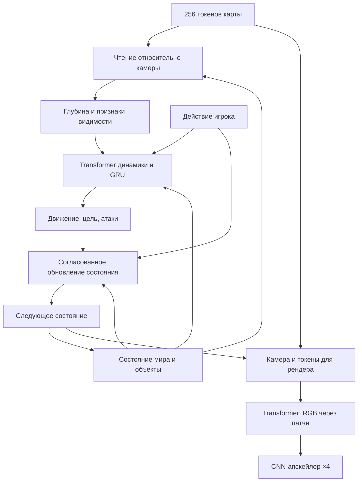

# TurkeyWorld Prototype 0.3 — Camera Transformer и длинные траектории

Игровая среда с противниками-индюками, структурированная world model,
Transformer renderer и отдельный обучаемый апскейлер 256×256 → 1024×1024.

В версии 0.3 добавлены согласованное обновление боевого состояния, перенос
состояния и памяти через обучающие куски TBPTT, сбор длинных записей без RGB
и отдельные проверки целостности и активности нейросетевой сессии.

**Готовых игровых весов нет.** Технические проверки кода и короткие запуски
обучения не подтверждают точность боя, 5 минут правильной игры или 30–60 FPS
на RTX 4090. Сеть должна научиться движению, выбору цели и условиям атаки;
согласованность счётчиков сама по себе не делает эти предсказания правильными.

## Архитектура



Карта и начальное состояние из 90 чисел передаются при старте один раз.
Состояние из RGB в этой версии не распознаётся. При нейросетевом исполнении
исходный движок после инициализации не используется для переходов, попаданий,
видимости или кадров. Явные правила `event_v1` реализованы отдельно на PyTorch:
это заявленные правила игры, а не результат обучения и не скрытая коррекция
исходным движком.

- `models.py`: общий API, конфигурация и совместимость с прежними моделями.
- `transformer_model.py`: Transformer карты, взаимодействие токенов, обучаемая
  геометрия и патчевый renderer. В новой world model нет `Conv2d`.
- `camera.py`: дифференцируемые преобразования координат и `grid_sample`.
- `geometry_targets.py`: точные DDA-метки для обучения; нейросетевая симуляция
  их не запрашивает.
- `structured_state.py`: атомарное обновление HP, `alive`, патронов, таймеров
  и событий по предсказанным целям и атакам.
- `collect.py`, `train.py`, `long_train.py`: сбор данных, короткое обучение
  и обучение на непрерывных длинных сегментах.
- `runtime_checks.py`, `evaluate_rollout.py`: измерение нарушений без исправления
  состояния или памяти нейромодели.
- `benchmark.py`, `neural_play.py`: измерение скорости и отдельный нейросетевой
  запуск.

## Чтение карты относительно камеры

Камера совпадает с игровой: FOV — 68 градусов, угол положителен по часовой
стрелке в координатах с осью Y вниз. Пусть `f` — направление вперёд,
`r` — вправо, `p` — позиция. Точка выборки карты:
`q = p + d * (f + u * tan(FOV/2) * r)`, где `u` — горизонтальная координата
изображения, `d` — глубина вдоль направления камеры.

На каждом шаге читаются 32 направления по 64 отсчёта на глубину до 24 клеток.
`grid_sample` читает обученные признаки карты с правильным совмещением центров
клеток; поза камеры участвует в вычислительном графе. Это чтение признаков,
а не вызов raycaster. Непрозрачность каждой выборки оценивает MLP; веса
пропускания интегрируют выборки в 32 лучевых токена и предсказанную глубину.
Выход за пределы карты считается непрозрачным явным ограничением; стены внутри
карты обучаются.

Для каждого объекта рассчитываются положение и скорость в осях камеры,
расстояние, направление, проекция на экран, размер и попадание центра в FOV.
Вместе с HP, `alive` и таймерами получается 18 признаков камеры плюс исходный
слот из 10 чисел. Каждый из 8 слотов имеет постоянный embedding ID.
Трупы сохраняются как объекты.

## Видимость

MLP получает признаки объекта и предсказанную глубину в направлении его центра.
Она выдаёт вероятность видимости центра с учётом стен. Аналитически задано
только попадание центра в FOV; нейромодель не получает истинные DDA-ответы.

**Эта метка не является точной маской силуэта:** не учитываются alpha спрайта,
частичная видимость, перекрытие другим NPC или оружием. Поэтому токены ID и
геометрии сохраняются, а признаки внешнего вида имеют мягкий gate с ненулевым
минимумом. Confidence дополнительно задаёт log-bias в cross-attention после
LayerNorm: простое умножение целого токена перед LayerNorm почти отменяло бы gate.

## Transformer, память и изображение

Студент: ширина 128, 4 головы, 2 слоя; учитель: ширина 192, 6 голов, 4 слоя.
Кодировщик карты обрабатывает 256 тайлов и кэширует результат для статичного мира.
В динамике 11 токенов: игрок, действие, память и 8 объектов. Они читают 256 токенов
карты и 32 признака направлений. Временная память GRU размером 256/512 сохраняется
между шагами.

Renderer использует 256 экранных запросов на сетке 16×16 с Fourier-координатами.
Они читают 41 токен: 32 направления, 8 объектов и 1 общий контекст. Линейная
голова создаёт RGB-патчи 16×16 для изображения 256×256 или 8×8 для 128×128.
Полного attention по 1024×1024 пикселям нет. Карта, динамика и базовый renderer
не используют CNN; отдельный SR остаётся CNN.

В режиме `event_v1` RGB зависит от явного состояния мира и карты. Скрытые
128-мерные признаки GRU не подмешиваются в изображение: одно и то же состояние
с одной картой должно давать тот же кадр независимо от скрытой истории.
Feature head сохраняется для вспомогательной дистилляции. Прежний режим
`residual_v0` сохраняет своё исходное поведение.

В RGB также не подмешиваются неотображаемые часы, счётчик убийств, число патронов
и cooldown выстрела; HP игрока используется как признак жив/мёртв. Эти данные
остаются в симуляции, но не должны менять стены или фон при неизменном видимом
мире. Вспышка оружия и визуальные состояния NPC сохранены.

| Компонент, Camera Transformer + `event_v1` | Параметров |
|---|---:|
| Teacher | 7 853 517 |
| Student | 2 067 341 |
| SR ×4 | 25 776 |
| Student + SR | 2 093 117 |

Размер не доказывает качество или скорость. Патчевый decoder может иметь швы;
нужны обучение, сравнение с исходной CNN-моделью и оценка временной стабильности.
Апскейлер пока однокадровый: temporal SR и интерполяция кадров не реализованы.

## Согласованный бой: `event_v1`

Сеть предсказывает ограниченное перемещение, одну цель выстрела из классов
`0..7` или `none=8` и восемь предложений атаки NPC. Затем один общий переход
состояния применяет правила игры:

- Выстрел возможен при нажатом огне, живом игроке, наличии патронов и готовом
  оружии. Принятый выстрел тратит ровно один патрон и запускает таймеры.
- Принятое попадание наносит 35 HP одному живому NPC. Выбор уже погибшего ID
  отклоняется; он не перенаправляется на другую цель.
- `alive` является бинарным флагом и обновляется вместе с HP. Событие убийства
  и счётчик убийств выводятся из того же перехода. Убитый ID не оживает, его
  координаты сохраняются, скорость обнуляется.
- Предложение атаки NPC дополнительно проверяется по жизни, расстоянию,
  таймеру и терминальному состоянию игрока. Принятая атака наносит 8 HP.
- Направление камеры, фазы анимаций, задержки и время обновляются по явным
  формулам. Координаты предсказывает сеть; перемещение ограничено скоростью
  2,4 клетки/с для игрока и 1,2 клетки/с для NPC. При отсутствии команды
  движения координаты игрока сохраняются.

**Правильность цели и видимости остаётся задачей обучения.** Модель всё ещё
может выбрать врага за стеной или предсказать движение в стену. В переходе нет
аналитической проверки стен, DDA или переноса объекта в свободную клетку.
Такие нарушения выявляет отдельный evaluator, не исправляя их.

При обучении прямой проход использует те же дискретные решения, что и при
исполнении; для градиентов через урон применяются straight-through
softmax/sigmoid. Головы цели и атак обучаются также по явным CE/BCE-меткам.

Авторитетное игровое состояние в `event_v1` хранится в FP32, в том числе при
FP16/BF16-вычислениях нейросетей. Патроны обновляются через целочисленный
счётчик с последующей нормализацией. Это устраняет потерю последнего патрона
и остановку нормализованных часов из-за округления FP16. Скорость GPU при
таком смешанном исполнении нужно измерять отдельно.

## Запуск обычной игры

```bash
python -m pip install -r requirements.txt
python -m turkeyworld.play --size 256 --display-size 1024 --fps 60
```

W/S — движение, A/D — стрейф, стрелки или Q/E — поворот, ЛКМ или пробел — выстрел,
R — сброс, Escape — выход. Windows: `run_game.bat`.

Игра использует точный обычный движок и классическое увеличение. Восемь NPC
обходят стены, атакуют и погибают от двух попаданий; выстрелы блокируются стенами.
Противники могут пересекаться друг с другом. Есть одна карта, нет звука и
перезарядки. Производительность этой игры не равна скорости нейросетевого
конвейера.

## Сбор данных

Короткие RGB-эпизоды с геометрией и настоящие пары 256/1024:

```bash
python -m turkeyworld.collect data_world --episodes 40 --frames 300 --size 256 --seed 0 --hz 30
python -m turkeyworld.collect data_hr --episodes 40 --frames 32 --size 256 --hr-size 1024 --seed 1000 --hz 30
```

Длинные записи динамики без RGB:

```bash
python -m turkeyworld.collect data_long --episodes 20 --frames 9600 --states-only --policy patrol --seed 2000 --hz 30
```

`--states-only` не вызывает RGB-renderer и по умолчанию не создаёт метки
геометрии. Добавить их можно явно через `--geometry`. С HR этот режим
несовместим. `--policy patrol` задаёт длительный маршрут; `mixed` добавляет
прицеливание и бой. Смерть игрока завершает запись, поэтому фактический файл
может оказаться короче запрошенного. Проверяйте длину и содержание записей:
долгое движение без боя или запись после окончания боя не заменяют боевые данные.

Один NPZ — один непрерывный эпизод. Основные поля:

| Поле | Форма и смысл |
|---|---|
| `map` | `[16,16]`, карта |
| `states` | `[T+1,90]`, состояния |
| `actions` | `[T,4]`, исходные действия |
| `events` | `[T,4]`, принятые события |
| `hit_ids` | `[T]`, ID попадания или `-1` |
| `attack_flags` | `[T,8]`, фактически атаковавшие NPC |
| `dt` | Фиксированный шаг времени эпизода |
| `frames` | `[T+1,S,S,3]`, только при сборе RGB |
| `depth`, `visibility` | `[T+1,32]` и `[T+1,8]`, при сборе геометрии |
| `hr_frames` | `[T+1,4S,4S,3]`, только при запросе HR |

Кадры и метки относятся к одному состоянию. HUD и прицел исключены, оружие
остаётся в сцене. HR получается настоящим рендером, а не растягиванием LR.
`--no-geometry` отключает геометрические метки при сборе RGB. Для короткого
`train.py` держите в одной папке однородные эпизоды: он требует RGB и не допускает
смеси файлов с геометрией и без неё. `long_train.py` принимает записи без RGB.
Reset не склеивается с обычным переходом.

Старые данные без `hit_ids`/`attack_flags` читаются с предупреждением:
вспомогательные метки восстанавливаются приблизительно по HP и таймерам.
Для надёжного обучения новых голов лучше заново собрать точные метки.

## Короткое обучение изображений и динамики

Установить PyTorch для своего CPU/CUDA: https://pytorch.org/get-started/locally/ .
Затем установить зависимости из `requirements-ml.txt`.

```bash
python -m turkeyworld.train --data data_world --architecture camera_transformer --transition-mode event_v1 --kind teacher --image-size 256 --device cuda --horizon 4 --batch 4 --steps 10000 --output checkpoints/teacher.pt
python -m turkeyworld.train --data data_world --architecture camera_transformer --transition-mode event_v1 --kind student --image-size 256 --device cuda --horizon 4 --batch 4 --steps 10000 --teacher checkpoints/teacher.pt --output checkpoints/student.pt
python -m turkeyworld.train --data data_hr --stage sr --image-size 256 --device cuda --horizon 1 --batch 2 --steps 10000 --output checkpoints/sr.pt
```

10 000 шагов — пример параметра запуска, а не установленный достаточный бюджет.
При нехватке VRAM уменьшить batch или horizon. Технический CPU-запуск:
`--device cpu --image-size 128 --horizon 2 --batch 1 --steps 2`.
Он проверяет исполнимость кода, но не обучает пригодную для игры модель.

Потери включают состояния, события, CE цели, BCE атак, изображение, глубину,
видимость и при наличии учителя — дистилляцию. Метки боя и геометрии дополнительно
калибруют головы на настоящем состоянии кадра: цель записанного перехода не
подставляется как точный ответ для другой, отклонившейся позы студента.
Основная RGB/state-траектория остаётся свободной внутри короткого окна.
Память этого короткого trainer обнуляется между окнами; стандартные 4 шага
дают около 0,133 секунды при 30 Гц.

## Непрерывное обучение: TBPTT и curriculum

`long_train.py` начинает сегмент с одного записанного состояния и далее несёт
**собственное предсказанное состояние и GRU-память** через последовательные
куски. На границе куска отсекается граф градиентов, а численные значения не
сбрасываются и не заменяются настоящим состоянием. Карта переэнкодируется
после обновления весов для каждого следующего куска, чтобы не использовать
устаревший граф encoder.

Начальный `burn-in` — свободные шаги без градиента. Вспомогательная ветка для
боевых меток имеет собственную память и получает записанные состояния; она
не исправляет основную свободную траекторию.

Пример продолжения визуально обученного учителя на длинных записях:

```bash
python -m turkeyworld.long_train --data data_long --kind teacher --resume checkpoints/teacher.pt --image-size 256 --device cuda --hz 30 --chunk 32 --rollout 9000 --burn-in 64 --updates 600 --curriculum 16,64,256,1024,4096,9000 --render-every 0 --event-fraction 0.25 --output checkpoints/teacher_long.pt
python -m turkeyworld.long_train --data data_long --kind student --resume checkpoints/student.pt --teacher checkpoints/teacher_long.pt --image-size 256 --device cuda --hz 30 --chunk 32 --rollout 9000 --burn-in 64 --updates 600 --curriculum 16,64,256,1024,4096,9000 --render-every 0 --event-fraction 0.25 --output checkpoints/student_long.pt
```

Это пример подготовки длительного эксперимента, а не заявленный завершённый
прогон. Доступная длина эпизода ограничивает фактический rollout; burn-in также
расходует часть записи. Все фактические длины и границы записываются в отчёт.

- `--updates` — целевое общее число непрерывных сегментов, включая уже пройденные
  при resume. Это не число optimizer steps: их в сегменте несколько, по числу
  кусков `ceil(actual_rollout/chunk)`.
- `--chunk 32` ограничивает длину графа одного backward. `--rollout 9000` задаёт
  длину численной траектории, а не один backward через 9000 шагов.
- `--curriculum` перечисляет возрастающие ограничения горизонта, равномерно
  распределённые по общему `--updates`. Пустая строка отключает curriculum.
- `--render-every 0` не загружает RGB и не обучает изображение. При наличии
  настоящих кадров можно задать, например, `--render-every 16` для редкой
  визуальной supervision. Файлы без кадров при этом не получают фиктивный RGB.
- `--geometry-every 32` задаёт частоту геометрической supervision там, где есть
  соответствующие метки. Отсутствие меток её отключает.
- `--event-fraction 0.25` повышает вероятность сегментов с попаданием или атакой.
  Веса `--none-class-weight 0.2` и `--attack-pos-weight 4` борются с дисбалансом
  боевых меток. Это настройки обучения, не калиброванные вероятности событий.
- Мягкий collision barrier штрафует опасные положения по приближённой карте
  расстояний только при обучении. Он не переносит актёров из стен при исполнении.

Длинное обучение только на состояниях не обучает renderer или SR. Изменение
общих признаков карты может повлиять на уже обученное изображение, поэтому
нужны последующая визуальная донастройка и/или смешанные RGB-сегменты. Само
наличие GRU и TBPTT не гарантирует 5 минут точной игры.

`--freeze-map` замораживает кодировщик карты при длинном обучении, сохраняя
совместимость optimizer state при resume. Общие геометрические признаки всё
равно могут изменяться. После динамики можно дообучить только изображение:

```bash
python -m turkeyworld.train --data data_world --kind student --image-size 256 --device cuda --resume checkpoints/student_long.pt --renderer-only --horizon 1 --batch 4 --steps 10000 --output checkpoints/student_final.pt
```

`--renderer-only` использует настоящую позу кадра и обновляет только параметры
renderer. Динамика, карта и головы геометрии заморожены. Это позволяет настроить
RGB после длинного обучения, сохраняя уже обученный переход состояния.

Validation отделяет целые файлы эпизодов. Для новых карт нужен отдельный
набор данных и разделение по картам; текущий игровой источник содержит один
уровень. Учитель и студент должны использовать согласованный шаг времени.

## Добор данных из состояний модели

`collect_corrections.py` записывает состояния, которые посещает текущая модель,
и запрашивает короткие правильные продолжения у исходной среды только для
обучающих меток:

```bash
python -m turkeyworld.collect_corrections --world checkpoints/student_long.pt --output data_corrections --device cuda --steps 9000 --every 64 --horizon 16 --max-branches 64 --scenario mixed
```

По умолчанию RGB отсутствует; `--rgb --size 256 --geometry` включает настоящие
кадры и геометрические метки. Каждая ветка сохраняется отдельным непрерывным
эпизодом. Нельзя склеивать независимые ветки в одну длинную траекторию.

Каноническое начальное состояние и цели записываются после адаптера исходной
среды; исходное предсказанное состояние хранится отдельно для аудита. Положение
внутри стены и другие недопустимые состояния отклоняются. Исправления не
возвращаются в продолжающуюся модель или её GRU-память. Такой сбор нужен при
обучении; итоговая проверка 300 секунд не использует эти исправления.

## Совместимость весов

По умолчанию новые модели используют `architecture=camera_transformer`,
`transition_mode=event_v1`, `simulation_hz=30`. У `event_v1` новые головы цели
и атак, поэтому старые веса не становятся новой моделью автоматически.

Checkpoint без поля `transition_mode` загружается как `residual_v0`; без поля
`architecture` — как `legacy_cnn`. Это сохраняет прежнее вычисление, включая
его ограничения. Для resume нужно явно выбрать ту же архитектуру, режим
перехода, размер изображения и частоту, что записаны в checkpoint. Например,
старому CNN-варианту соответствуют `--architecture legacy_cnn --transition-mode
residual_v0`. Новый режим требует нового согласованного обучения.

## Нейросетевой запуск и скорость

```bash
python -m turkeyworld.neural_play --world checkpoints/student_long.pt --sr checkpoints/sr.pt --device cuda --fp16 --fps 60
python -m turkeyworld.benchmark --checkpoint checkpoints/student_long.pt --sr-checkpoint checkpoints/sr.pt --device cuda --dtype fp16 --frames 300 --warmup 30 --output-json speed.json
```

Частота симуляции берётся из checkpoint, обычно 30 Гц. На окне 60 FPS
повторяется последний кадр; интерполяции и 60 независимых переходов пока нет.
Для 60 Гц нужно согласовать данные и обучение. 30 FPS дают 33,3 мс на весь кадр,
60 FPS — 16,7 мс. Вывод 1024×1024 сам по себе не подтверждает этот бюджет.

Benchmark модели не включает readback/present; `neural_play` отдельно измеряет
копирование на CPU. Проверяйте качество, длительность и GPU latency раздельно.
Исторические CPU-замеры случайных весов v0.1/v0.2 находятся в `verification`;
они не являются замером обученной модели v0.3 на RTX 4090.

## Проверка 300 секунд

`evaluate_rollout.py` заранее записывает фиксированную ленту действий. Затем
модель исполняет её без сбросов, настоящих состояний и коррекции памяти.
Исходная среда и геометрические проверки служат только измерению: их ответы
не поступают обратно в симуляцию.

Проверка целостности без изображения:

```bash
python -m turkeyworld.evaluate_rollout --world checkpoints/student_long.pt --device cuda --seconds 300 --scenario idle --no-render --output integrity_idle_300s.json
```

Проверка движения и боя с редкими RGB-измерениями:

```bash
python -m turkeyworld.evaluate_rollout --world checkpoints/student_long.pt --device cuda --seconds 300 --episodes 3 --scenario mixed --render-every 30 --output active_mixed_300s.json
```

Без явно заданного визуального порога полный `300s_active_pass` остаётся false.
Для пробного порога можно добавить `--min-render-psnr 20`; 20 dB здесь является
примером настройки, а не универсальным критерием качества. Измеряются выбранные
кадры базового renderer, а не качество SR и не каждая миллисекунда изображения.

Доступные сценарии: `idle`, `wall`, `turn`, `explore`, `combat`, `mixed`.
По умолчанию проверка останавливается на первом нарушении.
`--continue-on-failure` позволяет собрать остальные конечные нарушения;
при NaN продолжение небезопасно. `--no-shadow-reference` отключает парную
исходную физику и оставляет только диагностическую ленту: такая проверка
не засчитывается как активная сессия.

Отчёт различает:

- `integrity_pass`: выбранные проверки состояния и событий не нашли нарушений.
- `qualifying_active_session`: достаточные движение и покрытие, отсутствие
  раннего терминального состояния и завершённая парная проверка.
- `state_integrity_active_300s_pass`: оба условия выполнены на протяжении
  300 секунд симулируемого времени.
- `300s_active_pass`: дополнительно пройден заданный пользователем визуальный
  порог на всех выбранных RGB-кадрах.

Idle, поворот на месте, неподвижная модель или продолжение после смерти не
доказывают активную игру. Проверяются стены и пересечения, скорость, направление,
патроны, HP, `alive`, попадания, убийства и сохранность трупов. Измеряются парные
ошибки позиции/направления, совпадение событий и время переходов. Эти метрики
не заменяют полноценную проверку поведения NPC: прохождение выбранных
инвариантов и покрытие маршрута ещё не доказывают правильную погоню или бой.

Выборочные RGB сравниваются с исходным renderer **в том же допустимом
предсказанном состоянии**, без подмены состояния модели. Это отделяет качество
изображения от расхождения двух траекторий. Визуальный pass не выставляется
без явно выбранного `--min-render-psnr`; универсального правильного порога нет.
Отсутствие RGB-измерений не считается успешной визуальной проверкой.
9000 конечных шагов сами по себе не являются сертификатом правильной игры.

## Технические проверки

```bash
python -m unittest discover -s tests -v
```

Проверки охватывают исходную механику, координаты камеры, градиенты и видимость,
совместимость весов, бинарные состояния жизни, принятые события, сохранность
трупов, все 99 патронов, часы при пониженной точности нейросети, перенос памяти
между кусками TBPTT и различие целостности/активности сессии. Технические
teacher/student/KD-запуски и тесты интерфейсов не являются результатом
полноценного обучения. Обученные игровые веса не приложены; корректность
300 секунд активного боя и производительность RTX 4090 ещё предстоит измерить.

Итоговый набор v0.3: 51 автоматический тест проходит на CPU. В него также
включены проверки добора веток, согласованности обучающих меток и отсутствия
обратной подмены состояния модели ответами исходного движка.


Проверенный технический прогон v0.3: один полный обучающий сегмент из 9000
переходов при 30 Гц, 282 optimizer steps через chunks по 32, 281 отсечение
графа и ровно одна инициализация из настоящего состояния. Численные состояние
и память переданы на всех границах без изменения; RGB в этом прогоне не
обучалось. Сводка: `verification/tbptt_training_9000_summary.json`.

Отдельный необученный нейросетевой idle-прогон тоже выполнил 9000 шагов без
численных нарушений, но получил отрицательную оценку активной сессии из-за
неподвижных противников. Это подтверждает работу диагностики, а не качество
игры. Контрольная запись настоящей среды проходит тот же checker на всех
9000 переходах. В `examples/long_patrol_300s.npz` приложен один пример исходных
данных; он не заменяет разнообразный обучающий и независимый проверочный набор.
