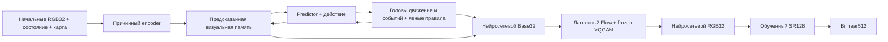

# TurkeyWorld: нейросетевая игровая среда

[English](README.md) | Русский

TurkeyWorld содержит обычную игру от первого лица и экспериментальную world
model. Текущий запуск обучает **новый VQGAN, нейроапскейлер×4, Teacher 175M,
нейрорендер и GAN с нуля** на новых исходных кадрах **32×32**. Отображение:
**нейросетевой RGB32 → обученный SR128 → bilinear512**.

Новый запуск начат; фактический этап виден на dashboard. **Завершение обучения,
сходство изображений и две минуты правильной автономной игры — отдельные
результаты.** Две минуты пока являются целью. Checkpoint сам по себе её не
подтверждает. Указанные ниже будущие артефакты появляются только после
выполнения соответствующих этапов.

## Установка и обычная игра

Команды PowerShell выполняются из корня репозитория. Можно использовать
существующий подходящий Python или создать окружение:

```powershell
python -m venv .venv
$twPython = Join-Path $PWD '.venv\Scripts\python.exe'
& $twPython -m pip install -r requirements-vqgan.txt
& $twPython -c "import torch; print(torch.__version__); print('CUDA:', torch.cuda.is_available())"
```

`requirements.txt` содержит зависимости игры; `requirements-ml.txt` добавляет
PyTorch; `requirements-vqgan.txt` — зависимости perceptual loss. Для GPU нужна
совместимая CUDA-сборка PyTorch. Замороженная сеть потерь LPIPS/VGG может
скачать свои веса при первом запуске. Это веса функции потерь, а не готовые
веса мира, VQGAN, SR или генератора изображений.

```powershell
& $twPython -m turkeyworld.play --size 32 --display-size 512
```

Управление: **WASD** — движение; **Q/E или ←/→** — поворот; **пробел или левая
кнопка мыши** — выстрел; **Esc** — выход. **R** перезапускает обычную игру.
Симуляция работает на 30 Гц. По умолчанию боезапас бесконечный, восемь постоянных
слотов противников, возрождение через три секунды, убийства суммируются.
Смерть игрока завершает сессию. `--classic` включает конечный режим.
Эта команда использует исходный движок и обычное увеличение изображения;
нейросетевое исполнение запускается отдельной командой ниже.

## Текущие данные

Новый корпус находится в `training_runs/fresh32_128k_20261109/data`.

| Выборка | Клипы | Переходов в клипе | Всего переходов |
|---|---:|---:|---:|
| Train | 4000 | 32 | **128000** |
| Validation | 512 | 32 | **16384** |

Эпизоды содержат исходные RGB32 и настоящие парные HR128, отрисованные движком
при тех же состояниях и действиях. HR не получен увеличением LR. Начальный
seed — 50 000 000; train и validation используют разные диапазоны seed. Версия
поведения — `deterministic_enemy_v3_simple_spawn`: движение, атаки, анимация
и возрождение противников детерминированы соответствующим состоянием и
игровым временем.

Девять обучающих политик покрывают движение, столкновения, бой, промахи,
убийства, возрождения, возвращение к объектам, атаки и допустимые возмущённые
состояния исходной игры. Последние — аугментация Source, а не собственные
ошибочные состояния модели. В клипе 33 наблюдения и 32 действия: действие `t`
относится к переходу `state[t] → state[t+1]`. NPZ также содержит карту, события,
hit/attack/spawn-метки и параметры инициализации. Длинных эпизодов здесь нет.

Текущий корпус уже подготовлен. Команда воспроизводит его план; повторять её
следует только для проверки или продолжения того же сбора:

```powershell
& $twPython -m turkeyworld.data_expansion training_runs/fresh32_128k_20261109/data `
  --rgb-train 4000 --rgb-val 512 --clip-frames 32 `
  --long-train 0 --long-val 0 --long-frames 3600 `
  --size 32 --hr-size 128 --hz 30 --seed 50000000 `
  --rgb-time-span 120 --workers 8
```

Параметра `--source` нет: старые записи не используются. Фактические количества
и происхождение записаны в `data/status.json`, `data/manifest.json` и
`data/progress.jsonl`. Контроллер фиксирует 4000 имён train-файлов в
`training_runs/fresh32_pipeline_20261109/training_subset_128k.json`.
Загрузчик модели читает только этот неизменяемый список. Окна выбираются
случайно с возвращением: обновления optimizer не равны числу уникальных
примеров или полных проходов по датасету.

## Обучение VQGAN, SR и мира

Контроллер запускает по одному обучающему GPU-процессу. Текущая конфигурация:

```powershell
& $twPython -m turkeyworld.fresh_pipeline `
  --run-dir training_runs/fresh32_pipeline_20261109 `
  --data-dir training_runs/fresh32_128k_20261109/data `
  --codec-run-dir training_runs/vqgan32_20261109 `
  --sr-run-dir training_runs/sr32x4_20261109 `
  --world-run-dir training_runs/vjepa175_32px_128k_20261109 `
  --image-size 32 --device cuda --batch 48 --gradient-accumulation-steps 21
```

В текущем workspace команда уже запущена; вторую копию запускать не нужно.
Для другого эксперимента нужны отдельные каталоги контроллера, VQGAN, SR и
мира. После корректной остановки та же команда продолжает сохранённые этапы;
изменение зафиксированной конфигурации контроллера отклоняется.

1. **VQGAN с нуля.** Encoder, codebook, decoder и codec PatchGAN учатся на
   Source32. Каждые 100 обновлений реконструируется фиксированная validation-
   панель. Порог кадра: PSNR≥35дБ, SSIM≥0.98, MAE≤2/255. Не менее 95% кадров
   должны пройти все пороги; дополнительно проверяются агрегированные SSIM/MAE
   и численная корректность/использование codebook. Экспорт требует **трёх
   успешных проверок подряд**, без лимита шагов:
   `training_runs/vqgan32_20261109/checkpoints/codec_for_renderer.pt`.
2. **Нейроапскейлер с нуля.** После выхода процесса VQGAN новая сеть×4 обучается
   **2000 обновлений** на настоящих парах Source32/Source128. Экспорт
   `training_runs/sr32x4_20261109/checkpoints/sr_for_game.pt` сопровождается
   актуальными held-out метриками. Завершение бюджета SR не означает достижения
   отдельного порога сходства.
3. **Offline-метки объектов.** Движок проверяет совпадение Source-пикселей и
   создаёт точные маски видимых NPC и соответствующие изображения без NPC.
   Этот CPU-кэш используется только как обучающие метки.
4. **Новые world, Base, Flow и conditional GAN.** Teacher создаётся случайно и
   загружает только новый обученный замороженный кодек. Совместное обучение
   ограничено **6000 обновлений optimizer**: microbatch **48**, accumulation
   **21**, эффективный batch фрагментов **1008**. Обучаются мир, Base и Flow;
   VQGAN заморожен. Вес conditional GAN — 0.005, feature matching — 0.01;
   прогрев — 32 обновления discriminator, ramp — 128.

Мир получает два наблюдаемых кадра контекста и предсказывает четыре будущих
шага. Независимая основная траектория продолжает собственные состояние и
латентную память; будущие Source-кадры/состояния являются целями и не подменяют
траекторию. Отдельный причинный GT-pose поток даёт согласованные локальные
motion/combat/spawn/Base/Flow-метки. Условия sampled GAN отсоединены от голов
мира. Base учится прямой реконструкции; Flow получает его условие с detach.
Точные пиксели NPC имеют нормализованный вес 4. Изображения Source без NPC
становятся отрицательными примерами discriminator только при наличии NPC.

Градиенты накапливаются за 21 отдельный microbatch, затем выполняется одно
обновление генератора и одно обновление discriminator. EMA, global step и
сохранения отсчитываются по обновлениям optimizer. Одновременно 21 полный
граф вычислений не удерживается.

После бюджета 6000 устанавливается `awaiting_user`. Запуск **не расширяет
автоматически данные, не начинает repair-циклы или Student** и не объявляет
игру проверенной. Профиль Student native32 существует для дальнейшей работы.
Квалификация кодека не ограничена временем; новым этапам нужны собственные
замеры. Прежнее время обучения 128px не является ETA этого запуска. Срок
достижения двух минут правильной игры неизвестен.

## Архитектура и исполнение

World model адаптирует идеи
[официального V-JEPA2](https://github.com/facebookresearch/vjepa2) и
[статьи](https://arxiv.org/abs/2506.09985); кодек —
[CompVis/taming-transformers](https://github.com/CompVis/taming-transformers).
Это компактная игровая реализация, без официальных pretrained-весов мира
или VQGAN.

| Компонент | Текущий Teacher | Будущий Student native32 |
|---|---:|---:|
| Параметров игрового генератора, включая кодек | **174 461 156** | 22 209 956 |
| Визуальная ширина | 512 | 320 |
| Слоёв encoder / predictor | 18 / 12 | 4 / 5 |
| Визуальный патч | 4×4 | 4×4 |
| Визуальных токенов на кадр | 64 | 64 |
| Переносимая память | 264×512 | 264×320 |
| Рендерер | Conditional Flow Matching | Rectified Flow |
| Интегрирование | 12 полных шагов Heun | 4 шага Euler |
| Общий замороженный кодек | 4 763 731 параметр | Тот же кодек |

Причинный encoder выдаёт 8×8 визуальных токенов. Predictor чередует токены
действия, 90-мерного состояния и изображения. Attention двунаправлен внутри
кадра и причинен между кадрами, с RoPE по времени/высоте/ширине. Четыре
переносимых блока содержат 264 токена. Отдельный EMA target encoder содержит
56 769 024 параметра и нужен только для обучения, как discriminator и сеть потерь.

Base сразу выдаёт RGB32. VQGAN уменьшает изображение в 4 раза до **8×8×16**,
используя обучаемую кодовую книгу из **1488** векторов. Flow работает с
непрерывными нормализованными латентами; патч 4 даёт четыре пространственных
токена transformer. Конечный латент квантуется и декодируется обратно в32.
В генераторе мира нет промежуточного RGB128. Обученный SR затем делает 32→128;
только 128→512 является bilinear. Параметры SR не входят в размер Teacher.



Это гибридная world model. Нейросеть предсказывает движение, цели попаданий,
атаки и spawn-позиции. Явные правила обновляют HP, alive, таймеры, направление,
боезапас и убийства, ограничивают скорость и направление командой. Карта
задаёт floor/distance-маску spawn-позиций. Эти правила раскрыты, а не выданы
за выученную физику. Признаки карты и восемь слотов объектов сохраняются
за камерой. Столкновения, бой и длинные траектории ещё требуют проверки.

Neural playback использует одну начальную карту, состояние и Source-кадр
движка. Затем движок не даёт новые изображения, ответы о столкновениях,
hit-тесты или исправления. Все следующие состояния и изображения даёт модель.

## Dashboard, preview, остановка и продолжение

Если локальный монитор ещё не запущен:

```powershell
& $twPython -m training_dashboard.local_server `
  --run-dir training_runs/fresh32_pipeline_20261109 --port 8765
```

Адрес: **http://127.0.0.1:8765**. Монитор следует за активным процессом;
результаты codec/SR отделены от счётчиков мира. Отсутствующие результаты
не заменяются предполагаемыми. Контроллер также публикует active-run указатель
для существующего каталога монитора.

Preview мира обновляется каждые **10 глобальных обновлений optimizer**.
Пять рядов: начальный контекст; будущий Source для сравнения; собственное
авторегрессионное предсказание модели RGB32; обученный SR128 именно этого
предсказания; bilinear512 именно этого SR-результата. Будущий Source только
показывается рядом; SR не получает его и не исправляет состояние мира.
У codec/SR отдельные preview/validation каждые 100 обновлений. Полная проверка
качества мира остаётся каждые 500; preview не засчитывается как её прохождение.

Запрос корректной остановки:

```powershell
New-Item -ItemType File -Path training_runs/fresh32_pipeline_20261109/stop_training -Force
```

Дождитесь сохранения и выхода активного worker. Удалите существующие stop-
маркеры контроллера и этапов, затем повторите ту же команду контроллера:

```powershell
$freshRuns = @('fresh32_pipeline_20261109', 'vqgan32_20261109',
               'sr32x4_20261109', 'vjepa175_32px_128k_20261109')
foreach ($runName in $freshRuns) {
  $stopRequest = Join-Path (Join-Path $PWD 'training_runs') "$runName/stop_training"
  if (Test-Path -LiteralPath $stopRequest) { Remove-Item -LiteralPath $stopRequest }
}
```

Продолжаются сохранённые состояния модели, optimizer и этапов. Не запускайте
два trainer одного каталога. Контроллер создаёт скрытые дочерние процессы
Windows и ждёт завершения GPU-процесса предыдущего этапа. Его foreground-
терминал нужно оставить открытым либо использовать фоновый launcher. Awake
guard допускает **Win+L** и выключение дисплея; сон компьютера, выход из учётной
записи или выключение прерывают процесс.

## Нейросетевая игра и проверка двух минут

Когда новые checkpoints мира и обученного SR появятся и GPU будет доступен:

```powershell
& $twPython -m turkeyworld.neural_play `
  --world training_runs/vjepa175_32px_128k_20261109/checkpoints/teacher175vq_world.pt `
  --sr training_runs/sr32x4_20261109/checkpoints/sr_for_game.pt `
  --device cuda --two-stage-upscale --max-catchup-steps 1
```

Для native32 итоговый размер по умолчанию 512; можно добавить
`--display-size 512`. Двухступенчатый режим требует обученный SR×4 и не заменяет
его обычным resize. Управление совпадает с исходной игрой; после смерти окно
нужно закрыть и запустить команду снова. Без `--two-stage-upscale` сохраняется
прежний display-default 1024. Настоящие 30 Гц/FPS нужно измерить.

Отдельный evaluator проверяет **120 секунд =3600 шагов**:

```powershell
& $twPython -m turkeyworld.evaluate_rollout `
  --world training_runs/vjepa175_32px_128k_20261109/checkpoints/teacher175vq_world.pt `
  --device cuda --seconds 120 --episodes 2 --scenario explore `
  --render-every 30 --output training_runs/vjepa175_32px_128k_20261109/evaluation_120s.json
```

Отчёт содержит фактическую длительность, корректность состояния, покрытие
движения/боя, отказы oracle и выборочные сравнения изображений. Oracle только
измеряет и не исправляет траекторию. Прохождение 120 секунд не является
прохождением 300. Seed меняют траектории на одной фиксированной арене;
перенос на новые карты этим не подтверждается.

## Артефакты и история

| Каталог внутри `training_runs` | Назначение |
|---|---|
| `fresh32_pipeline_20261109` | Статус/команды контроллера, fixed subset, object masks |
| `fresh32_128k_20261109/data` | Новый парный корпус 32/128 и provenance |
| `vqgan32_20261109` | Кодек: метрики/preview, resume-веса и квалифицированный экспорт |
| `sr32x4_20261109` | SR: метрики/preview, held-out результаты и экспорт×4 |
| `vjepa175_32px_128k_20261109` | Новый Teacher: метрики/preview, бюджет и checkpoints |

Worker записывают `status.json`, `training.stdout.log`, `training.stderr.log`
и checkpoints по мере выполнения. `active_run.json` указывает текущий этап.
Имена будущих checkpoints в инструкции не означают, что они уже созданы.

9 ноября 2026 по запросу пользователя **набор «Фрагменты Б», все старые
checkpoints и устаревшие данные экспериментов удалены**; освобождено 195.49GiB.
Исторические отчёты сохранены. Процедуры 128px/32k, replay-B 64k,
125M/250M/500M и прежний принятый кодек относятся к истории: удалённые пути
весов/данных не нужны и не доступны для нового запуска. Совместимые профили
в исходном коде сохранены.

## Код и проверки

Основные модули: [fresh_pipeline.py](turkeyworld/fresh_pipeline.py),
[train_vqgan.py](turkeyworld/train_vqgan.py), [train_sr.py](turkeyworld/train_sr.py),
[train_vq_world.py](turkeyworld/train_vq_world.py),
[vjepa2_ac.py](turkeyworld/vjepa2_ac.py),
[latent_flow_renderer.py](turkeyworld/latent_flow_renderer.py),
[neural_play.py](turkeyworld/neural_play.py).

```powershell
& $twPython -m unittest discover -s tests -q
```

Тесты проверяют причинность/память, native32/64/128-размеры, frozen-codec
градиенты, backward через Heun/GAN/R1, накопление, fixed membership, resume-
бюджеты, разделение preview/SR и игровые проверки. Успех тестов реализации
не доказывает качество обученной игры.
