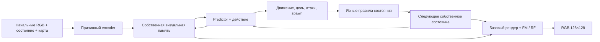

# TurkeyWorld: нейросетевая игровая среда

[English](README.md) · Русский

TurkeyWorld — шутер с противниками-индюками и экспериментальная world model,
которая учится продолжать состояние игры и генерировать изображение.
Сохранённый RGB-профиль: **Teacher 500 044 741 параметр → Student 22 475 013 параметров**,
compact V-JEPA 2-AC, Flow Matching и Rectified Flow.
Следующий этап — общий VQGAN, обучаемый с нуля, затем продолжение Teacher и
Student в его латентном пространстве.

**Проверенных игровых весов пока нет.** Обучение и checkpoints сохраняются
локально. Завершённый сбор данных, низкий loss или короткий тест не означают
пять минут правильной игры. Скорость нового Student и достижение 30–60 FPS
ещё не подтверждены.

Навигация: [установка и игра](#установка-и-обычная-игра) ·
[архитектура](#что-делает-модель) · [данные](#данные-и-их-сбор) ·
[обучение](#общий-vqgan-для-teacher-и-student) ·
[прогресс и остановка](#прогресс-остановка-и-экран-блокировки) ·
[нейросетевая игра](#артефакты-и-нейросетевая-игра) · [проверки](#код-и-проверки).

## Установка и обычная игра

Команды ниже выполняются в PowerShell из корня репозитория. Python 3.11+
рекомендуется; зависимости игры и ML разделены.

```powershell
py -3 -m venv .venv
$twPython = (Resolve-Path .venv/Scripts/python.exe).Path
& $twPython -m pip install --upgrade pip
& $twPython -m pip install -r requirements.txt
& $twPython -m turkeyworld.play --size 256 --display-size 1024 --fps 60
```

Можно использовать существующий Python: присвойте его путь переменной
`$twPython`. Активация venv не обязательна. `run_game.bat` запускает ту же
обычную игру через `python` из PATH.

Управление: W/S или ↑/↓ — движение; A/D — стрейф; Q/E или ←/→ — поворот;
пробел или левая кнопка мыши — выстрел; R — перезапуск обычной игры;
Esc — выход. Симуляция работает на 30 Гц; `--fps` ограничивает показ кадров.

По умолчанию игра бесконечная: до восьми живых противников, убитый
возрождается через три секунды, убийства суммируются, боезапас бесконечен,
а смерть игрока завершает игру. `--classic` возвращает прежний режим:
восемь противников, 99 патронов, без возрождений.

```powershell
& $twPython -m turkeyworld.play --classic
& $twPython -m turkeyworld.play --headless --seconds 10 --output reports/reference.png
```

Это запуск исходного движка с обычным увеличением изображения, без
нейросетевых весов. Для обучения и нейросетевого исполнения установите:

```powershell
& $twPython -m pip install -r requirements-ml.txt
& $twPython -c "import torch; print(torch.__version__, torch.cuda.is_available())"
```

Для CUDA нужна совместимая сборка PyTorch и драйвер NVIDIA; используйте
[официальный подбор установки PyTorch](https://pytorch.org/get-started/locally/).
CPU подходит для игры, генерации данных и небольших проверок. Обучение
500M на CPU существенно медленнее.

## Что делает модель

Это игровая адаптация идей [V-JEPA 2 / V-JEPA 2-AC](https://github.com/facebookresearch/vjepa2)
([статья](https://arxiv.org/abs/2506.09985)), с дополнительными игровыми головами,
генератором изображения и явными правилами состояния. Это не точная копия
официальной модели и не заявление о поддержке V-JEPA 2.1. Официальные
pretrained-веса Meta не используются.

Таблица описывает сохранённый RGB-профиль; размеры продолжения с VQGAN указаны
в разделе обучения кодека.

| Компонент | Сохранённая RGB-конфигурация |
|---|---|
| Teacher | 500 044 741 параметр генератора; ширина 512, 8 голов, encoder 76 слоёв, predictor 58, readout MLP ratio 9 |
| Изображение Teacher | Flow Matching renderer около 70M параметров; 12 шагов Heun |
| Student | 22 475 013 параметров генератора; ширина 320, 5 голов, encoder 8 слоёв, predictor 5 |
| Изображение Student | Rectified Flow: ширина 192, 4 слоя, 4 головы; 4 шага Euler |
| Вход и выход | RGB 128×128, патчи 16×16, 64 визуальных токена на кадр |
| Память | Четыре блока действий, состояния и визуальных токенов; Teacher 264×512, Student 264×320 |
| EMA target Teacher | 239 975 936 параметров, только для обучения |
| Discriminator | Отдельный conditional PatchGAN, только для обучения |

EMA и discriminator не входят в число параметров игрового генератора.
Пока обучается Teacher, dashboard показывает размер Student как
**запланированный**. Фактический `student_total` появляется после создания
Student; это счётчик параметров, а не подтверждение обученности.

Teacher 500M расширен из обученного Teacher 250M. Обученные значения
перенесены полностью; новые residual-блоки начинают с identity, новые
выходные столбцы readout — с нуля. Все новые блоки исполняются и обучаются.
Student создаётся отдельным явным профилем из `student_profile.py`;
прежний Student 11 747 077 параметров остаётся совместимым со старыми весами.



Статичная карта 16×16 кодируется и сохраняется. Состояние содержит 90 чисел:
игрока, восемь постоянных слотов NPC и служебные поля. Слоты сохраняются
за камерой. Причинный encoder, attention и 3D RoPE не раскрывают будущие
кадры прошлым токенам. После начального контекста модель получает действия
и продолжает собственные состояние и память.

Это гибридная система. Сеть предсказывает движение, выбор цели, атаки и
места появления. Явные PyTorch-правила обновляют HP, alive, cooldown,
таймеры, убийства и боезапас. Ограничение скорости и маски допустимых
мест spawn по карте и расстоянию заданы явно. Они не объявляются выученной
физикой и не гарантируют правильную видимость цели или отсутствие
столкновений.

В нейросетевом игровом runtime исходный движок используется для начальной
карты, состояния и одного начального RGB. Затем его переходы, raycast,
попадания и кадры не исправляют модель. При оценке отдельный эталонный
прогон предоставляет только диагностические цели сравнения.

## Данные и их сбор

Цели текущего корпуса:

| Часть | Цель |
|---|---:|
| Базовый RGB train | 156 250 клипов × 32 перехода = 5 000 000 переходов |
| Дополнительный model-visited train | 256 клипов × 32 = 8 192 перехода |
| Суммарный короткий train | 5 008 192 перехода |
| Фиксированный RGB val | 512 клипов × 32 = 16 384 перехода |
| Длинные train / val | 256 / 32 полных записей по 9 000 переходов |

Это **целевые**, а не автоматически достигнутые количества. Реальные
переходы берутся из `groups["rgb/train"]["transitions"]` в `data/status.json`;
`planned_rgb_training_transitions` хранит план. Подлинные ранние смерти
сохраняются. Для длинного корпуса дополнительно собираются новые независимые
записи до получения заданного числа полных 9000-шаговых примеров.
Длительность исходной записи сама по себе не доказывает качество нейромодели.

Короткие клипы покрывают движение, стены, попадания и промахи, убийства,
возрождения, атаки после первого действия, уход и возвращение к объектам.
Допустимые возмущённые эталонные состояния используются только в train
и не называются состояниями, посещёнными моделью. Train и val разделены
по seed; новые train-клипы не меняют фиксированную val-панель.

NPZ содержит RGB `uint8[T+1,H,W,3]`, состояния `[T+1,90]`, действия
`[T,4]`, события `[T,4]`, ID попаданий, флаги атак и возрождений,
карту, dt и точное начальное состояние. Метки получены реальными
`Game.step`; бессмертия и поддельных событий нет. В длинных NPZ RGB
обычно не сохраняется, чтобы ограничить размер корпуса.

### Базовый корпус

Текущий физический каталог — `training_runs/vjepa250_20261109/data`.
Каталог `training_runs/vjepa500_20261109/data` в текущем workspace является
junction на него: данные не скопированы дважды.

```powershell
& $twPython -m turkeyworld.data_expansion training_runs/vjepa250_20261109/data `
  --source training_runs/flow_20261108/data `
  --rgb-train 156250 --rgb-val 512 --long-train 256 --long-val 32 `
  --clip-frames 32 --long-frames 9000 --size 128 --hz 30 --workers 8
```

`--source` позволяет повторно использовать совместимые старые NPZ через
hardlink или копирование. Для нового корпуса без готового source этот
аргумент можно опустить; после создания плана source, seed и геометрию
менять нельзя. Возобновление — повтор той же команды. Разрешено увеличивать
целевые количества: задания дописываются с новыми seed, старые файлы,
пути и validation сохраняются. Уменьшение целей отвергается.

Генератор пишет `manifest.json`, `expansion_plan.json`, `progress.jsonl`
и `status.json`; очередь CPU-задач ограничена. Не запускайте одновременно
два генератора для одного каталога.

В новом workspace, если используется такая же общая структура, сначала
создайте родительский каталог и junction **только при отсутствии**
`training_runs/vjepa500_20261109/data`:

```powershell
New-Item -ItemType Directory -Path training_runs/vjepa500_20261109 -Force
New-Item -ItemType Junction -Path training_runs/vjepa500_20261109/data `
  -Target (Resolve-Path training_runs/vjepa250_20261109/data).Path
```

Можно вместо junction собирать корпус непосредственно в `RUN_DIR/data`.

### Примеры из собственных состояний модели

Отдельный collector запускает замороженную модель. Из её допустимого
неисправленного собственного состояния строится отдельная oracle-ветка
с точными метками. Неверная геометрия пропускается без проекции на карту
или подстановки эталонного состояния. Метки ветки не возвращаются в
основной rollout.

Следующая команда требует существующий checkpoint предыдущей модели:

```powershell
& $twPython -m turkeyworld.collect_model_states `
  --checkpoint training_runs/flow_20261108/checkpoints/teacher_for_student_vjepa125.pt `
  --output training_runs/vjepa250_20261109/data/rgb/train `
  --count 256 --steps 32 --max-model-steps 32 --device cuda
```

Прогресс и происхождение записываются в
`rgb/train/model_visited_manifest.json`. Эти дополнительные файлы не
перенумеровываются расширением базового корпуса.

При обучении RGB читается с диска через LRU-кэш 512 МБ. Список train-файлов
обновляется примерно раз в 30 секунд: CPU может продолжать сбор параллельно
с GPU-обучением. Начальный минимум runner — 8192 готовых train-клипа,
фиксированная val и 256 завершённых model-visited клипов; ждать готовности
всех пяти миллионов переходов не требуется.

## Общий VQGAN для Teacher и Student

Кодек учится на существующем игровом RGB-корпусе; validation-эпизоды отделены
от обучения. Encoder, codebook, decoder и PatchGAN-дискриминатор начинают со
случайных весов. **Готовые веса кодека и дискриминатора не загружаются.**
Замороженная pretrained-сеть LPIPS/VGG используется только в perceptual loss
при обучении и не участвует в инференсе. Это компактная адаптация
[CompVis/taming-transformers под лицензией MIT](https://github.com/CompVis/taming-transformers),
несовместимая с официальными VQGAN-checkpoints.

Encoder, codebook и decoder содержат **4 763 731 параметр**. Кодовая книга
содержит 1488 векторов размерности 16; RGB 128×128 преобразуется в латентную
сетку 32×32. Дискриминатор учитывается отдельно. На этом этапе Source служит
входом кодека, а проверяется именно реконструкция изображения.

```powershell
& $twPython -m pip install -r requirements-vqgan.txt
& $twPython -m turkeyworld.train_vqgan `
  --run-dir training_runs/vqgan_20261109 `
  --data-dir training_runs/vjepa250_20261109/data `
  --world-source-run training_runs/vjepa500_20261109 `
  --batch 8 --disc-start 1000 --validate-every 500 --continue-world
```

Batch 8 означает восемь пар соседних кадров. Reconstruction, quantization,
perceptual, edge и temporal losses работают с начала; adversarial loss
включается с шага 1000. Каждые 500 обновлений монитор показывает фактическую
held-out панель **Source / реконструкция / абсолютная RGB-ошибка ×4**,
использование кодовой книги, перплексию и temporal reconstruction error.

Обучение начинается после проверки 8192 файлов; затем каждые 30 секунд
подключается до 2048 следующих файлов, пока не будет доступен весь корпус.
`--initial-files 0` включает полную индексацию перед первым шагом. Монитор
различает проверенные файлы, все файлы на диске и реально использованные
RGB-примеры. Эти счётчики не означают число пройденных эпох.

Фиксированная панель содержит 128 validation-пар, то есть 256 кадров.
Не менее 95% кадров должны одновременно получить PSNR ≥40 дБ, SSIM ≥0,99
и MAE ≤1/255; также нужны конечные значения и минимум три активных кода.
Кодек принимается после **трёх успешных проверок подряд** в FP32.
Срок прохождения порогов заранее неизвестен. Успешная реконструкция сама
по себе не подтверждает пять минут автономной игры или её FPS.

По явному запросу пользователя обучение кодека можно завершить с текущим
качеством и перейти дальше. Тогда сохраняются
`quality_acceptance.mode="user_requested"` и `quality_gate_passed=false`.
Монитор показывает отдельный жёлтый статус принятия и реальные результаты
validation. Автоматическое принятие по-прежнему требует трёх успешных проверок.
Команда завершения остановленного запуска с принятием текущего качества:

```powershell
& $twPython -m turkeyworld.finalize_vqgan `
  --run-dir training_runs/vqgan_20261109 `
  --data-dir training_runs/vjepa250_20261109/data --accept-current-quality
```

При прямом продолжении обучения world model с таким экспортом также нужен
`--accept-current-codec`. Принятие пользователем замораживает кодек для
следующего этапа; пороги реконструкции и цель пяти минут игры остаются
непройденными.

После прохождения проверки `codec_ready.json` фиксирует замороженный экспорт
`checkpoints/codec_for_renderer.pt`. С `--continue-world` контроллер мигрирует
и продолжает сохранённый checkpoint 500M в
`training_runs/vjepa500_vqgan_20261109`. Teacher Flow Matching и Student
Rectified Flow генерируют латенты, которые декодирует один общий замороженный
VQGAN. Их полные размеры при инференсе, с однократным учётом кодека в каждой
модели: **504 857 752** и **22 475 096** параметров. У латентного Student
ширина 320, четыре encoder-блока, пять predictor-блоков, readout ratio 5;
у RF — ширина 192, глубина 4, hidden width 736. Прежний RGB-checkpoint
Student сохраняется отдельно.

Checkpoints кодека сохраняют оба оптимизатора и состояние генераторов случайных
чисел: повтор той же команды продолжает обучение. При совместимой миграции
учителя сохраняются optimizer, EMA и уже выполненные шаги обучения динамики.
Контроллер запускает отдельный скрытый процесс и освобождает GPU-ресурсы
обучения кодека. Монитор автоматически следует `active_run.json`.
Файл `stop_training` в каталоге кодека останавливает и активного учителя/студента;
перед продолжением удалите маркеры остановки.

Прямое продолжение уже мигрировавшей world model:

```powershell
& $twPython -m turkeyworld.train_vq_world `
  --run-dir training_runs/vjepa500_vqgan_20261109 `
  --codec-checkpoint training_runs/vqgan_20261109/checkpoints/codec_for_renderer.pt `
  --control-run-dir training_runs/vqgan_20261109 `
  --accept-current-codec --batch 1 --gradient-accumulation-steps 8 --preview-every 10
```

Teacher и Student используют микробатч 1 и **8 шагов накопления градиентов**:
эффективный batch — 8 фрагментов на обновление оптимизатора. В коротких фазах
основной счётчик считает обновления оптимизатора. В длинных прогонах прогресс
измеряется переходами траектории; глобальный счётчик оптимизатора показан отдельно.
Интервал preview и графики считают обновления оптимизатора. Монитор отдельно
показывает текущий микрошаг, например 7/8, и число обработанных фрагментов.
Train loss усредняется по накопленной группе. В длинном TBPTT последний
неполный набор обновляется на границе эпизода и может содержать меньше 8
фрагментов. `--gradient-accumulation-steps 1` сохраняет прежний режим.

ETA рассчитывается по времени полного обновления оптимизатора со всеми его
фрагментами. На одно обновление требуется больше вычислений; накопление не
даёт пропорционального ускорения обработки примеров. JEPA covariance и
variance regularizers считаются для каждого микробатча отдельно: их
статистика отличается от одного одновременного batch 8.

Source допустим на входе панели реконструкции кодека. Последующий
`free_rollout` world model получает только начальный контекст и управление;
будущие GT-кадры и состояния служат целями проверки.

## Сохранённый RGB-запуск обучения 500M → 22,48M

### Требуемые checkpoints

Первый запуск `train_500m` мигрирует **совместимый обученный Teacher 250M**,
указанный в `--source`, и создаёт
`checkpoints/teacher_vjepa500_initial.pt`. Случайный маленький checkpoint
вместо него не подходит. Если initial 500M уже существует в том же
`--run-dir`, source для повторной миграции не загружается.

Поэтому чистый clone без локальных весов позволяет запустить обычную игру,
собрать данные и обучить отдельную базовую модель, но не воспроизводит
текущий 500M эксперимент одной командой. Checkpoints и корпус не входят в Git.

### Команда запуска и продолжения

```powershell
& $twPython -m turkeyworld.train_500m `
  --run-dir training_runs/vjepa500_20261109 `
  --source training_runs/vjepa250_20261109/checkpoints/teacher250_world.pt `
  --device cuda --batch 1 --cache-mb 512 `
  --pretrain-steps 6000 --world-repair-steps 3000 --world-patience 6 `
  --context 2 --horizon 4 --chunk 16 `
  --student-steps 16000 --repair-steps 2000
```

Повтор этой команды с тем же run-dir восстанавливает checkpoints,
optimizer, RNG, EMA и состояние текущей фазы. В длинных сегментах также
сохраняются собственные состояние, память и позиция TBPTT. Передача
замороженного Teacher и квалификация Student имеют отдельные durable
указатели, чтобы после перезапуска не начинать завершённую фазу заново.

### Порядок обучения

1. **Динамика Teacher:** 6000 обновлений без GAN. Если короткий gate не
   пройден — раунды по 3000 обновлений. Gate проверяет 128 held-out окон,
   по два кадра начального контекста и четыре будущих собственных шага.
2. **Плато динамики:** шесть разных проверок без накопленного улучшения
   score хотя бы на 1%. При плато восстанавливается лучший Teacher,
   фиксируется непройденный gate, Teacher замораживается и передаётся Student.
   Длинная и визуальная донастройка Teacher в этой ветке пропускаются.
3. **Если динамика прошла:** Teacher проходит настоящий длинный curriculum
   с горизонтами 32/128/512/2048/9000, всего 14 888 переходов, TBPTT по 16.
   Внутри 9000-шагового сегмента нет сбросов состояния и памяти.
4. **Визуальное качество Teacher:** обучаются итоговый FM-рендер и GAN.
   Проверка использует 64 фиксированных val-окна: два начальных кадра →
   четыре собственных будущих кадра, итого 256 кадров. Порог: PSNR ≥35 дБ,
   SSIM ≥0,98 и MAE ≤2/255 одновременно минимум у 95% кадров, три проверки
   подряд. Проверка идёт в FP32, без TF32.
5. **Визуальное плато:** шесть локальных проверок через 500 обновлений
   без накопленного улучшения score хотя бы на 0,5%. Score =
   MAE + 0,5 × (1 − SSIM). Численно лучшие веса сохраняются и по глобальным
   preview-проверкам между локальными проверками терпения. При плато
   восстанавливаются лучшие веса; плато не означает достижение качества.
   При достижении трёх проходов сохраняются текущие прошедшие веса.
6. **Замороженный Teacher:** два независимых автономных прогона по 9000
   переходов, сценарии explore и mixed. Их результаты сохраняются явно,
   независимо от причины остановки обучения Teacher.
7. **Student 22,48M:** 16 000 коротких обновлений JEPA/Rectified Flow,
   дистилляция от замороженного Teacher; каждое четвёртое обновление включает
   reflow с одинаковым noise и Teacher endpoint. Затем тот же длинный
   curriculum и два собственных пятиминутных прогона.
8. **Если Student не прошёл:** новые раунды по 2000 коротких обновлений,
   длинному curriculum и двум новым независимым проверкам. Teacher остаётся
   замороженным. Продолжение не имеет заранее обещанного срока сходимости.

Короткий gate динамики требует среднюю ошибку позиций <0,15 клетки,
относительную ошибку скорости игрока <0,35 на движении, hit F1 и recall >0,7,
attack F1 >0,6 и долю нарушений столкновений <1%. Отдельно проверяются
позиция игрока, наличие настоящих положительных событий и покрытие движения:
пустые предсказания не дают прохода.

### Как согласованы обучающие метки

Основной авторегрессивный поток получает начальный контекст, затем
собственные state/memory и действия. Будущие GT RGB, состояния и события
используются только как цели loss. JEPA сравнивает предсказания с
stop-gradient EMA-признаками; variance/covariance regularizer помогает
против коллапса при обучении без официальных pretrained-весов.

Отдельная причинная обучающая ветвь использует наблюдённые прошлые RGB
и точное предыдущее состояние. Только её головам назначаются локальные
метки боя, движения и spawn. RGB/FM/GAN сравниваются при **той же GT-позе**,
что и целевое изображение. Это исправляет несогласованность «метка от
эталонной позы — прогноз от уже отклонившейся позы»; вспомогательные
GT-входы не исправляют основной поток. Preview, runtime и gate используют
автономный поток.

Двухмасштабный conditional PatchGAN видит итоговый RGB и одинаковое
базовое условие для real/fake. Используются spectral normalization, hinge,
feature matching и lazy R1; есть warmup и плавное включение веса.
Source — цель loss и real-образец discriminator, а не вход генератора.
Discriminator и EMA при игре не используются.

## Прогресс, остановка и экран блокировки

Локальная рабочая страница: **http://127.0.0.1:8765**.

```powershell
& $twPython -m training_dashboard.local_server `
  --run-dir training_runs/vjepa500_20261109 --port 8765
```

Страница показывает текущую фазу, реальные метрики, отдельные размеры
Teacher/Student/EMA/D, динамику до GAN, сбор корпуса, готовые и целевые
переходы. В текущем латентном запуске лёгкий `preview.png` на четырёх окнах
обновляет панель **«Что показывает модель» каждые 10 глобальных обновлений
оптимизатора**: контекст, будущий Source и собственный прогноз. Интервал задаёт
`--preview-every 10`. Полная проверка качества на 256 отложенных кадрах и
контроль плато остаются **каждые 500 обновлений**. Preview не считается
прохождением quality gate. При смене частоты старый preview сохраняет
фактический шаг генерации до появления нового изображения. Будущий Source
служит только для сравнения и не исправляет прогноз. Накопление градиентов
составляет 8: десять полных обновлений обрабатывают 80 фрагментов.
Микрошаги и игровые кадры не увеличивают счётчик preview.
Реконструкция кодека сохраняет свой отдельный интервал проверки 500 обновлений.
История предыдущей фазы не подставляется в график новой фазы.

Остановить обучение с сохранением на ближайшей границе:

```powershell
New-Item -ItemType File -Path training_runs/vjepa500_20261109/stop_training -Force
```

Продолжить: удалите или переименуйте флаг, затем повторите команду
`train_500m` из предыдущего раздела.

```powershell
Remove-Item -LiteralPath training_runs/vjepa500_20261109/stop_training
```

Runner использует Windows `SetThreadExecutionState` с
`ES_CONTINUOUS | ES_SYSTEM_REQUIRED`. Можно нажать **Win+L**: экран может
погаснуть, обучение продолжится при работающем процессе. Защита не
эмулирует ввод, не требует постоянно включённого дисплея и не меняет
настройки плана питания. Она не защищает от выключения, перезагрузки
или явного перехода в сон.

Отдельный guard для уже запущенного worker, если его настоящий PID уже
записан скриптом запуска в `training.pid`:

```powershell
& $twPython -m turkeyworld.power_guard `
  --pid-file training_runs/vjepa500_20261109/training.pid
```

Guard пишет `power_guard.json`. Не запускайте второй worker обучения
для того же run-dir. Остановка collector и остановка обучения — разные
процессы; флаг `stop_training` относится к runner.

## Артефакты и нейросетевая игра

| Путь внутри run-dir | Назначение |
|---|---|
| `checkpoints/teacher_vjepa500_initial.pt` | Мигрированный старт 500M |
| `checkpoints/teacher500_world*.pt` | Динамика и repair-фазы |
| `teacher_world_progress500.json`, `dynamics_gate_*.json` | Продолжение и реальные результаты gate |
| `checkpoints/teacher500_vjepa_temporal.pt` | Длинный curriculum Teacher |
| `checkpoints/teacher_quality_500m*.pt` | Визуальная фаза и лучшие веса |
| `checkpoints/teacher_for_student_vjepa500.pt` | Канонический замороженный Teacher |
| `teacher_handoff_vjepa500.json` | Причина передачи, выбранные веса и fingerprint |
| `student_plan.json` | Профиль 22,48M и состояние его обучения |
| `checkpoints/student_vjepa500_distill.pt` | Короткое обучение Student |
| `checkpoints/student_vjepa_temporal.pt` | Длинное обучение Student |
| `student_continuation_vjepa.json` | Продолжение repair-раундов и квалификация |
| `teacher_vjepa_evaluation*.json`, `student_vjepa_evaluation*.json` | Независимые проверки |
| `status.json`, `metrics.jsonl`, `preview.png` | Телеметрия, метрики и preview |

После появления нужного checkpoint его можно запустить вручную:

```powershell
& $twPython -m turkeyworld.neural_play `
  --world training_runs/vjepa500_20261109/checkpoints/student_vjepa_temporal.pt `
  --device cuda --display-size 1024 --fps 60
```

После repair-раундов используйте фактически квалифицированный checkpoint
из `student_continuation_vjepa.json` / `playable_checkpoint` в status,
а не обязательно ранний `student_vjepa_temporal.pt`.

Модель генерирует 128×128; показ 1024×1024 по умолчанию — обычный resize.
Старый отдельный SR можно подключить через `--sr` только при наличии
подходящих обученных весов. Лимит показа 60 FPS не доказывает 60 нейросетевых
кадров/с: симуляция идёт на 30 Гц, при 60 FPS последний кадр повторяется.

Пример отдельной диагностической проверки:

```powershell
& $twPython -m turkeyworld.evaluate_rollout `
  --world training_runs/vjepa500_20261109/checkpoints/student_vjepa_temporal.pt `
  --device cuda --seconds 300 --episodes 1 --scenario mixed `
  --render-every 300 --min-render-psnr 35 --continue-on-failure `
  --output reports/student_mixed_300s.json
```

Один завершённый 9000-шаговый прогон и state-only запуск не являются
свидетельством правильной пятиминутной игры. Runner требует оба свежих
активных сценария с проверками состояния и диагностического RGB.
Исходные метки этих проверок не подаются обратно в модель.

Измерение скорости выполняется отдельно от проверки качества:

```powershell
& $twPython -m turkeyworld.benchmark `
  --checkpoint training_runs/vjepa500_20261109/checkpoints/student_vjepa_temporal.pt `
  --image-size 128 --device cuda --dtype fp32 --frames 300 --warmup 30 `
  --no-sr --output-json reports/student_speed.json
```

## Измерения и ограничения

В отдельном замере Teacher 500M на RTX 4090, batch 1, обновление динамики
заняло около **5,08 с**, полный Heun/GAN — **5,89 с**, пик памяти —
**13,83 ГиБ**. Это время обучения, не inference FPS. Ориентир первых
6000 обновлений — около 8–10 часов плюс проверки, но холодный участок
с сохранением checkpoints и чтением данных был медленнее; текущий ETA
считается по реальному запуску.

Начальный CPU-замер расширения корпуса давал ориентир около 80 минут
и ещё 64 ГиБ сжатых данных до базовых 5M переходов. Скорость и остаток
меняются при параллельном обучении; актуальны `data/status.json` и dashboard.
Срок до прохождения автономных 300 секунд неизвестен. Для нового
Student 22,48M нельзя переносить старые замеры меньшей модели.

## Чистая установка без checkpoints и прежние модели

Маленький прежний Camera Transformer можно обучить с нуля отдельно:

```powershell
& $twPython -m turkeyworld.collect datasets/baseline `
  --episodes 16 --frames 300 --size 128 --hz 30 --geometry
& $twPython -m turkeyworld.train --data datasets/baseline `
  --architecture camera_transformer --transition-mode event_v1 `
  --kind teacher --image-size 128 --device cpu --batch 2 --horizon 4 `
  --steps 1000 --output checkpoints/baseline_teacher.pt
```

Это самостоятельный baseline; его checkpoint не заменяет требуемый
250M source для `train_500m`. Для прежнего FM-bootstrap доступен
`turkeyworld.training_pipeline --teacher-size current`; он требует
подготовленные `RUN_DIR/data/rgb/{train,val}`, длинные записи и
завершённый `data/status.json`. Профиль `75m` расширяет уже обученный
checkpoint. Далее `vjepa_training`, `train_250m` и `train_500m` используют
свои совместимые исходные checkpoints. Это отдельные исторические
workflow, без обещания автоматического обучения 500M с нуля одним флагом.

Camera Transformer, `legacy_cnn`, прежние V-JEPA 125M/250M и Student 11,75M
сохранены ради старых checkpoints. Отдельный CNN SR также остаётся
в `models.py`. Текущий запускаемый профиль определяется конфигурацией
checkpoint, а не только названием файла.

## Код и проверки

| Файлы | Ответственность |
|---|---|
| `engine.py`, `play.py` | Эталонная игра и обычный запуск |
| `vjepa2_ac.py`, `models.py`, `student_profile.py` | Архитектура, совместимость весов, профиль Student |
| `structured_state.py`, `spawn.py` | Явные правила состояния и ограничения spawn |
| `flow_renderer.py` | Flow Matching, Heun, Rectified Flow |
| `vqgan.py`, `vqgan_losses.py`, `vqgan_data.py` | Общий кодек, perceptual/GAN losses и пары Source RGB |
| `train_vqgan.py`, `vqgan_validation.py` | Обучение кодека и отдельная held-out проверка реконструкции |
| `aligned_training.py`, `vjepa_long_rollout.py` | Согласованные локальные метки и длинный TBPTT |
| `jepa_training_utils.py`, `streaming_sequences.py` | EMA, JEPA и потоковый LRU-loader |
| `data_expansion.py`, `collect_model_states.py` | Базовый корпус и отдельные model-visited oracle-ветки |
| `train_500m.py`, `train_250m.py`, `vjepa_training.py` | Фазы обучения, checkpoints и repair |
| `dynamics_gate.py`, `vjepa_validation.py`, `evaluate_rollout.py` | Held-out gate, AR RGB и независимая длинная оценка |
| `adversarial.py`, `adversarial_training.py` | Discriminator, hinge, feature matching, R1 |
| `neural_play.py`, `benchmark.py` | Нейросетевой runtime и измерение скорости |
| `training_dashboard/`, `power_guard.py` | Локальный прогресс и защита от автоматического сна |

```powershell
& $twPython -m unittest discover -s tests -v
node --test training_dashboard/worker.test.mjs
node training_dashboard/build.mjs
```

Node нужен только для тестов/сборки dashboard. Python-тесты покрывают
причинность, отсутствие будущих GT-входов в основной поток, точное
воспроизведение меток, resume, gate/плато, генератор/discriminator,
профили параметров и ограничения Windows power guard.
Наличие проходящих тестов не заменяет оценку обученных игровых весов.

Полный список параметров каждой команды доступен через `--help`.
Данные, веса, training_runs, локальные инструменты и сборки dashboard
исключены из Git через `.gitignore`; после clone их нужно собрать или
предоставить отдельно.
