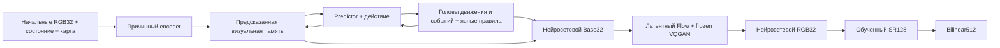

# TurkeyWorld: нейросетевая игровая среда

[English](README.md) | Русский

Журнал изменений и результатов: [Русский](README_HISTORY_RU.md) | [English](README_HISTORY_EN.md).

TurkeyWorld содержит обычную игру от первого лица и экспериментальную world
model. Активная конфигурация — **один постоянный противник**,
**20 значений состояния** и **два условия участников: игрок + NPC**. Все условия
и потери используют одного противника. Теперь активная динамика —
**три DreamerV3-подобных RSSM + прежний общий MoE trunk + пять отдельных
Transformer-experts** для игрока, врага и боя в
`training_runs/rssm_moe_nav15_enemy25_cap20_20261113`, продолжение с5800
с микробатчем32×накоплением1=effective32 и совместным обучением трёх задач; прежняя
JEPA-динамика сохранена в архиве на шаге **1633**. В RSSM worker обученные
renderer, VQGAN и SR остаются замороженными. Исходное разрешение **32×32**. Отображение:
**нейросетевой RGB32 → обученный SR128 → bilinear512**.

[RSSM-запуск](#текущее-обучение-динамики-rssm) завершил первые **2000 обновлений**,
включая 200 обновлений дистилляции. Продолжение с 2000 настроено до прохождения
качества навигации, без сброса модели или Adam; теперь эта история продолжается
явным обучением боя, no-enemy navigation replay и отдельным потоком чистого
движения NPC.
[Поэтапное обучение](#поэтапное-обучение-игры)
ниже описывает прежний JEPA-эксперимент. Приведённые ниже
корпус, checkpoints и замеры с восемью NPC/90 значениями состояния являются
историей и не описывают новую конфигурацию с одним NPC. **Завершение обучения,
сходство изображений и 15 секунд правильной автономной игры — отдельные
результаты.** Пятнадцать секунд пока являются целью. Checkpoint сам по себе её не
подтверждает. Указанные ниже будущие артефакты появляются только после
выполнения соответствующих этапов.

## Установка и обычная игра

Команды PowerShell выполняются из корня репозитория. Можно использовать
существующий подходящий Python или создать окружение:

```powershell
python -m venv .venv
$twPython = Join-Path $PWD '.venv\Scripts\python.exe'
& $twPython -m pip install -r requirements-vqgan.txt
& $twPython -c "import torch; print(torch.__version__); print('CUDA:', torch.cuda.is_available())"
```

`requirements.txt` содержит зависимости игры; `requirements-ml.txt` добавляет
PyTorch; `requirements-vqgan.txt` — зависимости perceptual loss. Для GPU нужна
совместимая CUDA-сборка PyTorch. Замороженная сеть потерь LPIPS/VGG может
скачать свои веса при первом запуске. Это веса функции потерь, а не готовые
веса мира, VQGAN, SR или генератора изображений.

```powershell
& $twPython -m turkeyworld.play --size 32 --display-size 512
```

Управление: **WASD** — движение; **Q/E или ←/→** — поворот; **пробел или левая
кнопка мыши** — выстрел; **Esc** — выход. **R** перезапускает обычную игру.
Симуляция работает на 30 Гц. В обновлённой игре боезапас бесконечный и один
постоянный слот противника. Спавн использует простой цикл игрового времени
без хешей; убийства суммируются.
Смерть игрока завершает сессию. `--classic` включает конечный режим.
Эта команда использует исходный движок и обычное увеличение изображения;
нейросетевое исполнение запускается отдельной командой ниже.

## Текущее обучение динамики RSSM

Текущая фаза — `training_runs/rssm_moe_nav15_enemy25_cap20_20261113`, мониторинг:
**http://127.0.0.1:8765/**. Три постоянные RSSM-памяти содержат2032 значения игрока,
1600 врага и1600 боя: всего5232, с обновлением каждый тик. Общий Transformer из
двух блоков содержит три sparse top-2 эксперта (3 118 099 параметров).
Добавленная боевая ветвь имеет **20 007 020 параметров**, включая нулевой адаптер
в существующий боевой query. Её четыре нулевые поправки уточняют logits цели,
атаки и иерархического спавна. Координаты, HP и события сохраняют единый
structured transition; боевая ветвь не создаёт второе состояние игры.

На полной границе5939 worker73164 продолжил этот же run с пятью отдельными
Transformer-experts после прежнего shared trunk. Их роли:
`player_without_enemy`, `player_with_enemy_quiet`, `player_with_enemy_combat`,
`enemy_motion_spawn`, `combat_health_hit_death`; у каждого width256/heads4/FF512.
Адаптер добавляет2 717 468 параметров в83 тензорах, с нулевыми task readouts при
активации. Сохранены три RSSM и память5232, все1434 прежних тензора модели,
277 Adam states/четыре группы, RNG, три sampler-потока и текущие
H208/cap20/микробатч16×4. Только новая optimizer-группа начинает без moments.
Три task losses остаются Player/Enemy/Combat; старые и новые router auxiliaries
используют общие веса0,01/0,001. Карточка8765 показывает routing пяти экспертов
только после совпадающего completed update, отдельно от task losses.
На5939 оставались закреплены NPR26200/Base25800 и Atlas SR106105. Позднее на5947
явная preview-only ревизия выбрала RF29609/Base29209 с тем же SR; assets
открытой игры не изменены. См.
[H84](README_HISTORY_RU.md#h84-пять-экспертов-динамики-при-трёх-сохранённых-rssm).
Первое полное обновление5940 конечно (TOTAL3,012795), H208/cap20 и
MAIN64/AUX64/late8 сохранены. Начальный routing —0,2 у каждого эксперта; на первом
шаге с нулевыми readouts градиенты private-блоков нулевые, новые routers/task
heads получили градиенты. Это подтверждение выполнения, а не выученной
специализации или улучшения игры.

При добавлении боевой памяти на границе5437 сохранены1386 тензоров,229 состояний/групп Adam,
сериализованные RNG и текущий горизонт/серия MoE. Только новая боевая группа
начинает без моментов. Проверки16 шагов на GPU в argmax и stochastic режимах
точно сохраняют прежние выходы, префикс памяти3632 и RNG до первого обновления.
Предыдущие фазы с двумя RSSM и pure-XY сохранены как история.

Предыдущее продолжение с5476 исправило только время смерти/возрождения. Общий шаг
30Гц восстанавливает погрешность float32-представления таймера при переходе,
сохраняя буквальный Source-декодер состояния и strict canonical guard2e-7.
Source, typed transition, головы/декодер спавна и проверки инвариантов используют
одинаковое правило. Полный5476 скопирован бит-в-бит:1434 тензора модели,277
состояний Adam, RNG и прежний gate H4/серия0. На тех же4096 окнах восстановлены
метки264→1043/1043 спавнов, включая все четыре шага. Реальные нейросетевые batches
теперь показывают на dashboard суммарные по всем микробатчам счётчики шагов/точек.
Невалидная собственная геометрия учитывается как пропуск без Source-исправлений.

В каждом обновлении32×1 обучаются **Player + Enemy + Combat**. Полный loss — их
сумма плюс0,01 CE ролей роутера и0,001 балансировки экспертов. EMA-нормировки,
KL-floor, реконструкции и обучения рендера нет. Локальные навигационные ветки имеют
вес0,1, поздние ветки из собственной памяти —0,25. Сбалансированные TRAIN-окна
событий имеют фактический горизонт min(H,16). Source даёт метки для собственного
состояния модели; будущие состояния и кадры не исправляют автономный прогон.

Единственный MAIN micro содержит19 combat/8 NPC-motion/5 navigation actors,
сохраняя59,375%/25%/15,625% из32. Combat AUX32 и late-prefix4 остаются вне долей
MAIN. Navigation добавляет weighted Player loss, чистое движение NPC — Enemy
loss; navigation исключена из NPC denominator. Прежние256- и64-example segments
сохраняют фактический размер; новые updates добавляют32. Активация на5958 сохранила
модель,360 Adam states, RNG/три sampler streams и H224/stage7; настоящий5959
завершил одно обновление из32 примеров. См.
[H89](README_HISTORY_RU.md#h89-микробатч32-с-одним-шагом-накопления);
[H79](README_HISTORY_RU.md#h79-микробатч16-с-накоплением-четырёх-шагов);
[H73](README_HISTORY_RU.md#h73-три-потока-main-и-двадцать-обновлений-на-этап)
сохраняет прежнюю фазу64×4.

Неизменяемый `--moe-plan` задаёт31 этап:
**4 → 8 → 16 → 32 → 48 → … → 432 → 448 → 450**.
Текущий `--stage-budget-plan` требует **по100 полных updates на H240, H368 и H450**;
на этих трёх этапах ранний переход по loss отключён. Остальные H переходят после
**5 последовательных полных обновлений optimizer со строгим TOTAL loss<0,5 ИЛИ20
полных обновлений этапа**. Loss считается по одному микробатчу из32; значение≥0,5
сбрасывает серию. Предыдущий cap25 на5741, когда у H48 было45 завершённых обновлений, вызвал
один переход на H64/0 без SGD, сохранив часы objective389 и историю прежних этапов.
Та прежняя ревизия порога начинала серию с0. На5800 cap20 сохранил H96/stage9
и objective448. Новая политика выбранных горизонтов активирована на5947 без SGD,
с сохранением H208/stage16, MoE595 и текущей серии. H450 теперь останавливается
после100 обязательных updates со статусом `completed_budget`; малая ошибка
не может завершить его раньше и не подтверждает качество игры.
Прежние cap50 и `50+15*N` остались историей; промежуточный лимит100 не активировался. Исходные objective и
`--moe-plan` не изменены;1434 тензора,277 состояний Adam и RNG сохранены.
Превью каждые10 обновлений использует текущий H и явно выбранный five-role
NPR29609/Base29209 (остановленный local1409,6241 параметр private-геометрии)
с прежним Atlas SR106105/local5175.
Отдельная held-out проверка450 переходов выполняется каждые250 обновлений.
Display-only revision возобновила ту же границу5816 без SGD; см.
[H76](README_HISTORY_RU.md#h76-последний-private-npr-в-превью-динамики).
Поздние изменения бюджета и рендера записаны в
[H85](README_HISTORY_RU.md#h85-обязательные100-обновлений-на-h240-h368-и-h450) и
[H87](README_HISTORY_RU.md#h87-новый-five-role-npr-в-превью-динамики-по-запросу).

Эта фаза заменяет описанные ниже pure-XY и принудительные длинные расписания.
Checkpoint — `checkpoints/rssm_world.pt`; безопасная остановка — маркер
`rssm_moe_nav15_enemy25_cap20_20261113/stop_training`. Для продолжения используйте argv из
`rssm_moe_nav15_enemy25_cap20_20261113/launch_command.json`, предварительно удалив маркер.
Полный `checkpoints/rssm_world.pt` теперь атомарно заменяется после каждого
завершённого optimizer update, включая все четыре micro, Adam, sampler и gate
commits, до начала следующего обновления. Сохраняется один возобновляемый файл;
preview остаётся каждые10, full450 validation — каждые250. Сбой незавершённого
обновления не заменяет последнюю полную границу. См.
[H78](README_HISTORY_RU.md#h78-пустое-source-покрытие-поздней-ветви-и-надёжные-checkpoints).
Сохраняйте исходный `--moe-plan`, новый `--combat-memory-plan`, доказательства
обеих миграций и закреплённые корпуса Source. Нужны также `--respawn-timing-plan`
и закреплённые им исходники часов, а также `--stage-budget-plan`, `--navigation-replay-plan`,
`--batch-revision-plan` (`micro32_batch_revision_plan.json`)
и `--enemy-motion-data-root`. Добавление памяти и исправление таймера сохраняют
часы лестницы4→450; горизонт и серию успешных обновлений оно не обнуляет.
Принудительного длинного optimizer-update больше нет. Прежний no-grad scout
восьми собственных префиксов может продолжаться до450 для подбора16-шаговых
XY recovery-ветвей; он не является H450-обновлением или успехом gate.
Полная held-out450 валидация остаётся отдельной: до SGD и каждые250 глобальных
обновлений. Прохождение обучающего этапа отделено от качества15-секундной игры.
См. [H53](README_HISTORY_RU.md#h53-горизонт-по-loss-и-десять-успешных-обновлений-подряд).
Предыдущий лимит25 и точное восстановление5741 записаны в
[H67](README_HISTORY_RU.md#h67-двадцать-пять-обновлений-или-пять-успешных-total-loss-на-этап).
Предыдущее включение cap50 сохранено в [H65](README_HISTORY_RU.md#h65-пятьдесят-обновлений-на-этап-без-сброса-обучения).

### Текущий SR: пять отдельных Transformer-experts

Отдельный worker `training_runs/sr_moe_20261113/training` обучает пять private
Transformer-experts: распознавание врага, выбор/размещение спрайта, дальние стены,
ближние стены и эффекты игрока/оружия. Все160 параметрических тензоров parent
AtlasSR и buffers заморожены; обучаются только343 460 новых параметров
(всего2 311 333). Входы — обновлённый NPR32 от frozen RF29609/Base29209 и мира5947,
с optional causal predicted hypotheses. Прежние8192 TRAIN/1024 VAL пары Source128
не изменялись; новый sampler явно начинает с seed173. Source HR, маски и будущий
RGB не поступают на inference.

**http://127.0.0.1:8779/** теперь показывает эту SR-фазу. Живая проверка
local1005/VAL1000 подтвердила пять измеренных routing gates, четыре строки preview
и настоящий weighted NPR validation loss. Прежний сервер отдаёт только недавние
train-строки; клиент дополнительно строит последнюю проверенную VAL-точку из
отчёта и явно сообщает об отсутствии полной VAL-истории. Preview reference0
подписан отдельно от последней полной валидации. Строгая цель
SSIM>0,91/MAE255<2,5 и качество игры пока не пройдены. Эти веса автоматически не
подключаются к игре или превью динамики. См.
[H88](README_HISTORY_RU.md#h88-пять-private-sr-experts-на-обновлённых-npr-парах).

### Остановленный архив hybrid-atlas SR

SR-worker в `training_runs/sr_atlas_enemy_20261113/training` остановлен
на update5175 по запросу пользователя; файлы сохраняют остановленный архив,
а новая SR-фаза выше и трёхпоточная динамика работают отдельно. Пиксели врага берутся из
фиксированного встроенного atlas;70 195 обучаемых NN-параметров предсказывают полную
необрезанную рамку, фазу анимации, окклюзию и бинарную видимость. Learned parent SR
создаёт фон и служит замороженным reference, а не matched NoGAN.
Сохранены158 тензоров остановленной PatchGAN2900/накопленно100930, Adam, RNG и sampler;
добавлены только49 RGB HP0 параметров в двух тензорах. Всего1 967 873 параметра.
Preview — каждые15 обновлений, полная validation — каждые100.
Обучение остаётся остановленным; экспортированный106105 используется в превью
динамики8765 с явно RGB-only вызовом SR и в новом парном окне ниже с подсказкой
текущего предсказанного нейросетевого состояния.

Worker40076 прошёл реальный GPU preflight с тремя пробными SGD и достиг420 обновлений
в сохранённой live-проверке. Страница, фактически обслуживаемый JavaScript и PNG
с четырьмя рядами прошли37 проверок: реальные Train/Validation,1024 held-out кадра
и138 cached temporal-пар. Между initial и VAL100 ошибка рамки снизилась10,217→6,708
пикселя, visibility IoU вырос0,346→0,395, но точность фазы упала27,22%→19,76%.
Размещение и окклюзия пока несовершенны. Quality pass и автоматическое обновление
игры не заявлены. См. [H70](README_HISTORY_RU.md#h70-фиксированный-atlas-врага-и-обучаемые-геометрия-и-видимость).

Предыдущий matched ROI PatchGAN / NoGAN worker находился в
`training_runs/sr_patchgan_ab_20261113/training`. Обе generator-ветви начинали
от полного restoration1830/накопленно98030: сохранены158 тензоров модели/состояний
Adam каждой ветви, RNG и403 440 draws sampler. В каждом generator **1 967 824**
параметра, trainable300 456;102 parent-тензора заморожены. Только GAN-обучение
добавляет отдельный conditional ROI discriminator с206 889 параметрами;
архитектура и стоимость inference generator не изменены.

GAN и обучаемый контроль NoGAN получают одинаковые фактические входы и равное
число generator updates. Обе ветви сохраняют RGB/alpha/geometry/edge reconstruction;
Source RGB/маски — только метки. Adversarial-вес равен0 первые100 обновлений,
затем растёт за400 до максимум0,01 с дополнительным пределом отношения градиента0,1
на общем readout. Обе доли restoration равны1. Четыре парных ряда preview —
каждые15; validation100 сравнивает1024 held-out кадра и138 подтверждённых соседних
cached one-step NPR пар. Эти temporal-пары не являются автономной игрой.

GPU preflight за7,38 секунды подтвердил сохранение source, точные совпадающие
обновления при нулевом весе и три пробных шага с принудительным весом. Живая
страница на paired200 показала GAN/NoGAN/D steps200, effective weight0,00088504
и прежнюю warmup VAL100. Совпадение в warmup не доказывает преимущество GAN.
Первая активная VAL200 дала смешанный результат: ROI/image SSIM немного выше
у GAN, но silhouette IoU и temporal foreground delta error хуже. Общее
преимущество GAN не подтверждено.
Image/temporal-метрики с количествами отделены от GAN/D losses. Открытая игра
автоматически не обновляется. См. [H69](README_HISTORY_RU.md#h69-парное-сравнение-roi-patchgan-и-обучаемого-nogan);
метод восстановления raw RGBA и его начальные результаты сохранены в
[H68](README_HISTORY_RU.md#h68-восстановление-сырых-rgba-перед-постепенным-смешиванием).

Следующие сведения о расписании и replay относятся только к предшествующим фазам.
На предшествующем этапе5014 были включены согласование памяти Player/Enemy RSSM на1/4/8/16,
отдельные потери скорости/направления NPC и сбалансированного движения игрока по осям.
Градиент проходит через накопление XY внутри TBPTT16; численные состояния и
отсоединённое нейросетевое кондиционирование сохраняются. Будущие RGB используются
только как остановленные цели памяти. Новый план `--coordinate-curriculum-plan`
задаёт горизонты16/32/64/128/256/450:500-е новое обновление уже использует450.
Полные450-шаговые проверки выполняются до SGD, каждые250 глобальных обновлений
и после100/200/300/400/500 обновлений расписания. `best_drift.json` выбирает
полные веса/Adam по дрейфу с масками жизни Source, включая пропущенного моделью NPC.
Это отдельный критерий от общего quality gate. См. [H49](README_HISTORY_RU.md#h49-обучение-против-дрейфа-и-согласование-памяти-с-первого-обновления).
После ухудшения длинной траектории добавлен `--replay-curriculum-plan`:
каждое пятое новое обновление использует450 переходов, остальные сохраняют
текущий короткий горизонт. Исходный clock46/500 не сброшен. На первом из четырёх
коротких микробатчей восемь собственных траекторий продолжаются до450 без новых
кадров и без сброса h/z; восемь мест в recovery резервируются для поздних законных
ветвям перед стенами, после спавна и при ошибках движения. На длинном обновлении
используются уже существующие собственные префиксы. EMA разделена на short/450;
коэффициенты фиксированы внутри всех четырёх микробатчей. В составном режиме
обновлялся выбранный банк после одного Adam commit; в текущем XY-only значения
обоих банков заморожены. Полные450-проверки и лучшие5014 сохранены.
Batch-dependent terms используют микробатч64, не globally pooled256. Resume также
требует сохранённый `--batch256-plan`; см. [H47](README_HISTORY_RU.md#h47-effective256-и-точный-resume-после-блокировки-status-файла). На4482 в предыдущем
запуске сохранены веса и Adam игрока/shared modules,
RNG и часы данных; RSSM врага увеличен, обучение навигации без врага временно
выключено. Enemy Adam states прежней формы сохранены;29 изменённых начинают заново.
На4430 в прежнем dual-запуске сохранены модель игрока, Adam/RNG,
curriculum и часы данных; добавлены отдельный новый RSSM врага и группа Adam.
Память игрока: **1008 детерминированных значений +32 категориальные переменные
по32 класса =2032 значения FP32**. Память врага: **1344 +8×32 =1600**;
общая память — **3632**. В динамике **45 007 371 параметр**, включая общую карту
и observation decoder для обучения; в текущей XY-only фазе обучаются
**40 065 236 параметров**. Прежний составной режим обучал43 287 657.
Сохранённая ветвь игрока содержит25 007 048, увеличенная ветвь врага —20 000 323.
Прежний первый сохранённый dual checkpoint4440 подтвердил10 обновлений:
все50 новых parameter tensors врага изменились, все1156 frozen tensors совпадают
бит-в-бит. Это не сохранённый4431 и не доказательство качества игры. См.
[H40](README_HISTORY_RU.md#h40-отдельный-rssm-врага-и-проверенное-продолжение-dual).
Замороженные
Base/Flow/VQGAN, map/geometry, appearance projection и SR сохраняют обученные
веса. Эти размеры динамики не включают генератор изображений и SR.

Первый полный combat-only update4483 завершён и сохранён. Независимый
checkpoint audit4482→4486 подтвердил четыре combat updates, включая прежний
navigation slot4485. Теперь динамика
обучается только на боевых эпизодах с одним врагом; Player и Enemy продолжают
учиться. Navigation counters и её EMA bank сохраняют историю, но не
продвигаются. Навигационная валидация остаётся контролем забывания. Combat-only
schedule сохранён в v6; нового прохождения навигации/боя не заявлено.
Сохранённая команда включает обязательный `--combat-only-plan` и прежние
revision pins. См.
[H43](README_HISTORY_RU.md#h43-rssm-врага20m-и-временное-обучение-только-combat).

Страница показывает **Player loss / Enemy loss / Interaction loss**. В текущем
pure XY используются постоянные координатные веса; Interaction и KL-floor равны
нулю. Следующая EMA-формула относится только к историческому составному v6-обучению.
В v6 BASE каждого actor использует
сохранённый actor EMA; spawn и recovery имеют независимые component EMA и
калиброванные priorities. Вклады компонентов прибавляются **после** нормировки
BASE. Поэтому actor raw total не делится на единственный actor scale:
`actor weighted = actor priority × base_raw / actor scale + sum(component weighted) + KL-floor`,
где `component weighted = component priority × component raw / component scale`.
Actor scale/effective weight относятся только к BASE. Actor priorities равны1;
component priorities взяты из зафиксированного measured-gradient probe.
Масштабы используют lagged EMA0.95/minimum0.1, фиксированы на весь текущий горизонт/TBPTT16/четыре
микробатча и обновляются один раз после commit Adam. Постоянные KL floors1.1+1.1
не масштабируются и не входят в EMA. Первый сохранённый4945 подтверждает обучение;
новые единицы total не доказывают улучшение качества. Baseline4944 выполнен до SGD;
дополнительные проверки через100/250 новых updates ещё предстоят. Подробности:
[H46](README_HISTORY_RU.md#h46-v6-combat-supervision-и-независимая-нормировка-компонентов).

Это PyTorch-адаптация RSSM из
[официальной реализации DreamerV3](https://github.com/danijar/dreamerv3/blob/main/dreamerv3/rssm.py),
описанной в [статье DreamerV3](https://arxiv.org/abs/2301.04104).
Используются групповые рекуррентные gates, straight-through категориальные
выборки, равномерная примесь 0,01 и раздельные остановки градиента в
dynamics/representation KL с порогом один nat; эти KL-цели и порог выключены
в текущей XY-only фазе. В игре категории выбираются
детерминированным argmax. **EMA target encoder, actor и critic отсутствуют**:
обучается модель мира, а не вся RL-система Dreamer. Явное игровое состояние
из 20 значений, известные правила управления/часов и обучаемые доли пропуска
движения по осям остаются частью игровой модели перехода. Результаты столкновений
изучаются без online-запросов к движку и исправления собственного состояния.

### Текущее обучение боя с одним NPC и параллельного рендера

[H30](README_HISTORY_RU.md#h30-новый-source-корпус-один-враг-бой-и-подробная-навигация)
описывает новый неизменяемый Source-корпус:139010 TRAIN и34756 VAL переходов,
включая настоящие ранние terminal-клипы,451-шаговый бой и no-enemy углы,
скольжение и возвращение. Для боевого продолжения только `navigation_only`
меняется на false; модель/Adam/RNG сохранены. Исходный цикл —3 боевых обновления
и1 no-enemy navigation replay, первоначально batch16×accumulation1,450 собственных переходов,
TBPTT16. Рендерер в этом RSSM worker заморожен. Validation каждые250 обновлений
требует дважды пройти и навигацию, и бой; preview каждые10 остаётся коротким
сравнением кадров. Начальные проверки3873 не пройдены; правильный бой
и15 секунд игры пока не заявлены.

Первые6 боевых обновлений дали конечные, но чрезмерно усиленные градиенты.
Остановка с checkpoint на3879 сохранила их; обучение продолжено без отката
и сброса optimizer с явным `--feedback-revision-plan`. Числовой state feedback
в боевых обновлениях отделён от autograd, собственные значения и h/z BPTT16
сохранены. Сохранённый3880 подтвердил замороженные компоненты и прежние Adam/RNG.
[H32](README_HISTORY_RU.md#h32-усиление-градиента-через-числовую-npc-обратную-связь-и-ревизия-v2)
фиксирует controlled probe и пределы первых проверок устойчивости.

Текущая ревизия динамики с4159 добавляет собственные боевые ветви1/4/8/16,
квоты auxiliary4/4/8 для спавна/отрицательных атак/прежней смеси и полный
контроль128 VAL-возрождений плюс302 отрицательные атаки. Сохранены прежние
Adam/RNG и450-шаговые проверки. План `--combat-recovery-plan` обязателен при
продолжении; сохранённая команда ниже уже включает его. Результаты:
[H35](README_HISTORY_RU.md#h35-короткие-автономные-ветви-баланс-спавна-и-отрицательные-атаки).

С4399 по4981 RSSM использовал **микробатч32 × накопление4 =
effective128**, сохраняя прежние Adam/RNG и протокол450/TBPTT16.
Каждый боевой микробатч32 отбирает8 спавнов,8 отрицательных атак,3 near-hit,
3 mid-hit,3 far-hit,3 fired-miss и4 legacy окна. Target CE использует только
фактические выстрелы Source, балансирует средние hit/miss1:1 и поровну
взвешивает присутствующие дистанции попаданий. Это новый loss-протокол,
его total нельзя напрямую сравнивать со старым. Первая preview revision использовала
NPR6600 (RF cumulative16200) и SRbest18100 (cumulative38100). Текущий immutable
v2 descendant закрепляет завершённый **private NPR26200 / фаза10000**, Base25800
и6241 параметр renderer-owned opacity с прежним **Atlas SR106105 / local5175**.
Новая [revision](training_runs/rssm_moe_nav15_enemy25_cap20_20261113/preview_assets_revision_npr26200_atlas_sr106105_v2.json)
`a85da445…` непосредственно продолжает Atlas revision `2535bab8…`; прежний NPR22200,
исходные preview pins и v1 NPR6600 сохранены как история. На **http://127.0.0.1:8765/** отдельный
замороженный clone рисует текущий RSSM rollout каждые 10 обновлений: пять строк
показывают context, Source-эталон, Base+RF1, Atlas SR и билинейное увеличение.
H превью совпадает с H текущего этапа; изображение другого H скрывается.
Под кадрами интерактивная карта сравнивает эталонные и предсказанные траектории
игрока и врага из того же прогона. Ползунок выбирает переход0..H, кнопки — четыре
показанных момента; доступны ошибки в клетках, направления и несовпадения
смерти/возрождения NPC. Дополнительных переходов и запросов движка нет;
эталонные траектории используются только для отображения.
Обучающие image-assets, loss-gated динамика и snapshots открытой игры сохранены.
Обновление отображения не подтверждает Source/gameplay качество.
См. [H39](README_HISTORY_RU.md#h39-дистанционное-обучение-effective128-и-обновлённые-assets-превью)
и [H56](README_HISTORY_RU.md#h56-актуальный-npr-в-превью-rssm-и-неизменяемая-цепочка-v2).
На прежней Atlas-only границе5797 сохранены все веса мира,277 Adam states, RNG, samplers
и счётчики этапа H96; реальная страница/PNG прошли23/23. Отдельная no-enemy
диагностика показала меньшую конечную XY-ошибку, но больше шагов внутри стен;
тот измеренный H96 кадр сочетал дрейф позы и размытие прежнего NPR. Это разные ошибки;
[H72](README_HISTORY_RU.md#h72-atlas-sr-в-превью-динамики-и-отдельная-диагностика-навигации)
описывает измеренные выборки и offline-проверку с заменой позы.

Продолжение обучения студента Base/RF1 завершено в
`training_runs/renderer_far_geometry_20261112`. Полные веса, 317 состояний Adam,
RNG и MAIN sampler сохранены из завершённого v 5 control на шаге 2000;
достигнут счётчик рендера 6000, валидация каждые 100, preview каждые 10.
RSSM 5152, compact VQGAN 997539 (E7) и SR 38100 заморожены; основное обучение RSSM
продолжается отдельно. Исходный MAIN batch 16 сохраняет квоты NPC/replay и losses.
Четыре дополнительных TRAIN-only кадра дальних стен дают отдельный far-only loss
с весом 0.25. Для стен на глубине 5–8, 8–12 и ≥12 клеток независимо нормируются
ошибки границ, рёбер и тонких углов. В фиксированном TRAIN-пуле из 2048 кандидатов
есть 271 deep, 481 other thin-face и 255 other far-wall примеров; новый сбор данных
и подбор по VAL не понадобились. Main 256, native-area 256 и distance 192 VAL-панели
сохранены. Завершённый pixel-residual pilot на 500 обновлений не выбран:
control 2000 показал лучший результат. На 2100 ошибки дальних стен снизились на
фиксированной main-панели, но общие RF MAE/SSIM и NPC error ухудшились;
preservation gates ещё не пройдены. Эти ранние результаты не подтверждают
исправление полигонов или качество автономной игры.
Завершённые отчёты v 6: **http://127.0.0.1:8777/**.
Диагностика codec и одинаковых Source-поз: **http://127.0.0.1:8780/**.
См. [H54](README_HISTORY_RU.md#h54-обучение-студента-рендера-на-маленьких-врагах-и-стенах)
и [H55](README_HISTORY_RU.md#h55-дальние-стены-и-продолжение-с-сохранённым-adam).

Обучение `training_runs/renderer_moe_five_20261113` остановлено по запросу на
local1409; worker38908 завершён. Его отчёт остаётся на
**http://127.0.0.1:8781/**. Завершённый parent MoE с тремя ролями на шаге2000
(накопленно RF28200/Base27800) продолжен на 2000 новых локальных обновлений.
MAIN16, far-wall4×0,25 и geometry8×1 сохранены; frozen feature world — прежний5906.
Prior по прошлому наблюдению использует записанный профиль navigation/combat,
статические кадры получают нулевые признаки.

В Base и RF теперь по **пять отдельных Transformer-experts**:
`near_geometry_player`, `far_geometry`, `enemy_motion`, `enemy_combat`,
`player_combat`. Три прежних parent gates сохранены; два обучаемых sigmoid split
разделяют сцену на near/far, врага — на motion/combat. Копии экспертов сохраняют
начальную функцию parent. Base experts: width8/heads2/FF16; RF: width32/heads4/FF64.
Фактические размеры: Base **1 001 157**, RF **7 051 654** с private geometry.
Добавлены 18 372 параметра в 52 тензорах; сохранены все 405 прежних Adam states/options
и состояния трёх samplers. Source-роли near **<5** клеток и far **≥5** служат только
метками loss. Пиксели обычного оружия относятся к near/player, вспышки, выстрелы
и эффекты урона — к player combat. Runtime router получает существующие neural
tokens/текущее числовое состояние, без Source depth oracle. Веса router —
CE×0,01/balance×0,001. World/map, E7, SR и private opacity6241 заморожены.

Реальная GPU-проверка за 7,72 с подтвердила точные initial Base/RF latent/RGB,
строгий export/reload, сохранение прежних тензоров/RNG и ненулевые градиенты всех
десяти expert-блоков, без SGD. Проверка durable local47 подтвердила 405 прежних
Adam states, 52 новых states, frozen tensors и точные draw clocks трёх потоков.
Страница проверена на82/preview80; preview — каждые10, полный held-out validation
— каждые100. Начальные RF SSIM/MAE на256 кадрах — **0,701969/0,043726**: это
завершённый parent на тех же позах/признаках5906. Независимая read-only validation
local1156 дала RF SSIM0,730221/MAE0,037521, но foreground MAE дальних NPC ухудшился
0,081721→0,083856. Quality, geometry и distance guards не пройдены. По явному
запросу пользователя export остановленного1409 RF29609/Base29209 теперь рисует
preview динамики; assets игры прежние, Atlas SR106105 не меняется. Это явная
экспериментальная смена, а не автоматический promotion. См.
[H83](README_HISTORY_RU.md#h83-пять-экспертов-рендера-с-сохранением-parent-routing),
[H86](README_HISTORY_RU.md#h86-независимая-валидация-five-role-рендера1156) и
[H87](README_HISTORY_RU.md#h87-новый-five-role-npr-в-превью-динамики-по-запросу).
История завершённых трёх ролей и её результаты сохранены в
[H82](README_HISTORY_RU.md#h82-moe-рендера-с-отдельным-transformer-у-каждого-эксперта).

Предыдущий private worker46212 завершил8000→10000 в
`training_runs/renderer_private_geometry_20261113`. Отдельная renderer-копия opacity из6241 параметра
получает Source-depth метки; исходные shared geometry/map/RSSM и E7/SR заморожены.
RF с этой копией имеет6 998 433 параметра. Сохранены317 прежних Adam states и все
три samplers; четыре новых тензора имеют fresh moments. Private LR5e-5,
depth weight растёт0→1 за500 updates. Отброшенный depth-only pilot улучшил глубину,
но испортил RGB, поэтому его веса не использованы. В joint VAL8100 depth
улучшился2,0321→1,5726 клетки, но RF SSIM упал0,75799→0,73225 и RGB MAE вырос.
На VAL8200 depth достиг1,2391, но RF SSIM0,72661/MAE0,038584 всё ещё хуже.
Release gates остаются false; исправление резкости стен не заявлено.
См. [H74](README_HISTORY_RU.md#h74-private-opacity-рендера-и-совместная-калибровка-depth-rgb).

Предыдущее renderer-only исправление v7 завершило8000 с worker12752 в
`training_runs/renderer_wall_repair_20261113`: полное продолжение v6 с6000 до8000,
архитектура Base/RF1 сохранена, RSSM/VQGAN/SR заморожены. Прежние MAIN16 и
far-wall aux4×0,25 дополняются geometry aux8×1 по всем пяти диапазонам глубины,
углам, тонким граням и парному cross-boundary contrast. Отчёты сохранены в
каталоге запуска;8781 теперь показывает MoE-рендер. Первый preview-handler упал на кадрах пустых стен;
исправление продолжает сохранённые веса/Adam/samplers, временные несохранённые
метрики архивированы. Live-проверка прошла34/34 на6191, VAL6100 и geometry preview6190.
RF mean SSIM вырос0,74364→0,75375 на фиксированной main-панели, но geometry
preservation и release gates остаются false. Исправление стен пока не подтверждено.
См. [H71](README_HISTORY_RU.md#h71-геометрия-стен-на-всех-глубинах-при-остановленном-sr).

Исходный этап Base/RF завершил **6000 локальных обновлений** в
`training_runs/renderer_repair_corrected_20261111`, с дообученным и снова
замороженным compact VQGAN1900, замороженными RSSM/map/SR и выключенным GAN.
Batch16 смешивает8 боевых,4 NPC appearance и4 detailed-navigation кадра.
Контролируемые пилоты сохранили detach Base, latent weight0.1 и добавили
регрессионный штраф RF; исходный parent Base остаётся контрольной точкой.
6000 обновлений — завершённый бюджет нового этапа; полный Source gate и Base-preservation release gate не пройдены.
Предыдущий запуск6000 архивирован на8772. Два следующих matched-пилота по200
дошли до6200: crop0.2 отвергнут; sampler-only немного улучшил RF near/far,
но ухудшил mid и не прошёл all-band release gate. Sampler-only завершил8000
в `training_runs/renderer_distance_refine_20261111/training_rebalance_only`,
мониторинг — **http://127.0.0.1:8774/**. На6600 обе головы прошли относительный
gate улучшения на всех трёх дистанциях; полный Source/gameplay release остаётся
false. Adam/RNG сохранены, crop выключен. Детали и проверка codec:
[H33](README_HISTORY_RU.md#h33-кодек-для-hp0-контролируемые-rf-пилоты-и-продолжение-рендера).

Прежняя последовательная цепочка для маленьких врагов записана на
**http://127.0.0.1:8776/**: `training_runs/small_enemy_pipeline_20261111`.
Порядок — compact codec → SR → Base/RF1, с отдельным held-out relative gate
перед каждой передачей. Кодек2000 и SR2000 завершены (SR cumulative40100);
дальнейшие результаты рендера записаны ниже.
В4096 TRAIN/512 VAL примерах есть3072/384 живых NPC площадью1–16 native pixels,
навигация, близкие враги, трупы и HP0 guards, с настоящими парными Source32/128.
Цепочка не заменяет игровые assets автоматически и не подтверждает качество игры.
См. [H41](README_HISTORY_RU.md#h41-последовательное-обучение-кодека-sr-и-renderer-на-маленьких-врагах).

SR x4 **остановлен по запросу пользователя на18788 локальных обновлениях**; сохранённый дашборд — **http://127.0.0.1:8775/** в
`training_runs/sr_combat_refine_20261111`, на настоящих парах Source32/128
с врагом, боем и25% навигации. После продолжения2000→10000 пользователь
заменил лимит шагов условием: **clean mean SSIM >0.91 и MAE <2.5/255 одновременно**
на фиксированной панели384 VAL-кадров. Продолжение с8672 шло без максимума шагов,
с сохранением весов/Adam/RNG; VQGAN заморожен, проверка каждые100 обновлений.
Последний полный checkpoint сохраняет18788 и Adam; новая игра использует
отдельно сохранённый best18100: clean SSIM0.856338, MAE4.367513/255.
Строгая цель остаётся false.
Codec-degraded и навигация отчётны отдельно; цель clean не подтверждает нейроигру.
История2000 и прежнего бюджета:
[H34](README_HISTORY_RU.md#h34-дообучение-sr-x4-на-бое-и-запрошенное-продолжение200010000).
Новый immutable план — `quality_revision_ssim091_mae2p5.json`; MAE на странице
показывается в шкале0–255. Игровые веса автоматически не меняются.

Последнее парное окно по запросу пользователя — экспериментальная сессия
`training_runs/paired_latest_20261113_private_geometry`; она же выбрана в
`training_runs/latest_play_session.json`. Immutable snapshots: динамика5805,
private-geometry NPR8480 (накопленно RF24680/Base24280, Euler1), frozen E7 codec
и автономный Atlas SR106105/local5175. Видимое окно открылось с Source слева,
нейросетью справа, autonomous combat и display-size1024; при проверке запуска
было93/450 обновлений, stderr пуст. Обучение8765/8781 продолжается независимо.
Эти последние веса не прошли quality/gameplay gate и автоматически в открытой
игре не обновляются. Strict profile rebind и по два GPU smoke-шага навигации/боя
прошли; см.
[export proof](training_runs/paired_latest_20261113_private_geometry/export_verification.json),
[runtime smoke](training_runs/paired_latest_20261113_private_geometry/runtime_smoke_verification.json)
и [H75](README_HISTORY_RU.md#h75-новое-парное-окно-с-последней-private-geometry-моделью).
Собственные state/memory RSSM не исправляются по будущему Source. В отдельной
shared-camera диагностике камера Source влияет только на отображение.
**T** переключает навигацию/бой, **Q/влево** — поворот влево, **E/вправо** — поворот вправо, **W/S/вверх/вниз** —
движение, **A/D** — стрейф, **Space/ЛКМ** — выстрел, **Tab** — autonomous/shared camera,
**P** — пауза, **R** — явный сброс пробы, **Esc** — закрыть окно. T сохраняет
игрока/время/h/z, явно инициализируя единственный NPC-слот сцены. Это разрешённый
пользователем эксперимент, а не прохождение качества или15 секунд игры.
Это управление подтверждено новым запуском; [H37](README_HISTORY_RU.md#h37-остановка-sr-по-запросу-и-новое-парное-окно)
сохраняет первый запуск и прежнее переключение через E.
Прежние три450-шаговые боевые пробы воспроизвели ближний урон, но выявили пропущенные
или несвоевременные попадания/респавны и прохождение NPC через стену; игра не квалифицирована.
[H38](README_HISTORY_RU.md#h38-t-для-боя-e-для-поворота-и-проверка-боевой-нейроигры)
сохраняет знаменатели событий и контрпримеры.

Команда сбора идемпотентна для неизменяемой конфигурации:

```powershell
& $twPython -m turkeyworld.collect_combat_training `
  --output training_runs/combat_source_20261111/data --workers 4
```

Worker динамики, рендера и SR независимы. Для продолжения после остановки с checkpoint используйте
сохранённую команду нужного worker; не запускайте дубликат:

```powershell
$rssmRun = 'training_runs/rssm_moe_nav15_enemy25_cap20_20261113'
New-Item -ItemType File -Path (Join-Path $rssmRun 'stop_training') -Force
# Дождитесь выхода этого worker перед удалением маркера и продолжением.
Remove-Item -LiteralPath (Join-Path $rssmRun 'stop_training')
$rssmLaunch = Get-Content -Raw -Encoding utf8 (Join-Path $rssmRun 'launch_command.json') | ConvertFrom-Json
$rssmCommand = @($rssmLaunch.argv)
& $twPython @($rssmCommand[1..($rssmCommand.Count - 1)])
# SR остановлен по запросу; используйте сохранённую команду только по запросу продолжения.
$srRun = 'training_runs/sr_moe_20261113/training'
New-Item -ItemType File -Path (Join-Path $srRun 'stop_training') -Force
# После выхода именно SR-worker:
Remove-Item -LiteralPath (Join-Path $srRun 'stop_training')
$srLaunch = Get-Content -Raw -Encoding utf8 (Join-Path $srRun 'launch_command.json') | ConvertFrom-Json
$srCommand = @($srLaunch.argv)
& $twPython @($srCommand[1..($srCommand.Count - 1)])
# Продолжение рендера: только после остановки его отдельного worker.
$renderRun = 'training_runs/renderer_moe_five_20261113'
Remove-Item -LiteralPath (Join-Path $renderRun 'stop_training') -ErrorAction SilentlyContinue
$renderLaunch = Get-Content -Raw -Encoding utf8 (Join-Path $renderRun 'launch_command.json') | ConvertFrom-Json
$renderCommand = @($renderLaunch.argv)
& $twPython @($renderCommand[1..($renderCommand.Count - 1)])
```

Текущая динамика запускает `turkeyworld.train_rssm_moe --updates 0` с32×1;
0 не добавляет отдельный бюджет: обычные H имеют cap20, H240/H368/H450 —
обязательные100 updates, после финального H450 обучение завершается. Архивный рендер запускается
через `turkeyworld.train_renderer_moe_five --steps 2000 --batch 16`, с сохранёнными
`--world`, `--renderer-checkpoint`, `--parent-checkpoint`, `--frozen-sr-checkpoint`,
`--validation-frames 256 --validation-batch 8 --preview-every 10 --validate-every 100`
и точными data/asset pins. Для сохранения Adam/RNG и трёх Source sampler histories
нужен полный сохранённый argv. Five-role фаза начинает локальный счётчик с0 после
завершённого three-role renderer2000, сохраняет405 прежних Adam states и добавляет52
тензора экспертов/router; private opacity заморожена. RSSM продолжает обучаться
отдельно с прежними preview assets.
RSSM resume требует точные сохранённые `--moe-plan`, `--combat-memory-plan`,
`--respawn-timing-plan`, `--stage-budget-plan`, `--batch-revision-plan` и preview/data pins. Прежние
batch/XY/EMA-планы остаются историей. Текущий five-expert SR использует
`turkeyworld.train_sr_moe` с точными сохранёнными initial-checkpoint, reference,
data и hypothesis pins; обучаются только новые SR-experts. Для resume нужны
полные model, Adam, RNG, sampler и встроенный atlas. Остановленная Atlas-фаза
использует `turkeyworld.train_atlas_enemy_sr`; предыдущий парный SR — `turkeyworld.train_sr_patchgan`
с `--updates 0` и точными сохранёнными initial-checkpoint/data/hypothesis pins.
Неизменяемый план сохраняет batch8, preview15, validation100 и GAN-расписание.
Полный checkpoint сохраняет Adam обоих generators, discriminator/Adam, RNG,
активный sampler и общий batch ledger; model-only export не заменяет checkpoint для resume.
Маркеры остановки и счётчики процессов независимы. Разделы ниже сохраняют
историю прежней navigation-only инициализации и контактных ревизий.

Первый план **200 обновлений дистилляции → 1800 обновлений по Source** завершён
на глобальном шаге **2000**. Та историческая Source-фаза использовала
**batch16 × accumulation1 = effective16**. Source — основная цель уже при
дистилляции; архивный teacher добавляет вес **0,1** на коротких траекториях,
поскольку его навигация прежде не прошла проверку. Будущие RGB Source поступают
в **отдельный вспомогательный posterior-поток** для reconstruction/KL.
Они не заменяют собственные состояние и память независимого prior.
Дистилляция использует H16, Source-фаза — **450 переходов** с TBPTT16.
В первом бюджете validation выполнялась каждые **100** обновлений optimizer,
preview — каждые **10**, с четырьмя показанными будущими кадрами. Завершение
бюджета не подтвердило качество: на 2000 в held-out16×450 средняя конечная ошибка
XY составила **0,483 клетки**, внутри стен — **986/7200** шагов модели при нуле у Source.

### История навигации: продолжение после шага 2000

Запрошенное продолжение сохраняет веса, Adam, RNG и накопленные счётчики.
**Фиксированного лимита обновлений и времени нет**; проверка — каждые **250
глобальных обновлений optimizer**, preview по-прежнему каждые 10. Остановка — после
**двух последовательных полных проверок навигации**, прошедших критерии;
старый бюджет 2000 и плато loss не служат условием завершения. Монитор показывает
открытый счётчик без процента готовности и ETA.
Критерии held-out: средняя ошибка скорости≤0,35 клетки/с, доли ложных остановок
и пропущенных блокировок≤0,05, конечная ошибка XY mean≤0,1/p95≤0,25 клетки,
**ноль шагов внутри стен** на 450-шаговой панели. Дополнительная контактная панель
и default-spawn регрессия проверяются отдельно; прохождение TRAIN-регрессии
не подтверждает held-out качество. Прохождение навигации пока не заявлено.
Worker публикует текущую серию и пороги в `rssm_training.continuation`;
`training_until_quality=true` отличает этот режим от завершённого первого бюджета.

Исходный архив:
`training_runs/staged_single_20261110/checkpoints/dynamics_before_navigation_recovery_g1633.pt`.
Новая архитектура использует **новый Adam**; старые веса, моменты и история
сохраняются в архиве. Совместимые readout-головы и замороженные компоненты
изображений переносятся с явной историей миграции и проверкой хешей тензоров.
Инициализация уже выполнена. Для отдельного нового запуска helper требует
свободный путь назначения и сохраняет исходный checkpoint:

```powershell
@'
from turkeyworld.rssm_migration import initialize_rssm_checkpoint
initialize_rssm_checkpoint(
    'training_runs/staged_single_20261110/checkpoints/dynamics_before_navigation_recovery_g1633.pt',
    'training_runs/rssm25m_20261111/checkpoints/rssm_initial.pt',
    config_overrides={'rssm_deter_dim': 1008, 'rssm_hidden_dim': 1024})
'@ | & $twPython -
```

Прежние данные восстановления собраны и сохранены для replay и неизменной
validation. Исходная команда collector:

```powershell
& $twPython -m turkeyworld.navigation_recovery_data `
  --root training_runs/staged_single_20261110/data_navigation_recovery_v1 `
  --own-trajectory training_runs/renderer_distill_one_step_20261110T212351Z/diagnostics/autonomous450_fp16/trajectory.npz `
  --short-train 512 --short-val 128 --long-train 64 --long-val 16 --workers 4
```

Допустимые записанные нейросетевые позы могут начинать только train-ветки Source;
далее каждая ветка непрерывно исполняется обычным движком без врагов. Held-out
данные отделены. Trainer также использует прежнюю выборку navigation450.
Эти offline-цели не добавляют обратной связи движка в нейросетевую траекторию.

Историческая команда `turkeyworld.train_rssm_dynamics` и navigation-only пути
сохраняются в `rssm25m_contact_b_20261111/launch_command.json`. Этот worker
остановлен на3873 для боевого продолжения выше. Используйте маркер и команду
текущего боевого запуска, не перезапускайте архивный навигационный worker.

### Коррекция контактов со стенами с шага 339

Пилот A ухудшил held-out проверки ложных остановок и длинной навигации после
20 обновлений коррекции. Он остановлен и архивирован на 368 в
`training_runs/rssm25m_20261111/checkpoints/rssm_contact_trial_a_g368.pt`.
**Контролируемый вариант B** в `training_runs/rssm25m_contact_b_20261111`
продолжил 339, а не 368, и завершил первый бюджет на 2000. Веса, состояния Adam
и RNG побитово сверены с
`checkpoints/rssm_before_contact_g339.pt`; сохранена исходная
[проверка восстановления](training_runs/rssm25m_20261111/diagnostics/contact_revision/resume_verification.json).
Новый Adam выше относится к прежней смене архитектуры JEPA→RSSM, а не к этому
продолжению. Batch16, accumulation1, собственный prior450, TBPTT16,
preview10 сохранены. Validation100 относится к первому бюджету;
продолжение после 2000 использует validation250.

Новый неизменяемый offline-корпус Source:
`training_runs/rssm25m_20261111/data_contact_v1`.

| Выборка | Начальные позы | Веток / позу | Клипы | Переходы Source |
|---|---:|---:|---:|---:|
| Train | 256 | 8 | 2048 | 65536 |
| Дополнительная validation | 32 | 8 | 256 | 8192 |

Прежде 512 коротких train-клипов приходились только на 32 начальные позы.
Новые ветки покрывают зазоры **0,005/0,02/0,04/0,08/0,16/0,30 клетки**, все
четыре нормали стен, углы, оба направления скольжения, повороты с движением
обоих знаков, отход, паузу и повторное приближение. Это настоящие непрерывные
записи Source32 без активного NPC, исправления физического состояния или сброса
внутри эпизода. Частичное движение отдельной оси не выдумывается: его
фактический cohort-count равен нулю.

Свежие предсказания RSSM339 получены по **32 TRAIN-траекториям ×450 =14400
собственных переходов**. Из 14432 сохранённых состояний **10572 допустимы,
3860 отклонены**; после удаления дублей XY выбранные 64 допустимые нейропозы
дают 25% новых train-поз. Только эти начальные состояния исполняются в Source
для получения новых целей. Held-out предсказания не используются как train-позы.
Начальные XY train/validation разделены расстоянием не менее 0,25 клетки;
старые validation-позы исключены из новых train-окрестностей, прежние панели
128 коротких/16 длинных held-out эпизодов не меняются. Новая validation на 256 клипах
показывается отдельно.

```powershell
& $twPython -m turkeyworld.rssm_contact_data `
  --root training_runs/rssm25m_20261111/data_contact_v1 `
  --own-trajectory training_runs/rssm25m_20261111/diagnostics/contact_revision/train_own_states.npz `
  --exclude-data-root training_runs/staged_single_20261110/data_navigation_recovery_v1 `
  --short-train 2048 --short-val 256 --long-train 0 --long-val 0 --workers 4
```

До навигационной ревизии V3 каждый auxiliary-batch содержал **12 новых клипов** с балансом Source-групп
free/blocked/slide/turn-idle по первым 16 переходам и **4 прежних клипа** replay.
Имена файлов и хеши зафиксированы manifest; посторонние NPZ отвергаются.
Вспомогательные физические motion-loss балансируются по контактным группам; прежние одинаковые
raw/accepted-слагаемые заменены одним physical motion, добавлены endpoint-margin
и проверка движения сквозь стены. Классификационный порог 0,5 записывается
отдельно от физического порога ошибки движения 0,2. Это функции потерь по
известной карте и offline-меткам, а не исправления столкновений при исполнении.

Настройки варианта B зафиксированы в
[contact_revision_plan.json](training_runs/rssm25m_contact_b_20261111/contact_revision_plan.json):
вес Source-wall 8, autonomous-wall 0,05, autonomous-XY 16, motion 7, BCE 1 и endpoint-margin 2.
[Gradient-probe](training_runs/rssm25m_contact_b_20261111/diagnostics/contact_revision/gradient_probe.json)
измерил взвешенные нормы 1,65/0,692 для Source/autonomous стен и 3,48 для
autonomous XY против 8,69 для BCE, 5,60 для motion и 4,55 для endpoint-margin на одном
фиксированном сбалансированном batch и собственном чанке 16.
Это калибровка численного масштаба, а не доказательство качества;
clipping 1 сохранён.
Три из четырёх обновлений используют argmax-категории, одно — категориальную
выборку (`argmax,argmax,sample,argmax`), чтобы уменьшить разрыв обучения и
исполнения. Основание — парные latent-проверки; они не доказывают, что выборка
была единственной причиной ошибок навигации.
Диагностическая CLI ниже использует номинальные веса модуля;
действующее обучение определяется сохранённым планом коррекции, а не defaults
этой диагностической команды:

```powershell
& $twPython -m turkeyworld.probe_rssm_contacts `
  --world training_runs/rssm25m_20261111/checkpoints/rssm_before_contact_g339.pt `
  --data-root training_runs/rssm25m_20261111/data_contact_v1 `
  --old-data-root training_runs/staged_single_20261110/data_navigation_recovery_v1 `
  --output training_runs/rssm25m_contact_b_20261111/diagnostics/contact_revision/gradient_probe_recheck.json `
  --device cuda --parameter-scope all --latent-mode argmax
```

### Навигация V3: контексты, углы и ветви собственной памяти

V3 добавляет явный план без сброса сохранённых весов, Adam, RNG и глобальных
счётчиков. Opt-in `--navigation-revision-root` указывает на
`training_runs/rssm25m_contact_b_20261111/navigation_revision/data_corners_v1`;
полная команда продолжения остаётся в `launch_command.json`. Исходные планы
training/contact/continuation не меняются; ревизия привязывается отдельно в
`navigation_revision_plan.json`. Подтверждение GPU-продолжения — отдельный
результат; новая функция потерь сама по себе не подтверждает качество.

- За цикл из 16 обновлений **каждая комбинация original/coverage × контекст 1/2
  получает три argmax-обновления и одно с sampled latent**. Числовой и RGB-контекст
  совпадают, оба начинаются с окна 0; главный rollout по-прежнему 450 шагов.
- Source auxiliary-batch: **8 угловых +4 у одиночной стены +4 прежних клипа**.
  Новый неизменяемый пул содержит 2048 угловых клипа и 4864 побитово сохранённых
  TRAIN replay-клипа; held-out панели не меняются. Обычный offline Source
  размечает свободные обе оси, каждую из двух блокировок одной оси и обе блокировки.
- До **4 отдельных H16 контактных ветвей** начинаются с фактических detached
  prior-state **и его собственной h/z-памяти**. Offline-цели получают только
  допустимые канонические Source-позы. Ветви добавляют XY/wall и контактные
  anchor-потери; они не подают posterior RGB или исправления в независимый
  главный поток 450 шагов. Взвешенный loss ветвей уже входит в total;
  абсолютные значения прежней функции потерь напрямую несопоставимы.
- Лучшие inference-веса выбираются по **обеим held-out450 проверкам с контекстами
  1/2**: сначала point+swept шаги у стен, затем худший p95 конечной XY-ошибки и
  средняя ошибка. Train loss не участвует. Неизменяемый кандидат сохраняется и
  проверяется до смены `navigation_best.json`; одна полная успешная проверка
  отличается от требуемого подтверждения двумя подряд. Последний полный Adam
  checkpoint хранится отдельно. Лучшие веса не подключаются к игре автоматически.

Карточка 8765 показывает фактические счётчики ревизии и примеров 8/4/4, текущие
pool/context/latent mode, потери ветвей и выбор physical/qualified best.
Validation по-прежнему **250**, preview **10**. Навигационный порог остаётся
непройденным до появления новых полных подтверждающих результатов.

Отдельное **дообучение компактных Base и одношагового RF-ученика по Source**
завершило бюджет 2000 обновлений в `training_runs/renderer_refine_rssm25m_20261111`;
результаты доступны на **http://127.0.0.1:8768/**. Динамика варианта B продолжает
обучаться независимо на 8765. Выбран лучший renderer на шаге 100, а не последний 2000:

| Сравнение с Source | Исходный SSIM | Выбранный SSIM | Выбранный MAE |
|---|---:|---:|---:|
| Base, 128 held-out кадров | 0,4082 | 0,6578 | 0,0510 |
| RF1, те же 128 held-out кадров | 0,5775 | 0,6603 | 0,0478 |
| RF1, стартовая TRAIN-поза | 0,3033 | 0,7701 | 0,0240 |

Стартовая поза — TRAIN-проверка регрессии. Held-out порог **Source SSIM≥0,90
и MAE≤0,03 не пройден**; завершение бюджета не подтверждает качество изображения
или игры. Сравниваются RGB Source в GT-позах с признаками причинного prior,
а не подражание прежнему renderer. RSSM339, общие map/geometry, appearance,
SR и каждый тензор компактного VQGAN побитово неизменны за все 2000 обновлений.
Непройденная квалификация исходного кодека сохранена вместе с явным разрешением
экспериментального preview. Выбранные артефакты — соседние
`checkpoints/base_student.pt` и `checkpoints/renderer_student.pt` этого renderer-run.
Вариант B сохраняет собственную замороженную копию renderer; экспорт сам по себе
не меняет worker динамики.
Выбранный экспорт записан в `training_runs/active_renderer.json`.
Предпросмотр из пяти строк загружает его в отдельную модель для инференса;
обучение RSSM и его оптимизатор продолжают использовать сохранённые замороженные компоненты.

### Дообучение компактного VQGAN на одном противнике

Отдельный запуск `training_runs/codec_enemy_refine_20261111` обновляет E/D
существующего компактного кодека **997 539 параметров** на Source-кадрах с NPC.
Первые 200 шагов обучают только decoder, затем — encoder и decoder с LR
0,00002 / 0,0001. Кодовая книга и все её буферы, latent normalization,
оригинальный VQGAN учителя, Base, RF и RSSM фиксированы. GAN в этой серии выключен.
Проверяются отдельно NPC, фон, прежние RF-endpoints и полный RF с новым encoder.
Данные TRAIN/VAL и панель 256 кадров сохраняются; validation100, preview10.
Прогресс и изображения: **http://127.0.0.1:8770/**.

Воспроизведение или возобновление того же протокола после остановки процесса:

```powershell
python -m turkeyworld.train_codec_enemy `
  --world training_runs/paired_compare_20261111T133512Z_g3420/rssm_for_play.pt `
  --renderer-checkpoint training_runs/renderer_enemy_refine_20261111/checkpoints/renderer_student.pt `
  --data-root training_runs/staged_single_20261110/data_v2 `
  --empty-data-root training_runs/staged_single_20261110/data_navigation_recovery_v1 `
  --run-dir training_runs/codec_enemy_refine_20261111 `
  --steps 2000 --decoder-warmup-steps 200 --batch 8
```

Resume сохраняет Adam, фазу, sampler и RNG из `checkpoints/codec_enemy_last.pt`.
Для изменения протокола нужен новый каталог. Выбранный экспорт —
`checkpoints/codec_student.pt`; `validation_selected.json` описывает именно его.
Экспорт не подключается к игре автоматически: Base/RF должны адаптироваться
и пройти проверку с новым кодеком. История и измеренные результаты —
[H27 журнала](README_HISTORY_RU.md#h27-дообучение-компактного-vqgan-на-противнике).

Последующая адаптация Base/RF идёт отдельно в
`training_runs/renderer_enemy_codec_adapt_20261111`, **http://127.0.0.1:8771/**.
Кодек в ней снова заморожен. Протокол `one_enemy_source_balanced_renderer_latent_v2`
добавляет `--source-latent-weight .1`; точная команда сохранена в
`launch_command.json` этого запуска. Active renderer автоматически не меняется.

## Исторические данные с восемью противниками

Для четырёхэтапного curriculum собраны данные с одним NPC и 20 значениями
состояния в `training_runs/staged_single_20261110/data_v2`.
Архивный корпус 128k ниже содержит восемь NPC/90
значений и не должен загружаться в новый профиль. Фактические новые количества
берутся из manifest этапов и `current_data` dashboard, а не из этой таблицы.

Архивный корпус с восемью NPC находится в `training_runs/fresh32_128k_20261109/data`.

| Выборка | Клипы | Переходов в клипе | Всего переходов |
|---|---:|---:|---:|
| Train | 4000 | 32 | **128000** |
| Validation | 512 | 32 | **16384** |

Эпизоды содержат исходные RGB32 и настоящие парные HR128, отрисованные движком
при тех же состояниях и действиях. HR не получен увеличением LR. Начальный
seed — 50 000 000; train и validation используют разные диапазоны seed. Версия
поведения — `deterministic_enemy_v3_simple_spawn`: движение, атаки, анимация
и возрождение противников детерминированы соответствующим состоянием и
игровым временем.

Девять обучающих политик покрывают движение, столкновения, бой, промахи,
убийства, возрождения, возвращение к объектам, атаки и допустимые возмущённые
состояния исходной игры. Последние — аугментация Source, а не собственные
ошибочные состояния модели. В клипе 33 наблюдения и 32 действия: действие `t`
относится к переходу `state[t] → state[t+1]`. NPZ также содержит карту, события,
hit/attack/spawn-метки и параметры инициализации. Длинных эпизодов здесь нет.

Прежний корпус был подготовлен следующей исторической командой. Это не команда
для пересбора новой конфигурации с одним NPC в том же каталоге:

```powershell
& $twPython -m turkeyworld.data_expansion training_runs/fresh32_128k_20261109/data `
  --rgb-train 4000 --rgb-val 512 --clip-frames 32 `
  --long-train 0 --long-val 0 --long-frames 3600 `
  --size 32 --hr-size 128 --hz 30 --seed 50000000 `
  --rgb-time-span 120 --workers 8
```

Параметра `--source` нет: старые записи не используются. Фактические количества
и происхождение записаны в `data/status.json`, `data/manifest.json` и
`data/progress.jsonl`. Контроллер фиксирует 4000 имён train-файлов в
`training_runs/fresh32_pipeline_20261109/training_subset_128k.json`.
Загрузчик модели читает только этот неизменяемый список. Окна выбираются
случайно с возвращением: обновления optimizer не равны числу уникальных
примеров или полных проходов по датасету.

## История первоначального обучения VQGAN, SR и мира

Команда и история запусков ниже относятся к прежнему pipeline с восемью NPC.
Текущие команды для одного NPC находятся в разделе
[поэтапного обучения](#поэтапное-обучение-игры). VQGAN/SR используются замороженными.

Прежний контроллер запускает по одному обучающему GPU-процессу. Его последняя конфигурация:
microbatch 16, accumulation 1, effective batch 16,
цель 15 секунд / 450 шагов:

```powershell
& $twPython -m turkeyworld.fresh_pipeline `
  --run-dir training_runs/fresh32_pipeline_20261109 `
  --data-dir training_runs/fresh32_128k_20261109/data `
  --codec-run-dir training_runs/vqgan32_20261109 `
  --sr-run-dir training_runs/sr32x4_20261109 `
  --world-run-dir training_runs/vjepa175_32px_128k_20261109 `
  --image-size 32 --device cuda --batch 16 --gradient-accumulation-steps 1 --target-seconds 15
```

Эксперимент уже существует в workspace; вторую копию запускать не нужно.
Смена accumulation **21→5** применена при продолжении checkpoint 154 после полного
обновления optimizer, с сохранением весов, состояния optimizer и счётчиков.
Это историческая конфигурация. Обучение продолжено с checkpoint **746**
при **27×1=27**; завершённое обновление **747** и его checkpoint проверены.
Последующая смена на **16×1=16** подтверждена: обучение продолжено с checkpoint
**800**, а завершённый checkpoint **801** содержит ещё 16 фрагментов,
одно обновление optimizer и отсутствие незавершённых microbatch.
Для другого эксперимента нужны отдельные каталоги контроллера, VQGAN, SR и
мира. После корректной остановки та же команда продолжает сохранённые этапы;
изменение зафиксированной конфигурации контроллера отклоняется.
Актуальная production-команда также записана в
`training_runs/fresh32_pipeline_20261109/launch_command.json`. Завершённый
`spatial_entities_migration.json` внутри world-run выбирает пространственный
профиль, motion-curriculum и улучшенный SR при продолжении. Историческая цель
30 секунд сохраняется в записи миграции; явный параметр контроллера
`--target-seconds 15` переопределяет её для текущего запуска.
Существующие бюджет и совместимые состояния optimizer продолжаются.

1. **VQGAN с нуля.** Encoder, codebook, decoder и codec PatchGAN учатся на
   Source32. Каждые 100 обновлений реконструируется фиксированная validation-
   панель. Порог кадра: PSNR≥35дБ, SSIM≥0.98, MAE≤2/255. Не менее 95% кадров
   должны пройти все пороги; дополнительно проверяются агрегированные SSIM/MAE
   и численная корректность/использование codebook. Автоматический экспорт требует **трёх
   успешных проверок подряд**, без лимита шагов:
   `training_runs/vqgan32_20261109/checkpoints/codec_for_renderer.pt`.
2. **Нейроапскейлер с нуля.** После выхода процесса VQGAN новая сеть×4 обучается
   **2000 обновлений** на настоящих парах Source32/Source128. Экспорт
   `training_runs/sr32x4_20261109/checkpoints/sr_for_game.pt` сопровождается
   актуальными held-out метриками. Завершение бюджета SR не означает достижения
   отдельного порога сходства.
3. **Offline-метки объектов.** Движок проверяет совпадение Source-пикселей и
   создаёт точные маски видимых NPC и соответствующие изображения без NPC.
   Этот CPU-кэш используется только как обучающие метки.
4. **Новые world, Base, Flow и conditional GAN.** Teacher создаётся случайно и
   загружает только новый обученный замороженный кодек. Совместное обучение
   ограничено **6000 обновлений optimizer**. Активный запуск использует
   microbatch **16**, accumulation **1**, эффективный batch фрагментов **16**. Обучаются мир, Base и Flow;
   VQGAN заморожен. Вес conditional GAN — 0.005, feature matching — 0.01;
   прогрев — 32 обновления discriminator, ramp — 128.

Мир получает два наблюдаемых кадра контекста и предсказывает четыре будущих
шага. Независимая основная траектория продолжает собственные состояние и
латентную память; будущие Source-кадры/состояния являются целями и не подменяют
траекторию. Отдельный причинный GT-pose поток даёт согласованные локальные
motion/combat/spawn/Base/Flow-метки. Условия sampled GAN отсоединены от голов
мира. Base учится прямой реконструкции; Flow получает его условие с detach.
Точные пиксели NPC имеют нормализованный вес 4. Изображения Source без NPC
становятся отрицательными примерами discriminator только при наличии NPC.

В этой конфигурации один microbatch даёт одно обновление генератора и одно
обновление discriminator, без накопления градиентов. EMA, global step и
сохранения отсчитываются по завершённым обновлениям optimizer.

После бюджета 6000 устанавливается `awaiting_user`. Запуск **не расширяет
автоматически данные, не начинает repair-циклы или Student** и не объявляет
игру проверенной. Профиль Student native32 существует для дальнейшей работы.
Квалификация кодека не ограничена временем; новым этапам нужны собственные
замеры. Прежнее время обучения 128px не является ETA этого запуска. Срок
достижения 15 секунд правильной игры неизвестен.

## Отдельное улучшение качества SR

VQGAN зафиксирован на **42 216 обновлениях**, заморожен и принят пользователем;
`quality_gate_passed=false` сохраняется в отчёте. История прежнего Teacher 175M
сохранена в архиве; новый RSSM использует завершённый SR замороженным.
Прежний SR на 25 776 параметров завершил
2000 обновлений: mean PSNR 20,907 дБ и mean SSIM 0,698759 на прежней 100-кадровой панели.
На новой 512-панели baseline clean/decoded SSIM — 0,705097/0,702811;
на шаге 1000 новый SR показал 0,806688/0,803097. Это промежуточные измерения.
Завершённый SR после 20 000 обновлений выбрал clean/decoded SSIM 0,852550/0,846338;
запрошенная цель 0,90 остаётся неподтверждённой.

Отдельный запуск `training_runs/sr32x4_quality_20261109` использует EDSR-подобную остаточную сеть:
64 канала, 16 residual-блоков, **1 517 571 параметр**, повышение 32→128.
Цель — **mean SSIM≥0,90 для чистого Source LR на двух разных полных проверках**
фиксированной validation-панели 512 кадров. Опциональная деградация замороженным
кодеком выбирается с вероятностью 0,25 для каждого train LR; парный HR не меняется.
Метрики чистого и декодированного LR записываются отдельно; decoded-метрики
не заменяют критерий clean Source.

```powershell
& $twPython -m turkeyworld.train_sr `
  --run-dir training_runs/sr32x4_quality_20261109 `
  --data-dir training_runs/fresh32_128k_20261109/data --image-size 32 --device cuda `
  --architecture edsr --channels 64 --blocks 16 --res-scale .1 `
  --steps 20000 --batch 16 --lr .0002 --edge-weight .1 --ssim-weight .2 `
  --target-ssim .9 --quality-patience 10 --quality-min-delta .0005 --lr-min .000001 `
  --codec-checkpoint training_runs/vqgan32_20261109/checkpoints/codec_for_renderer.pt `
  --codec-fraction .25 --validation-frames 512 --validation-batch 8 `
  --validate-every 500 --preview-every 100 --save-every 500
```

`sr_last.pt` используется для продолжения, `sr_best.pt` хранит лучший численный
clean SSIM, `sr_for_game.pt` — выбранные лучшие веса с соответствующими
validation-метаданными. Плато/причина остановки не означают достижение 0,90.
Отдельная панель http://127.0.0.1:8766/ доступна после запуска её local server;
прогресс Teacher остаётся на 8765. Параллельное обучение зависит от свободной VRAM.

## История пространственного расширения на девять участников

Опциональный профиль `spatial_entities` кодирует игрока и восемь постоянных
NPC-ID девятью токенами: позиция, относительные forward/side координаты,
направление/валидность, состояние и повёрнутый локальный фрагмент обученной карты.
Направление NPC выводится из скорости; у неподвижного NPC оно не наблюдается.
Спрайты Source повёрнуты к камере и не имеют отдельной метки собственного yaw.
Скорость игрока из одного state90 неизвестна и отмечена соответствующим флагом.
Мёртвые и находящиеся за камерой слоты остаются в состоянии и памяти.

Renderer читает эти токены отдельной residual attention-веткой, привязанной
к пересечению выходных патчей с проецируемыми границами NPC. Её выходная
проекция начинается с нуля; прежняя ray/object attention сохраняется.
NPC позади камеры получают нулевой визуальный вес этой ветки; перекрытие стенами
остаётся обучаемым. Нет вызовов движка, oracle-видимости или будущего RGB.
Выключенный профиль сохраняет прежние ключи и число параметров. Миграция
переносит совместимые обученные параметры и создаёт новые; полная включённая
модель не объявляется функционально идентичной прежней.

Корпус остаётся 128k переходов; новые данные пока не собирались. Короткое
авторегрессионное обучение использует локальный motion-curriculum
**1→4→8→16→29** внутри существующих 33-кадровых клипов. В пространственном
режиме ошибка движения выражена в локальных forward/side координатах;
legacy сохраняет мировые оси. `motion_player` и `motion_npc` уже имеют общий
вес ×5 и в сумме дают существующий `motion`: это диагностика, а не новые слагаемые.
Независимая итоговая цель — **15 секунд = 450 автономных шагов при 30 Гц**.
Обучение на 29 шагах не означает 450-шагового обучения или прохождения проверки.
Реальный GPU-probe прошёл 29-шаговый forward/backward/sampler при batch 21:
пик выделенной памяти 15,75 GiB. Это не квалификация автономной игры.

## История боя, спавна и рендера с восемью противниками

Опциональное расширение `spatial_combat` требует `spatial_entities`. Миграция
завершена на шаге optimizer 147; обучение продолжилось со включённым расширением,
и обновление 148 подтверждено с новым combat/spawn/Flow loss protocol.
Это подтверждает обновление optimizer, а не квалификацию игры или изображения.
Загруженную конфигурацию и loss protocol показывает дашборд.
Прежний профиль девяти участников содержит 175 585 830 параметров;
полный профиль с боем, спавном и картой стен — **176 492 456** вместе
с замороженным кодеком, без EMA, critics и SR.
90-мерное состояние и переносимая память из 264 токенов не меняются.

Каждый NPC получает парную боевую голову: собственный пространственный токен,
токен игрока, визуальный контекст и признаки из HP. Она добавляет остаточную
поправку к прежним головам цели попадания и атаки; класс промаха сохраняется.
Счётчики обозначают **номинальный урон в текущей жизни**, а не журнал выстрелов
или накопленную историю игры. Обычный NPC проходит HP **60→25→0**:
номинальные попадания **0→1→2** при уроне 35. После возрождения счётчик
сбрасывается. Дополненные примеры с HP 35 не соответствуют этой лестнице
и имеют флаг невалидной лестницы.

Base получает адаптер счётчиков. Обе сети скорости Flow — основной DiT
и residual adapter — получают девять отдельных токенов участников:
координаты, направление/валидность, HP и номинальные счётчики. Дополнительно
передаются явные координаты и материалы стен известной карты 16×16.
Это условия генерации; пиксели остаются нейросетевыми. Восемь запросов спавна
по слотам читают всех девятерых участников, известное время и 256 обученных
ключей клеток карты. Прежняя общая голова спавна и ограничения проходимости,
расстояния и разделения NPC сохраняются. Выходы новых residual-веток начинаются
с нуля; [миграция](turkeyworld/combat_migration.py) сохраняет старые веса и моменты optimizer, EMA, GAN, RNG
и счётчики выполненных обновлений.

Обучение использует прежние фиксированные **128k переходов**. Активный запуск:
microbatch **16 × 1** accumulation = **16 фрагментов на обновление optimizer** и остаток
исходного бюджета 6000 обновлений. Выборка: **25% равномерных, 35% motion
и 40% combat** окон по событиям Source: попадание, промах, атака, урон, смерть,
стена и спавн. Основной авторегрессионный rollout завершается раньше отдельного
обучения изображений боя/спавна в GT-позе с отсоединённым контекстом.
Будущие Source-метки/RGB служат целями обучения и не корректируют основной
rollout или нейросетевую игру.

Дашборд отдельно показывает `combat_events`, `combat_target`, `combat_attack`,
`combat_damage_npc`, `combat_damage_player`, `combat_death_npc`: они остаются
составляющими общего `combat`. Отдельно выводятся ошибки изображения
`combat_image_loss`, `spawn_image_loss`, `foreground_base`, `foreground_sampled`.
Значения берутся только из текущих этапа и `loss_protocol`; отсутствующее поле
обозначается «—», без выдуманного нуля. Расширение не означает прохождение
цели **15 секунд / 450 шагов** и не меняет результат выбранного SR:
clean mean SSIM **0,852550**, ниже цели 0,90.

## Улучшения V5: история конфигурации с восемью противниками

V5 был **активирован: обучение продолжено с checkpoint 725, завершённое обновление 726
подтверждено**, включая счётчики optimizer генератора/discriminator и EMA.
Сохраняются фиксированные 128k переходов,
замороженный кодек и выбранный SR после 20 000 обновлений. Смена batch на
**27×1=27** подтверждена завершённым и сохранённым обновлением **747**
после продолжения checkpoint **746**.
Текущий batch **16×1=16** подтверждён сохранённым обновлением **801** после
продолжения checkpoint **800**, с сохранением состояния optimizer и счётчиков.
Цель игры 15 секунд / 450 шагов не квалифицирована. Смена длительности
не меняет замороженные Source-клипы по 32 перехода и не сбрасывает веса. Измеренное
число параметров полного генератора — **181 167 857** с кодеком.
EMA, critics и SR считаются отдельно.

Флаг V5 включает девять связанных изменений:

1. Явные XY-потери собственной траектории на шагах **1, 4, 8, 16**, если их
   допускает текущий curriculum, плюс штраф пересечения кругов со стенами
   и пути X-then-Y. Это потери обучения, а не исправление позиций в runtime.
2. Attack BCE отдельно нормализует положительные и допустимые отрицательные
   случаи по batch и horizon с массами классов **4:1**. Отсутствующий класс
   не разбавляет имеющийся; focal-вес опционален и по умолчанию выключен.
3. Обучаемый выбор **восьми anchors + fallback** сохраняет прежнюю голову
   на 256 клеток для остальных позиций. Геометрическая безопасность и порядок
   слотов сохраняются. Anchor/fallback CE нормализуется по реальным
   возрождениям во всём **B×H**; effective 256-cell CE повторно не добавляется.
4. Потери изображений и непрерывных латентов дают равную массу каждой имеющейся
   области NPC/фона по настоящей offline-маске. Это применяется к Base,
   sampled Flow и вспомогательным изображениям боя/спавна.
5. Латентный патч Flow меняется **4→2**: **4→16 токенов изображения** при
   native32. RGB-разрешение, 64 visual encoder tokens и память не меняются.
6. Каждый блок Flow в основном DiT и residual adapter получает явные условия
   девяти участников и карты стен через новые residual-ветки.
7. Декодированная оценка конечной точки CFM получает небольшие SSIM- и
   edge-слагаемые (**по 0,05**) вместе с реконструкцией.
8. Времена Flow стратифицируются по выбранной CDF. Teacher сохраняет фиксированное
   logit-normal распределение; `time_uniform_fraction` — опциональный параметр
   renderer, по умолчанию 0. Пять time-bin losses служат диагностикой; ошибки
   не меняют распределение выборки автоматически.
9. Фиксированная held-out behavior validation выполняется каждые **100
   обновлений optimizer**: одношаговые группы событий и 32 собственные
   траектории horizon16. Начальный baseline нового протокола записан на шаге
   **725**, первая регулярная проверка — на **800**. Отчёты записываются в
   `behavior_validation_latest.json` и `behavior_validation/step_XXXXXX/`;
   это не квалификация на 450 шагах.

Перед миграцией нужно остановить controller и worker после полного обновления
optimizer. Команда создаёт резервные копии и восстанавливаемый completion marker:

```powershell
& $twPython -m turkeyworld.training_v5_migration `
  --run-dir training_runs/vjepa175_32px_128k_20261109 --seed 173
```

После миграции продолжается прежний production controller. Завершённый
`training_v5_migration.json` добавляет `--training-improvements-v5` в команду
мира; при прямом запуске `train_vq_world` также нужны `--spatial-entities`
и `--spatial-combat`. Совместимые тензоры генератора, EMA, GAN, RNG и счётчики
выполненных шагов/бюджета корпуса продолжаются с 725. Восемь тензоров нового
размера патча переносятся детерминированно; **сбрасываются только их восемь
Adam states**, новые параметры начинают без моментов. Изменение патча
не обещает идентичных изображений. У V4 и V5 разные objectives: raw total loss
нельзя сравнивать напрямую; нужны held-out замеры соответствующего протокола.

## Поэтапное обучение игры

**История JEPA-запуска, остановленного и сохранённого в архиве на шаге 1633.**
Поэтапный curriculum **с одним противником** работал в
`training_runs/staged_single_20261110`; это не текущий RSSM trainer.
Был проверен checkpoint обновления **1**:
одно обновление optimizer, 16 фрагментов, accumulation 1, незавершённых минишагов нет.
Источник переноса — архивный checkpoint **818** с восемью NPC. Совместимые веса
модели перенесены с отдельной проверкой изменённых размеров состояния и голов;
для новой схемы созданы **новые состояния Adam и дискриминатора**. Нумерация
глобальных шагов начинается с 0, остаётся **5182 обновления** прежнего бюджета
6000. Конфигурация — **batch16 × accumulation1 = effective16**. VQGAN и выбранный
SR заморожены. Новые данные всех этапов содержат 20 значений состояния и максимум
одного NPC; прежние 90-мерные записи не используются для replay.
В том Teacher **180 071 125 параметров**. Production CUDA-проба с batch 16
и горизонтом 29 выполнила все четыре обратных прохода за 38,6 секунды при пике
11 919 MiB; эта проба не подтверждает качество автономной игры.

Проверенный датасет расположен в `training_runs/staged_single_20261110/data_v2`:

| Этап | Train | Validation |
|---|---:|---:|
| Навигация | 1000 клипов / 32000 переходов | 64 клипа / 2048 переходов |
| Статичный NPC | 32000 отдельных изображений | 2048 отдельных изображений |
| Движущийся NPC | 2000 клипов / 64000 переходов | 64 клипа / 2048 переходов |
| Полная игра | 64 клипа / 28864 перехода | 32 клипа / 14432 перехода |

Длинные записи содержат 451 непрерывный переход после допустимой начальной
позы, выбранной по seed, без сбросов и восстановления здоровья. Статичные
изображения не задают цели движения и не считаются переходами мира. Команда сбора:

```powershell
& $twPython -m turkeyworld.staged_data `
  --root training_runs/staged_single_20261110/data_v2 `
  --navigation-clips 1000 --static-clips 1000 --moving-clips 2000 `
  --val-clips 64 --full-train-clips 64 --full-val-clips 32 `
  --full-frames 451 --workers 4
```

Для подготовленного запуска уже существуют `curriculum_plan.json`,
`training_ready.json` и перенесённый `checkpoints/single_enemy_initial.pt`.
Продолжение отдельного trainer после остановки действующего worker:

```powershell
& $twPython -m turkeyworld.train_staged_world `
  --run-dir training_runs/staged_single_20261110 `
  --source training_runs/staged_single_20261110/checkpoints/single_enemy_initial.pt `
  --curriculum-manifest training_runs/staged_single_20261110/curriculum_plan.json `
  --sr-checkpoint training_runs/sr32x4_quality_20261109/checkpoints/sr_for_game.pt `
  --device cuda --batch 16 --gradient-accumulation-steps 1 `
  --target-seconds 15 --updates 5182 --cache-mb 128
```

Исторические аргументы также сохранены в `launch_command.json` этого запуска.
Для остановки с сохранением checkpoint создайте файл `stop_training` в его
каталоге; дождитесь завершения supervisor и worker, затем удалите маркер перед
продолжением. Возобновляется этот staged runner, а не исторический `fresh_pipeline`.

Четыре этапа: навигация без активного NPC → один статичный NPC с обучением
**только renderer** → один движущийся NPC → полная игра с тем же единственным
NPC. По статичным изображениям не создаются вымышленные цели движения мира.
Source версии `deterministic_enemy_v4_single_spawn_cycle` использует
`anchor=(game_tick//90)%8` с переходом к следующему допустимому anchor при
необходимости. Фаза длится три секунды, цикл спавна — 24 секунды, без хешей.
Восемь anchors — возможные места для **одного врага**, а не восемь слотов.
Нейросетевая голова спавна продолжает учиться выбирать место; совпадение
с Source проверяется отдельно.
Повторение данных прежних этапов настроено на **25%**, когда такие данные
уже доступны; dashboard показывает фактическую долю и отдельную текущую
train/validation-выборку этапа.

Held-out проверки перехода выполняются каждые **100 обновлений optimizer**;
допускается начальный baseline. Preview остаётся каждые **10 обновлений**.
Непройденная проверка оставляет обучение на том же этапе; одного прошедшего
времени для перехода недостаточно. На **http://127.0.0.1:8765/** перечислены
все четыре этапа, их состояние, шаг и время прохождения, а также измеренные
метрики, пороги и история отчётов каждого этапа. Пока ожидается новый отчёт,
видны шаг последней проверки и число обновлений после неё.

Начальная проверка навигации на шаге 0 **не пройдена**: средний дрейф игрока
0,8395 тайла, RGB SSIM 0,4649 и одно окно со столкновением. Обучение навигации
продолжается; эти начальные измерения не являются результатом завершения.

Прохождение промежуточного этапа не квалифицирует игру. Итоговая независимая
цель остаётся **15 секунд / 450 автономных переходов**; только успешная полная
игровая проверка может выставить `staged_curriculum.final_qualified=true`.
Срок завершения и автоматический запуск Student не обещаются.

### Три фазы обучения компонентов модели

Согласованный план отделяет обучение компонентов от четырёх игровых этапов
выше. Тот же запуск продолжен с шага optimizer **777**. Renderer зафиксирован
на шаге **1444**, после **667 обновлений**, по запросу пользователя;
непройденный порог качества остался непройденным. **Затем обучалась JEPA Dynamics**:
первое новое GPU-обновление сохранено на шаге **1445**, до архивирования на **1633**.
Веса модели и история
optimizer сохраняются; VQGAN и SR заморожены, batch16 и accumulation1 не меняются.

| Фаза компонентов | Обучаются | Заморожены | Минимум / максимум обновлений |
|---|---|---|---:|
| Renderer | Base, Flow и GAN по координатам Source GT | Динамика, общий map encoder, VQGAN, SR | 200 / 1000 |
| Динамика | Движение, скольжение у стен и возвращения | Base, Flow, GAN, общий map encoder, VQGAN, SR | 300 / 1000 |
| Совместная | Динамика мира, renderer и общий map encoder, затем автономная проверка | VQGAN, SR | Остаток общего бюджета |

Общий map encoder заморожен в **обеих раздельных фазах**, чтобы обновление
только динамики не меняло условие карты у renderer для фиксированной позы.
Он обучается только в совместной фазе. Сохранённое обновление подтверждает
GPU-исполнение и продолжение фазы, но не улучшение качества или прохождение порога.

Артефакт сохранённых Base/Flow/GAN:
`training_runs/staged_single_20261110/checkpoints/renderer_base_flow_gan_frozen_g1444.pt`.
Проверка заморозки 1444 → 1445 подтвердила неизменность Base, Flow, общей карты,
кодека, appearance head и GAN/optimizer дискриминатора; ядро динамики и EMA
обновились с сохранением существующих состояний Adam. Фиксация по запросу
пользователя не подтверждает достижение качества renderer.

Dynamics переключена на **450 собственных переходов / 15 секунд симуляции**
на границе optimizer **1520**; первое завершённое длинное обновление сохранено
на шаге **1521**. Batch16 × accumulation1 — это **16 траекторий / 7200 переходов**
на обновление мира. **TBPTT по 16 переходов** даёт 29 обратных проходов;
численные значения состояния и памяти сохраняются между чанками, а Adam/EMA
обновляются один раз после всех 450 переходов. Будущие состояния/RGB Source
используются только как цели, без исправления состояния и обратной подачи
изображений. В длинной навигационной выборке 64 train и 16 held-out эпизодов
без активных врагов и respawn; это обучение навигации, а не подтверждение
автономности полной игры. Граница функции потерь —
`single_enemy_staged_long450_v5`; total нельзя напрямую сравнивать с прежним
обучением на коротких окнах.

Длинный forward/backward пути мира в Dynamics и совместной фазе теперь
выполняется в **FP32**, общая норма градиента вычисляется в **FP64**. Проверки
конечности после чанков и финальная защита останавливают обновление до world
optimizer при невалидных loss/градиентах. Каждое завершённое длинное обновление
сохраняется в checkpoint. Семь безопасных smoke-обновлений проверили этот путь;
они не устанавливают причину исходного non-finite на целевом шаге 1537 и не
гарантируют отсутствие будущих сбоев.

Совместная фаза сразу начинает с 450: три из четырёх нестатичных обновлений —
long450, одно — короткое обновление вспомогательных голов; прогрева на 64/128
переходах нет. В каждом длинном joint-обновлении одна согласованная по позе
RGB/GAN-проверка на чередующихся записанных смещениях 450/225/64/16; цели Source
не заменяют собственное авторегрессионное состояние. Validation остаётся каждые
**100 обновлений**, с траекториями 450 как основной проверкой. Preview — каждые
**10**, с **H4**, двумя кадрами контекста и пятью рядами native/SR/bilinear;
контактный лист не является видео длительностью 15 секунд.

Проверки выполняются каждые **100 обновлений optimizer**, preview — каждые
**10**. Первые две фазы переходят дальше после двух успешных проверок, плато
на пяти проверках или лимита обновлений. Завершение по плато/бюджету записывается
отдельно от прохождения порога качества. Совместная фаза сохраняет общий бюджет
**5182 обновления** и прежние строгие игровые проверки, включая отдельную цель
**15 секунд / 450 переходов**. Она продолжает навигацию → статичного NPC →
движущегося NPC → полную игру; завершение фаз компонентов не заменяет эти этапы.

На **http://127.0.0.1:8765/** три карточки компонентов показывают фактический
статус, обновления, минимум/бюджет, обучаемые/замороженные модули, источник
координат, измеренные потери и результат проверки/причину завершения.
Четыре игровых этапа показаны отдельно. Фаза динамики использует шесть весов
выборки ниже с новыми счётчиками этой фазы; данные и fingerprint неизменяемого
плана curriculum не меняются.

### Прежний фокус выборки навигации: заменён новым планом

Прежний эксперимент на **300 обновлений optimizer** начался на шаге **625**
и заменён трёхфазным планом на шаге **777**, после **152 обновлений / 2432 выбранных
окон**. Прежнее плановое завершение на шаге 925 больше не действует. Выбирались
существующие окна Source по случаям внутри интервала прогноза: скольжение у
стены 30%, короткое возвращение 25%, остановка у стены 20%, поворот 15%, прямое
движение 5%, движение боком 5%. Меняется только выбор окон: данные,
неизменяемый fingerprint плана curriculum, функции потерь и
**batch16 × accumulation1 = effective16** сохраняются. Метки Source выбирают
примеры; будущие исходные состояния не подаются в модель и не исправляют её
собственную авторегрессионную траекторию.

В checkpoint поле `staged_curriculum.sampling_experiment` хранит фактические
начальный/конечный шаги optimizer, выполненные/оставшиеся обновления,
fingerprint источника, число выбранных окон и счётчики по случаям. Dashboard
показывает эти значения; окна выбираются с возвращением и не равны уникальным
примерам. Исходный план предполагал возврат к MotionCurriculum через 300
обновлений, но до этой границы его заменил план компонентов выше. При
продолжении сохраняются веса, состояния
optimizer и счётчики выборки. Проверки этапа остаются каждые **100 обновлений**,
preview — каждые **10**; окончание эксперимента не означает прохождение порога
качества.

Исторические границы — **625 → 925**. Каждая held-out проверка через 100
обновлений отдельно показывает по случаям mean/p95 ошибки конечной XY и число
окон/шагов со столкновениями, число проверенных окон, шаг отчёта и отдельный
baseline. Для отсутствующего случая показывается отсутствие измерения, а не
нулевая ошибка.

## Историческая архитектура с восемью противниками

Этот раздел описывает архивную модель с 90 значениями состояния и восемью NPC.
Текущий профиль одного NPC использует 20 значений и два токена участников;
фактическое число параметров после переноса будет взято из нового запуска,
а не из этой таблицы.

World model адаптирует идеи
[официального V-JEPA2](https://github.com/facebookresearch/vjepa2) и
[статьи](https://arxiv.org/abs/2506.09985); кодек —
[CompVis/taming-transformers](https://github.com/CompVis/taming-transformers).
Это компактная игровая реализация, без официальных pretrained-весов мира
или VQGAN.

| Компонент | Базовый Teacher, spatial выключен | Базовый Student, spatial выключен |
|---|---:|---:|
| Параметров игрового генератора, включая кодек | **174 461 156** | 22 209 956 |
| Визуальная ширина | 512 | 320 |
| Слоёв encoder / predictor | 18 / 12 | 4 / 5 |
| Визуальный патч | 4×4 | 4×4 |
| Визуальных токенов на кадр | 64 | 64 |
| Переносимая память | 264×512 | 264×320 |
| Рендерер | Conditional Flow Matching | Rectified Flow |
| Интегрирование | 12 полных шагов Heun | 4 шага Euler |
| Общий замороженный кодек | 4 763 731 параметр | Тот же кодек |

Причинный encoder выдаёт 8×8 визуальных токенов. Predictor чередует токены
действия, 90-мерного состояния и изображения. Attention двунаправлен внутри
кадра и причинен между кадрами, с RoPE по времени/высоте/ширине. Четыре
переносимых блока содержат 264 токена. Отдельный EMA target encoder содержит
56 769 024 параметра и нужен только для обучения, как discriminator и сеть потерь.

Base сразу выдаёт RGB32. VQGAN уменьшает изображение в 4 раза до **8×8×16**,
используя обучаемую кодовую книгу из **1488** векторов. Flow работает с
непрерывными нормализованными латентами; прежний патч 4 даёт четыре пространственных
токена transformer, V5 patch2 — 16. Конечный латент квантуется и декодируется обратно в32.
В генераторе мира нет промежуточного RGB128. Обученный SR затем делает 32→128;
только 128→512 является bilinear. Параметры SR не входят в размер Teacher.



Это гибридная world model. Нейросеть предсказывает движение, цели попаданий,
атаки и spawn-позиции. Явные правила обновляют HP, alive, таймеры, направление,
боезапас и убийства, ограничивают скорость и направление командой. Карта
задаёт floor/distance-маску spawn-позиций. Эти правила раскрыты, а не выданы
за выученную физику. Признаки карты и восемь слотов объектов сохраняются
за камерой. Столкновения, бой и длинные траектории ещё требуют проверки.

Neural playback использует одну начальную карту, состояние и Source-кадр
движка. Затем движок не даёт новые изображения, ответы о столкновениях,
hit-тесты или исправления. Все следующие состояния и изображения даёт модель.

## Dashboard, preview, остановка и продолжение

Если локальный монитор ещё не запущен:

```powershell
& $twPython -m training_dashboard.local_server `
  --run-dir training_runs/rssm_loss_gated_drift_20261112 --port 8765
```

Адрес: **http://127.0.0.1:8765**. Существующий монитор следует по active-run
указателю к RSSM; второй сервер запускать не нужно. Результаты codec/SR
отделены от счётчиков мира. Отсутствующие результаты не заменяются предполагаемыми.

В активном gated-запуске **«Что показывает модель» генерирует текущие H переходов**
и показывает четыре смещения от1 доH: H16 —1/6/11/16, H32 —1/11/22/32.
Preview обновляется каждые **10 глобальных обновлений optimizer** и сразу после
перехода этапа. Картинка прежнего H скрывается до готовности нового preview.
`preview.json` сохраняет H, число сгенерированных переходов и display offsets;
четыре показанных кадра не сокращают сгенерированный прогон до четырёх переходов.
Полная валидация остаётся отдельной450-шаговой проверкой каждые250 глобальных updates.
Пять рядов: начальный контекст (один наблюдаемый кадр в RSSM preview);
будущий Source для сравнения; собственное
авторегрессионное предсказание модели RGB32; обученный SR128 именно этого
предсказания; bilinear512 именно этого SR-результата. Будущий Source только
показывается рядом; SR не получает его и не исправляет состояние мира.
У codec/SR сохраняются завершённые результаты. Проверка поведения в продолжении
RSSM — каждые **250 глобальных обновлений** с раздельными navigation/combat gates;
первый бюджет использовал100. Параллельное обучение изображений Base/RF:
**http://127.0.0.1:8777/**; проверки codec и одинаковых Source-поз:
**http://127.0.0.1:8780/**. Preview не засчитывается как прохождение проверки.

Используйте маркер `rssm_loss_gated_drift_20261112/stop_training` и сохранённые аргументы
продолжения из [раздела RSSM](#текущее-обучение-динамики-rssm). Прежние staged/fresh
контроллеры архивированы. Не запускайте два trainer одного каталога.
Awake guard worker допускает **Win+L** и выключение дисплея; сон компьютера,
выход из учётной записи или выключение прерывают процесс.

## Нейросетевая игра и проверка 15 секунд

Записано [видео нейросетевой игры](training_runs/neural_video_20261111T072305Z/capture/neural_game.mp4):
RSSM2000, выбранные Source-дообученные Base/RF1, цепочка
**RGB32 → SR128 → bilinear1024**. Это 450 собственных переходов с движением
вперёд/назад, стрейфом и поворотами. **15 секунд симуляции занимают примерно
32 секунды воспроизведения**: кадры повторяются с фактической скоростью вывода,
без ускорения до 30 переходов за секунду реального времени.
Это экспериментальная навигация без врагов: один начальный кадр Source,
без последующей обратной связи движка. [Метаданные записи](training_runs/neural_video_20261111T072305Z/capture/report.json)
содержат время команд, число вызовов solver и проверку неизменности кодека;
[постер](training_runs/neural_video_20261111T072305Z/capture/poster.png) — настоящий записанный кадр.
Видео не подтверждает прохождение навигационной проверки.

Три стадии обучения изображений завершены: **компактный VQGAN → компактный
Base → RF renderer**. Завершение отдельно от прохождения порогов качества.
У выбранного кодека **997 539 параметров E+Q+D суммарно**, включая точный
замороженный codebook учителя (1488×16). Новый Base head содержит **996 844
параметра** и использует общие map/CameraGeometry учителя и реальные features128.
У RF **6 992 192 параметра сети velocity**, один шаг Euler в текущем гибриде,
patch2 и условия
пространства/стен. Общая геометрия мира и SR в эти бюджеты не входят. Исходные
веса Base остаются в памяти для provenance/общей геометрии; эти числа не
означают, что весь загруженный мир занимает только девять миллионов параметров.
Динамика и память остаются Teacher; дистилляция renderer не запускает отдельный
полный Student мира.
Активные компактные головы/кодек суммарно содержат **8 986 575 параметров**,
без общих map/geometry и SR; неактивные исходные веса Base остаются в памяти отдельно.

| Компонент | Завершено обновлений / выбранный шаг | Held-out SSIM к цели Teacher / RGB MAE | Порог качества |
|---|---:|---|---|
| Decoder кодека | 6000 / 5900 | 0,944053 / 0,011402 | Не пройден |
| Encoder-путь кодека | 6000 / 5900 | 0,929427 / 0,012620 | Не пройден |
| Base | 1100 / 1100 | 0,960514 / 0,013893 | Пройден |
| RF, архивный четырёхшаговый | 1000 / 700 | 0,908584 / 0,017261 | Не пройден |
| RF, текущий одношаговый | 1500 / 1500 | 0,911468 / 0,017808 | Не пройден |

MAE рассчитана для RGB в [0,1]. Оценка RF относительно Teacher измеряет
дистилляцию; сравнение архивного четырёхшагового варианта с Source дало SSIM
**0,688909** на его held-out панели.
Это разные сравнения, они не подтверждают автономную игру.

Reflow опирается на метод из статьи
[Flow Straight and Fast: Learning to Generate and Transfer Data with Rectified Flow](https://arxiv.org/abs/2209.03003)
и [официальной реализации](https://github.com/gnobitab/RectifiedFlow).
В игре используется собственная условная latent-реализация; эти источники не
предоставляют готовые обученные веса renderer.

Обычная замена кодека требует квалифицированной дистилляции с точными codebook
и нормализацией учителя и интерфейсом latent8×8×16. У текущего компактного
кодека выбранный шаг 5900 дал SSIM decoder **0,94405**, encoder **0,92943** — ниже
порога 0,95; gate остаётся **false**. Явный opt-in
`--allow-unqualified-codec` разрешает **экспериментальный preview**, сохраняя
непройденную проверку, контроль Source/codebook и лимит параметров. Это не
означает принятия точности или квалификации игры. Флаг нужен при сборке
такого RF-bundle и при запуске игры; строгая загрузка по умолчанию отклоняет
непрошедший кодек. RF-bundle проверяет исходные
Base/map/appearance/config учителя и содержит одобренные компактные Base и
кодек. Метрики компонентов измеряют приближение к выходам учителя; они не
подтверждают автономную игру или определённый FPS.

Экспорт `checkpoints/renderer_student.pt` уже существует и содержит компактные
Base/кодек. Экспериментальный гибрид запускается со снимком мира Teacher
на шаге **1598**:

```powershell
& $twPython -m turkeyworld.neural_play `
  --world training_runs/renderer_distill_20261110T204351Z/teacher_latest_for_play.pt `
  --renderer-checkpoint training_runs/renderer_distill_one_step_20261110T212351Z/checkpoints/renderer_student.pt `
  --allow-unqualified-codec `
  --sr training_runs/sr32x4_quality_20261109/checkpoints/sr_for_game.pt `
  --device cuda --fp16 --display-size 1024 --smooth --max-catchup-steps 1
```

Эта команда выполняет **native32 → обученный SR128 → bilinear1024**. Отдельный
режим `--two-stage-upscale` остаётся native32 → SR128 → bilinear512 и требует
размер окна 512. Управление совпадает с исходной игрой; после смерти окно
нужно закрыть и запустить команду снова. Настоящие 30 Гц/FPS нужно измерить.
Прежний четырёхшаговый benchmark RTX 4090 выполнен в FP32, по три измерения на вариант,
при параллельном основном обучении. Среднее время полного пути
world/render/SR/resize/readback: **4407,95 мс Teacher → 292,45 мс четырёхшаговый гибрид**,
измеренное ускорение **15,07×** в этом запуске. State и memory точно совпали
на трёх шагах. Этот короткий замер при занятой GPU не является изолированным
игровым FPS или прохождением 15 секунд; отчёт — `renderer_benchmark.json` в каталоге запуска.
Прежняя четырёхшаговая команда FP16 также прошла smoke-проверку восьми шагов с конечными выходами;
среднее время pipeline при занятой GPU было 211,15 мс. Эта короткая проверка
не подтверждает качество длинной траектории или изолированный FPS.

Фаза RF **с одним шагом Euler** завершила 1500 обновлений с batch16 в
`training_runs/renderer_distill_one_step_20261110T212351Z`; выбранный экспорт —
`checkpoints/renderer_student.pt` на шаге 1500. Инициализация выполнена из
четырёхшагового checkpoint (шаг 700), с новыми Adam/RNG/счётчиками и теми же
6 992 192 параметрами velocity. Компактные Base/кодек оставались замороженными.
Обучался настоящий одношаговый endpoint; старый четырёхшаговый артефакт не изменён.

Автономная FP16-диагностика выполнила **450 шагов / 14,99995 секунды симуляции
за 63,26 секунды реального времени**: 450 вызовов velocity, конечные state/RGB/
memory, ноль будущих Source-входов, исправлений движком и сбросов state/memory.
**Проверка навигации провалена**: средняя ошибка XY **6,542 тайла**, p95 **9,908**,
конечная **8,420**; пересечение стен на **284 шагах**, первое на смещении **167**,
у Source — ноль. Бой не проверялся. Физика Source измерялась отдельно после
нейросетевого прогона и не исправляла его состояние.

На пяти парных собственных позах, FP16 при параллельном основном обучении,
среднее время полного pipeline: **285,94 мс RF4 → 152,00 мс RF1** (**1,88×**);
исходный Teacher — 4165,58 мс (**27,41×** относительно RF1). State/memory точно
совпали на пяти разреженных проверках замены renderer. Это замеры при занятой
GPU, а не изолированный отображаемый FPS. В CPU FP32 первые 16 команд вперёд
также оставили игрока в (2,5; 2,5): отрицательное предложение local-forward
(−0,123) ограничивалось нулём. Наблюдаемая ошибка движения воспроизводится и
вне FP16-rendering. Отчёт — `diagnostics/autonomous450_fp16/report.json` в
одношаговом запуске. Конечные выходы и ускоренный рендер пока не подтверждают
правильную нейроигру.
RF-bundle автоматически загружает проверенные компактные Base/кодек. Параметр
`--base-checkpoint` позволяет заранее загрузить тот же одобренный Base;
несовпадающий отклоняется. Исходный checkpoint Teacher и его обученная динамика
сохраняются.

Отдельный evaluator ниже проверяет **checkpoint учителя** на
**15 секунд = 450 шагов**; отдельный renderer-bundle он не загружает:

```powershell
& $twPython -m turkeyworld.evaluate_rollout `
  --world training_runs/renderer_distill_20261110T204351Z/teacher_latest_for_play.pt `
  --device cuda --seconds 15 --episodes 2 --scenario explore `
  --render-every 30 --output training_runs/renderer_distill_20261110T204351Z/evaluation_teacher_15s.json
```

Отчёт содержит фактическую длительность, корректность состояния, покрытие
движения/боя, отказы oracle и выборочные сравнения изображений. Oracle только
измеряет и не исправляет траекторию. Прохождение 15 секунд не подтверждает
более длинные прогоны. Seed меняют траектории на одной фиксированной арене;
перенос на новые карты этим не подтверждается.
Исторические 30-секундные отчёты checkpoint 700 сохраняются с прежней
длительностью в `diagnostics/validation_20261110T055628Z_g700/`;
новая цель не переименовывает эти замеры и не означает нового прохождения.

## Артефакты и история

| Каталог внутри `training_runs` | Назначение |
|---|---|
| `rssm_b256_20261112` | История64×4=256 с4981 по5014 |
| `rssm_drift_curriculum_20261112` | История5014–5060: согласование памяти, XY-градиент и16→450 |
| `rssm_coordinate_replay_20261112` | История5060–5079:20% длинных обновлений и поздние собственные ветви |
| `rssm_loss_gated_drift_20261112` | История pure-XY5112→5352; остановлено перед совместной фазой MoE |
| `rssm_moe_multitask_20261112` | История5352→5437: две RSSM и sparse MoE для трёх задач |
| `rssm_combat20m_moe_20261112` | История5437→5476: третья боевая RSSM20 007 020 параметров |
| `rssm_respawn_timing_20261112` | Активное с5476: согласованы часы возрождения, восстановлены поздние spawn-метки; прежние веса/Adam/gate |
| `rssm_drift_only_20261112` | История5079–5112: pure XY с прежним short/450 replay-расписанием |
| `rssm_components_v6_20261112` | Прежнее128 продолжение4944→4981; component EMA и late-event supervision |
| `rssm_enemy20m_combat_20261112` | Прежнее продолжение врага20M4482→4944; navigation validation сохранена |
| `rssm_dual_balanced_20261111` | Прежние dual RSSM4454→4482; раздельные task-loss EMA сохранены в новом запуске |
| `rssm_dual_20261111` | Dual-архитектура4430→4454; прежние Adam/RNG игрока и новая группа врага |
| `rssm25m_combat_20261111` | Прежний single-RSSM бой3873→4430, архивирован без отката |
| `small_enemy_pipeline_20261111` | Цепочка codec→SR→Base/RF; codec2000 завершён, SR запущен, renderer ожидает |
| `renderer_combat_navigation_20261111` | Параллельный Base/RF1 по бою/NPC/навигации; те же Adam2000→6000, codec frozen |
| `renderer_objects_walls_20261112` | Завершённый v5 control2000 студента Base/RF1 от выбранного6600; источник полного продолжения v6 |
| `renderer_far_geometry_20261112` | Завершённый v6 Base/RF1, полный Adam2000→6000 сохранён; прежний frozen preview NPR22200, MAIN16 + far-wall aux4 |
| `renderer_wall_repair_20261113` | V7 стены/углы6000→8000, прежний Base/RF1; MAIN16 + far4 + geometry8, без автоматической подмены preview/игры |
| `combat_source_20261111` | Неизменяемый Source-корпус боя с одним NPC и подробной навигации;1280 проверенных NPZ |
| `rssm25m_contact_b_20261111` | Навигационный вариант B: продолжение339, архивирован на3873 для перехода к бою |
| `rssm25m_20261111` | Начальная RSSM-миграция, зафиксированные contact-данные и архив остановленного пилота A 368 |
| `renderer_refine_rssm25m_20261111` | Завершённое Source-дообучение Base/RF1, выбран 100; порог Source не пройден |
| `staged_single_20261110/data_navigation_recovery_v1` | Зафиксированные Source-данные восстановления с раздельными train/validation |
| `staged_single_20261110` | Архив JEPA-динамики на 1633 и прежнего staged-обучения |
| `fresh32_pipeline_20261109` | Статус/команды контроллера, fixed subset, object masks |
| `fresh32_128k_20261109/data` | Новый парный корпус 32/128 и provenance |
| `vqgan32_20261109` | Кодек: метрики/preview, resume-веса и квалифицированный экспорт |
| `sr32x4_20261109` | SR: метрики/preview, held-out результаты и экспорт×4 |
| `vjepa175_32px_128k_20261109` | Новый Teacher: метрики/preview, бюджет и checkpoints |

Worker записывают `status.json`, `training.stdout.log`, `training.stderr.log`
и checkpoints по мере выполнения. `active_run.json` указывает текущий этап.
Имена будущих checkpoints в инструкции не означают, что они уже созданы.

9 ноября 2026 по запросу пользователя **набор «Фрагменты Б», все старые
checkpoints и устаревшие данные экспериментов удалены**; освобождено 195.49GiB.
Исторические отчёты сохранены. Процедуры 128px/32k, replay-B 64k,
125M/250M/500M и прежний принятый кодек относятся к истории: удалённые пути
весов/данных не нужны и не доступны для нового запуска. Совместимые профили
в исходном коде сохранены.

## Код и проверки

Основные модули: [fresh_pipeline.py](turkeyworld/fresh_pipeline.py),
[train_vqgan.py](turkeyworld/train_vqgan.py), [train_sr.py](turkeyworld/train_sr.py),
[train_vq_world.py](turkeyworld/train_vq_world.py),
[vjepa2_ac.py](turkeyworld/vjepa2_ac.py),
[latent_flow_renderer.py](turkeyworld/latent_flow_renderer.py),
[neural_play.py](turkeyworld/neural_play.py).

```powershell
& $twPython -m unittest discover -s tests -q
```

Тесты проверяют причинность/память, native32/64/128-размеры, frozen-codec
градиенты, backward через Heun/GAN/R1, накопление, fixed membership, resume-
бюджеты, разделение preview/SR и игровые проверки. Успех тестов реализации
не доказывает качество обученной игры.
